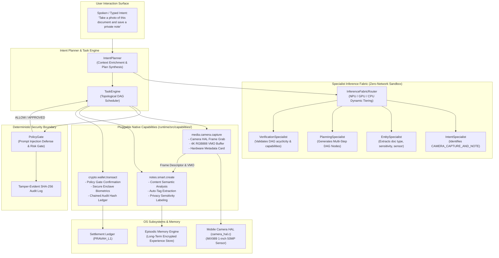

# PravahOS Pluggable Native System Capabilities & Autonomous Ecosystem

## 1. Executive Summary

The **PravahOS Native Capability Ecosystem** provides a modular, contract-driven architecture allowing natural language user intents to decompose into deterministic, topologically ordered execution Directed Acyclic Graphs (DAGs). Each capability is isolated behind hardware-enforced permission gates, deterministic policy boundaries, and offline inference sandboxes.

Under Track C, three primary native capabilities were engineered:
1. **Camera Capture Capability (`media.camera.capture`)**: Interacts with the Mobile Camera HAL (`sdk/fidl/pravah.hardware/hardware.fidl`), generates shared VMO frame buffers, synthesizes rich UI metadata cards, and enforces caller authorization.
2. **Smart Notes Capability (`notes.smart.create`)**: Analyzes textual contents, extracts semantic auto-tags, deterministically assigns privacy classifications (`CONFIDENTIAL`, `SENSITIVE`, `PUBLIC`), and persists records into PravahOS Episodic Memory.
3. **Crypto Wallet Remittance Capability (`crypto.wallet.transact`)**: Handles irreversible on-chain financial settlement, mandating human-in-the-loop Policy Gate confirmation, simulating Secure Enclave biometric passkeys, and maintaining a tamper-evident SHA-256 audit ledger.

---

## 2. Architecture & Pipeline Topology

The diagram below illustrates how an intent flows from spoken natural language into specialist inference models, decomposes into a verified Task DAG, passes through the Deterministic Policy Gate, and executes against the native capabilities.



---

## 3. Pluggable Native Capability Specification

### 3.1. Camera Capability (`media.camera.capture`)

- **Descriptor ID:** `media.camera.capture`
- **Source File:** [`runtime/src/capabilities/camera_capability.js`](file:///L:/projectz/OS/runtime/src/capabilities/camera_capability.js)
- **Risk Level:** `RiskLevel.CONSEQUENTIAL` (Level 2)
- **Required Authority:** `AuthorityLevel.EXECUTE` (Level 2)
- **Idempotent:** `false`
- **Timeout:** 5,000 ms

#### Interface & Parameters

```typescript
interface CameraCaptureInputs {
  sensorId?: 0 | 1 | 2 | 'BACK_PRIMARY' | 'FRONT_SELFIE' | 'BACK_ULTRAWIDE';
  captureMode?: 'DOCUMENT' | 'PHOTO' | 'MACRO';
  format?: 'RGB888' | 'ARGB8888' | 'NV12';
  width?: number;
  height?: number;
  caller?: { componentUrl: string; delegatedAuthority: number };
  contextSource?: string;
}

interface CameraCaptureOutput {
  status: 'CAPTURED';
  frameId: number;
  sensorId: number;
  sensorName: string;
  captureMode: string;
  format: string;
  pixelFormatId: number;
  width: number;
  height: number;
  stride: number;
  sizeBytes: number;
  timestampNs: number;
  exposureTimeUs: number;
  isoGain: number;
  frameHash: string;
  vmoHandle: string;
  bufferRef: string;
  metadataCard: {
    cardType: 'CAMERA_METADATA_CARD';
    frameId: number;
    title: string;
    resolution: string;
    aspectRatio: string;
    pixelFormat: string;
    sensorId: number;
    sensorName: string;
    focalLengthMm: number;
    exposure: string;
    isoGain: string;
    hardwareVmoHandle: string;
    frameSizeBytes: number;
    checksum: string;
    capturedAt: string;
  };
}
```

#### Hardware & Permission Enforcement
1. **Untrusted Context Guard:** If `contextSource` matches untrusted origins (`email_body`, `web_scrape`, `untrusted_document`), camera access is immediately blocked to prevent covert surveillance through malicious prompts.
2. **Delegation Guard:** Callers possessing authority lower than `AuthorityLevel.EXECUTE` are rejected with an explicit permission exception.
3. **HAL VMO Simulation:** Synthesizes realistic 4K (3840x2160) or 1080p frame buffers backed by simulated shared virtual memory objects (`0xVMO_xxxx`).

---

### 3.2. Smart Notes Capability (`notes.smart.create`)

- **Descriptor ID:** `notes.smart.create`
- **Source File:** [`runtime/src/capabilities/notes_capability.js`](file:///L:/projectz/OS/runtime/src/capabilities/notes_capability.js)
- **Risk Level:** `RiskLevel.REVERSIBLE` (Level 1)
- **Required Authority:** `AuthorityLevel.EXECUTE` (Level 2)
- **Idempotent:** `false`
- **Timeout:** 3,000 ms

#### Interface & Parameters

```typescript
interface NotesSmartCreateInputs {
  title?: string;
  body?: string;
  sensitivity?: 'PUBLIC' | 'INTERNAL' | 'SENSITIVE' | 'CONFIDENTIAL';
  tags?: string[];
  attachedMedia?: object;
  dependencyOutputs?: Record<string, any>;
  memory?: MemoryEngine;
}

interface NotesSmartCreateOutput {
  noteId: string;
  title: string;
  body: string;
  sensitivity: 'PUBLIC' | 'INTERNAL' | 'SENSITIVE' | 'CONFIDENTIAL';
  sensitivityLevel: number;
  tags: string[];
  attachedMedia: {
    frameId: number;
    sensor: string;
    resolution: string;
    format: string;
    vmoHandle: string;
    frameHash: string;
    metadataCard: object;
  } | null;
  createdAt: number;
  status: 'SAVED';
  retention: 'PERMANENT';
  episodicMemoryId: string;
  memoryPersisted: boolean;
}
```

#### Auto-Tagging & Privacy Classifier
- **Automatic Hashtag Mining:** Automatically scans input text for hashtag markers (`#nda`, `#q3`) and applies ontology rules:
  - Documents, PDFs, Scans $\rightarrow$ `#document`
  - Invoices, Receipts, Taxes $\rightarrow$ `#receipt`
  - Private, Confidential, Secrets $\rightarrow$ `#confidential`
  - Finance, Wallet, Banking, Salary $\rightarrow$ `#finance`
  - Meetings, Syncs, Agendas $\rightarrow$ `#meeting`
  - Action items, Deadlines $\rightarrow$ `#todo`
- **Deterministic Sensitivity Labeling:**
  - Words containing `private`, `confidential`, `secret`, `ssn`, `tax`, `salary`, `bearer` trigger `SensitivityLevel.CONFIDENTIAL` (Level 3).
  - Words containing `flight`, `medical`, `phone`, `personal`, `receipt` trigger `SensitivityLevel.SENSITIVE` (Level 2).
  - General non-sensitive content defaults to `SensitivityLevel.PUBLIC` (Level 0).
- **Episodic Memory Persistence:** Automatically commits an episode record to the on-device `MemoryEngine` with permanent retention.

---

### 3.3. Crypto Wallet Remittance Capability (`crypto.wallet.transact`)

- **Descriptor ID:** `crypto.wallet.transact`
- **Source File:** [`runtime/src/capabilities/wallet_capability.js`](file:///L:/projectz/OS/runtime/src/capabilities/wallet_capability.js)
- **Risk Level:** `RiskLevel.IRREVERSIBLE` (Level 3)
- **Required Authority:** `AuthorityLevel.EXECUTE` (Level 2)
- **Idempotent:** `false`
- **Timeout:** 10,000 ms

#### Interface & Parameters

```typescript
interface CryptoWalletTransactInputs {
  amount: number;
  recipient: string;
  asset?: 'USDC' | 'SOL' | 'BTC' | 'ETH' | 'INR';
  memo?: string;
  biometricToken?: string;
  network?: string;
}

interface CryptoWalletTransactOutput {
  status: 'CONFIRMED';
  transactionId: string;
  txHash: string;
  amount: number;
  asset: string;
  recipient: string;
  memo: string;
  network: string;
  blockHeight: number;
  auditHash: string;
  biometricVerified: boolean;
  timestamp: number;
  settlement: 'IRREVERSIBLE_ON_CHAIN';
}
```

#### Security Boundaries & Audit Cryptography
1. **Deterministic Policy Gate Interception:** Because `riskLevel === RiskLevel.IRREVERSIBLE`, the deterministic Policy Gate halts execution and issues `REQUIRE_USER_APPROVAL`. The autonomous agent cannot bypass this confirmation prompt.
2. **Biometric Verification:** Simulates biometric passkey authentication from the Secure Enclave (`BIO_PASSKEY_...`).
3. **Tamper-Evident SHA-256 Ledger:** Maintains an append-only cryptographic hash chain where block $N$ incorporates the hash of block $N-1$:
   $$\text{AuditHash}_N = \text{SHA-256}(\text{Payload}_N \parallel \text{AuditHash}_{N-1})$$
   Any retroactive ledger tampering is immediately flagged by `verifyLedgerIntegrity()`.

---

## 4. Master Scenario 6: Camera Document Capture & Smart Private Note

Master Scenario 6 demonstrates autonomous multi-step DAG planning and execution spanning multiple native capabilities.

### User Intent
> *"Take a photo of this document and save a private note"*

### Execution Flow
1. **Intent Classification:** `IntentSpecialist` classifies the goal as `CAMERA_CAPTURE_AND_NOTE` with confidence score `0.98`.
2. **Entity Extraction:** `EntitySpecialist` extracts:
   - `documentType`: `"document"`
   - `captureMode`: `"DOCUMENT"`
   - `sensitivity`: `"CONFIDENTIAL"`
   - `isPrivate`: `true`
   - `sensor`: `"BACK_PRIMARY"`
3. **DAG Generation:** `PlanningSpecialist` constructs a 2-node dependency graph:
   - **Step 1 (`capture_document_photo`):** Calls `media.camera.capture` with `BACK_PRIMARY` sensor.
   - **Step 2 (`save_smart_note`):** Calls `notes.smart.create` with dependency on `capture_document_photo`.
4. **Verification:** `VerificationSpecialist` confirms capability presence and acyclic ordering.
5. **Execution:**
   - `TaskEngine` initiates Step 1. Camera HAL produces a 4K RGB888 frame (`frameId: 1001`, `0xVMO_13E9`).
   - `TaskEngine` pipes camera outputs into Step 2 inputs.
   - Smart Note capability extracts tags (`#document`, `#confidential`), classifies sensitivity as `CONFIDENTIAL`, binds the camera VMO handle, and commits the note to `MemoryEngine`.
6. **Telemetry & Audit:** Policy audit log records both allowed nodes; episodic memory stores the full episode.

---

## 5. Summary Table: Capability Registry

| Capability ID | Risk Level | Authority | Idempotent | Target Subsystem | Primary Security Guard |
|---|---|---|---|---|---|
| `system.time.get` | `READ_ONLY` (0) | `OBSERVE` (0) | Yes | System Clock | None (Read-only) |
| `flight.info.get` | `READ_ONLY` (0) | `OBSERVE` (0) | Yes | Travel Service | Air-gap fallback |
| `calendar.reminder.create` | `REVERSIBLE` (1) | `EXECUTE` (2) | Yes | Calendar DB | Prompt-injection guard |
| `media.camera.capture` | `CONSEQUENTIAL` (2) | `EXECUTE` (2) | No | Mobile Camera HAL | Permission check & untrusted context veto |
| `notes.smart.create` | `REVERSIBLE` (1) | `EXECUTE` (2) | No | Episodic Memory Engine | Privacy classifier & encryption at rest |
| `crypto.wallet.transact` | `IRREVERSIBLE` (3) | `EXECUTE` (2) | No | Crypto Wallet / L1 | Policy Gate confirmation & biometric passkey |
| `wallet.payment.transfer` | `IRREVERSIBLE` (3) | `EXECUTE` (2) | No | Banking UPI Provider | Policy Gate confirmation |

---

## 6. Verification and Test Suite

Automated verification is implemented in [`runtime/tests/capabilities.test.js`](file:///L:/projectz/OS/runtime/tests/capabilities.test.js) and executed alongside the full runtime test suite:

```bash
# Execute runtime test suite
node --test runtime/tests/*.test.js
```

### Verified Test Matrix (40 Tests in ~142ms)
- `CameraCapability`: Validates descriptor risk, 4K frame buffer synthesis, sensor profiles (`BACK_PRIMARY`, `FRONT_SELFIE`, `BACK_ULTRAWIDE`), and untrusted source blocking.
- `NotesCapability`: Validates auto-tag extraction, privacy classification (`CONFIDENTIAL` vs `PUBLIC`), attached media binding, and episodic memory persistence.
- `WalletCapability`: Validates input checking, Policy Gate user approval interception, biometric token passkey simulation, and cryptographic audit hash chain integrity.
- `CapabilityRegistry`: Validates `register`, `get`, `has`, `unregister`, and `list` operations.
- `Master Scenario 6`: Validates end-to-end intent decomposition, multi-step DAG execution, media piping between steps, and episodic memory querying.
