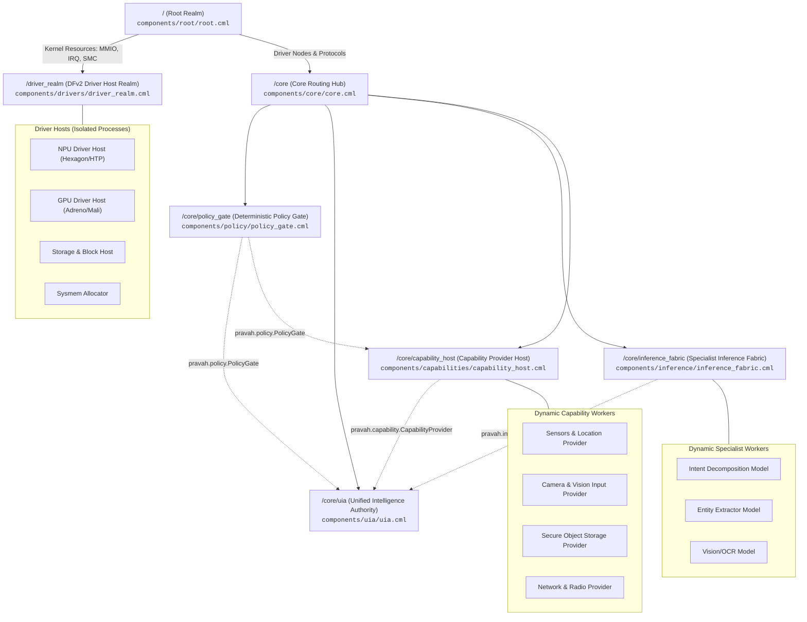
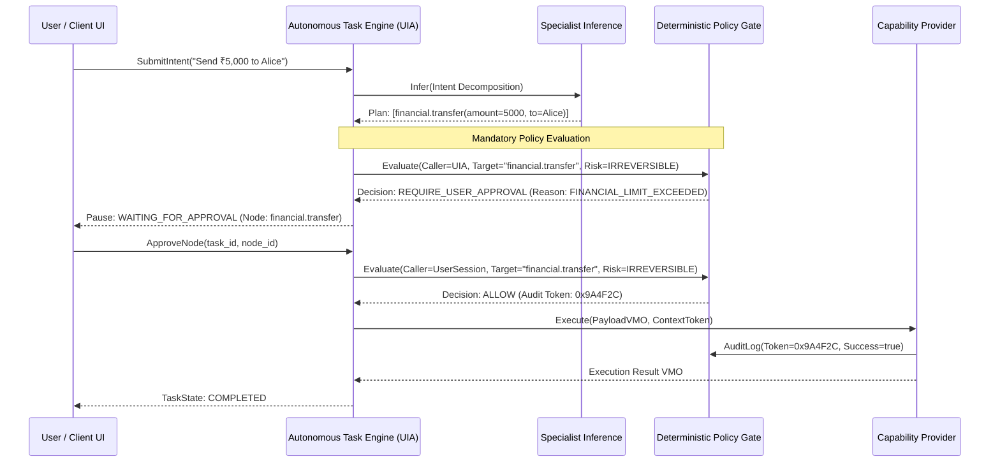

# PravahOS Component Framework Architecture (CFv2)

> **Component Tree Topology • Capability Routing Matrices • Sandboxing Invariants • Manifest Specifications**

---

## 1. Architectural Overview

PravahOS structures userspace entirely as sandboxed, isolated units governed by the **Fuchsia Component Framework (CFv2)**. Abandoning legacy monolithic POSIX models (ambient filesystem authority, shared UID/GID permissions, and ring-0 drivers), PravahOS establishes an **object-capability operating system**:

1. **Sandboxing by Default:** No component possesses ambient access to files, devices, memory, or network sockets. Every resource must be explicitly granted via capability routing.
2. **Explicit Capability Routing:** All cross-process interactions occur through typed Fuchsia Interface Definition Language (FIDL) protocols transferred across kernel channels (`zx_channel`).
3. **Deterministic Security Mediation:** The **Unified Intelligence Authority (UIA)** is strictly decoupled from raw execution. Every task DAG transition that interacts with the real world is deterministically evaluated by the **Policy Gate**.
4. **Offline Inference Sandboxing:** The **Specialist Inference Fabric** is isolated from network sockets and persistent user data stores, preventing prompt injection exfiltration and unauthorized data leakage.
5. **Userspace Driver Isolation:** Device drivers (DFv2) execute in isolated driver host processes in `/driver_realm`, completely ring-fencing kernel MMIO, IRQ, and IOMMU handles from userspace applications.

---

## 2. Component Realm Hierarchy & Moniker Tree

The component hierarchy forms a strict tree where parent realms supervise and mediate capabilities between child realms:



### Moniker Reference Table

| Component Moniker | Manifest Source | Role & Responsibility | Failure Domain Policy |
| :--- | :--- | :--- | :--- |
| `/` | [`root.cml`](file:///L:/projectz/OS/components/root/root.cml) | Top-level realm instantiator; microkernel resource distributor | `on_terminate: reboot` |
| `/driver_realm` | [`driver_realm.cml`](file:///L:/projectz/OS/components/drivers/driver_realm.cml) | Userspace Driver Framework (DFv2); hardware abstraction | `on_terminate: reboot` |
| `/core` | [`core.cml`](file:///L:/projectz/OS/components/core/core.cml) | System routing backbone; capability mediation hub | `on_terminate: reboot` |
| `/core/policy_gate` | [`policy_gate.cml`](file:///L:/projectz/OS/components/policy/policy_gate.cml) | Deterministic security verification; audit ledger | Supervised / Respawn |
| `/core/uia` | [`uia.cml`](file:///L:/projectz/OS/components/uia/uia.cml) | Intent decomposition; Task DAG engine; state coordinator | Supervised / Respawn |
| `/core/inference_fabric` | [`inference_fabric.cml`](file:///L:/projectz/OS/components/inference/inference_fabric.cml) | Quantized on-device AI runtimes; tensor acceleration | Dynamic / Reclaim |
| `/core/capability_host` | [`capability_host.cml`](file:///L:/projectz/OS/components/capabilities/capability_host.cml) | Supervisor for concrete OS action & device capabilities | Supervised / Respawn |

---

## 3. Subsystem Manifest Specifications

### 3.1 Root Realm (`components/root/root.cml`)
Instantiated directly by `component_manager` upon microkernel handoff. It enforces the fundamental hardware isolation rule:
- **Parent Kernel Resource Partitioning:** Low-level kernel resources (`MmioResource`, `IrqResource`, `SmcResource`, `IommuResource`, `RootResource`) are routed exclusively to `#driver_realm`.
- **Zero Kernel Leaks:** The `core` realm never receives kernel device resources. It receives only abstracted FIDL protocols from `#driver_realm`.

### 3.2 Userspace Driver Realm (`components/drivers/driver_realm.cml`)
Encapsulates all device drivers within isolated userspace processes using the Fuchsia Driver Framework (DFv2):
- **Collections:** Contains dynamic collection `driver-hosts` where individual drivers are spawned with isolated address spaces and limited rights.
- **Dedicated Driver Hosts:**
  - `npu_driver_host`: Manages Qualcomm Hexagon NPU / Neural Processing Unit firmware and execution queues.
  - `gpu_driver_host`: Manages Adreno/Mali GPU command streams and Vulkan render pipelines.
  - `sysmem`: Allocates shared memory VMOs (`zx_vmo`) for zero-copy hardware buffer passing.
- **Exposed Abstractions:** Exposes `/dev` (`dev-topological`), `fuchsia.hardware.npu.Device`, `fuchsia.hardware.gpu.Device`, and `fuchsia.hardware.sysmem.Sysmem` upward to `root`.

### 3.3 Core Realm (`components/core/core.cml`)
The system routing backbone connecting all userspace services:
- **Capability Intermediation:** Connects Policy Gate, Specialist Inference, Capability Host, and UIA.
- **Hardware Protocol Distribution:** Routes `fuchsia.hardware.npu.Device` and `fuchsia.hardware.gpu.Device` exclusively to `#inference_fabric`.
- **System Storage Isolation:** Declares isolated persistent `data` and ephemeral `cache` directories for children.

### 3.4 Deterministic Policy Gate (`components/policy/policy_gate.cml`)
The uncompromising security boundary of PravahOS:
- **Deterministic State Evaluation:** Inspects caller credentials, declared `RiskLevel` (`READ_ONLY`, `REVERSIBLE`, `CONSEQUENTIAL`, `IRREVERSIBLE`), and required `AuthorityLevel`.
- **Zero AI Authority:** Contains no neural runtimes, LLM interpreters, or heuristics.
- **Zero Network / Direct Driver Access:** Fully sandboxed; reads static policy rules from `/pkg/data/policies` and writes tamper-evident audit logs to isolated `/data/audit.log`.

### 3.5 Unified Intelligence Authority (`components/uia/uia.cml`)
The autonomous task orchestrator:
- **Task Graph Lifecycle:** Operates the deterministic state machine: `Created` $\to$ `Understood` $\to$ `Planned` $\to$ `Authorized` $\to$ `Executing` $\to$ `Verifying` $\to$ `Completed`.
- **Mandatory Policy Check:** Invokes `pravah.policy.PolicyGate/Evaluate` prior to every capability node execution.
- **Inference Consultation:** Queries `pravah.inference.SpecialistInference` for natural language intent decomposition and verification.
- **Capability Invocation:** Calls `pravah.capability.CapabilityProvider/Execute` passing explicit `zx.Handle:VMO` and `zx.Handle:EVENTPAIR` tokens.

### 3.6 Specialist Inference Fabric (`components/inference/inference_fabric.cml`)
The on-device machine learning host:
- **Offline-First Isolation:** Strictly omits any network socket provider (`fuchsia.posix.socket.Provider`). No data can be transmitted off-device.
- **Zero Ambient User Data:** Cannot browse user files; accepts only explicit input VMOs via FIDL.
- **Hardware Acceleration:** Utilizes Sysmem zero-copy VMOs and `fuchsia.hardware.npu.Device` to execute quantized models (INT4/INT8/FP16) within a bounded 1GB system memory budget.

### 3.7 Capability Host (`components/capabilities/capability_host.cml`)
Supervisor for modular system capabilities:
- **Mutual Distrust Sandboxing:** Providers reside in an isolated dynamic collection (`providers`).
- **Policy Handshake:** Capability implementations can independently query the Policy Gate to verify execution authority tokens before executing physical actions.
- **Resource Routing:** Dispatches specific device handles and sysmem buffers only to the capability providers that require them.

---

## 4. Capability Routing Matrix

| Capability Identifier | Capability Type | Originating Component | Destination Component(s) | Architectural Purpose |
| :--- | :--- | :--- | :--- | :--- |
| `fuchsia.kernel.MmioResource` | Protocol | Microkernel (`parent`) | `/driver_realm` ONLY | Raw memory-mapped I/O access for hardware drivers |
| `fuchsia.kernel.IrqResource` | Protocol | Microkernel (`parent`) | `/driver_realm` ONLY | Interrupt handler registration for hardware controllers |
| `fuchsia.kernel.IommuResource`| Protocol | Microkernel (`parent`) | `/driver_realm` ONLY | DMA mapping and memory protection for hardware devices |
| `fuchsia.hardware.npu.Device` | Protocol | `/driver_realm/npu_driver_host` | `/core/inference_fabric` | Tensor compute offload to on-device NPU |
| `fuchsia.hardware.gpu.Device` | Protocol | `/driver_realm/gpu_driver_host` | `/core/inference_fabric` | Shader and compute acceleration |
| `fuchsia.hardware.sysmem.Sysmem`| Protocol | `/driver_realm/sysmem` | `/core/inference_fabric`, `/core/capability_host` | Zero-copy VMO buffer allocation between drivers & runtimes |
| `pravah.policy.PolicyGate` | Protocol | `/core/policy_gate` | `/core/uia`, `/core/capability_host` | Deterministic verification and audit logging of actions |
| `pravah.inference.ModelRegistry` | Protocol | `/core/inference_fabric`| `/core/uia` | Discovery and registration of specialist neural models |
| `pravah.inference.SpecialistInference` | Protocol | `/core/inference_fabric` | `/core/uia` | Execution of intent, vision, speech, and verification models |
| `pravah.capability.CapabilityProvider` | Protocol | `/core/capability_host` | `/core/uia` | Execution endpoint for concrete OS capabilities |
| `pravah.task.TaskManager` | Protocol | `/core/uia` | `/core` (Exposed to UI & Client) | Submission of user intents, task inspection, approval |
| `dev-topological` | Directory | `/driver_realm` | `/core` | Filtered device tree access |
| `data` | Storage | `/core` | `/core/*` (Isolated per component) | Persistent local storage partitioned by component moniker |
| `cache` | Storage | `/core` | `/core/inference_fabric`, `/core/uia` | Reclaimable transient weight and decomposition caches |

---

## 5. Security Invariants & Sandboxing Guarantees

### 5.1 AI Zero-Authority Invariant
Under no circumstances may an inference model directly trigger a state-changing capability or modify policy rules:


### 5.2 Offline-First Network Isolation
The Specialist Inference Fabric component manifest explicitly omits network socket capabilities (`fuchsia.posix.socket.Provider`). Because the Fuchsia Component Framework enforces mandatory capability routing, the inference process cannot create, open, or transfer network sockets. This mathematically guarantees that prompt data, model inputs, and embeddings cannot be exfiltrated.

### 5.3 Zero-Copy Handle Passing & Memory Isolation
All bulk data transfer (audio streams, camera frames, tensor buffers, task state payloads) uses Zircon Virtual Memory Objects (`zx_vmo`):
- **Rights Attenuation:** Handles passed across FIDL boundaries are restricted using rights masks:
  - `ZX_RIGHT_READ`: Granted to inference runtimes processing input tensors.
  - `ZX_RIGHT_WRITE`: Prohibited on input VMOs to preserve idempotency and caller integrity.
  - `ZX_RIGHT_TRANSFER` & `ZX_RIGHT_DUPLICATE`: Regulated by capability manifests.
- **Eventpair Cancellation:** Asynchronous capability execution is paired with a `zx.Handle:EVENTPAIR`. If the UIA or user cancels the task, closing the eventpair immediately signals the capability worker to abort.

---

## 6. SDK Manifest Shards (`sdk/cml/`)

To streamline component development across PravahOS, standard manifest shards provide reusable capability definitions:

| Shard Path | Included Protocols & Capabilities | Recommended Usage |
| :--- | :--- | :--- |
| [`sdk/cml/pravah_base.shard.cml`](file:///L:/projectz/OS/sdk/cml/pravah_base.shard.cml) | `fuchsia.inspect.InspectSink`, `fuchsia.logger.LogSink` | Mandatory base shard for all PravahOS components |
| [`sdk/cml/pravah_policy_client.shard.cml`](file:///L:/projectz/OS/sdk/cml/pravah_policy_client.shard.cml) | Uses `pravah.policy.PolicyGate` | Included by components requiring policy verification |
| [`sdk/cml/pravah_inference_client.shard.cml`](file:///L:/projectz/OS/sdk/cml/pravah_inference_client.shard.cml) | Uses `pravah.inference.ModelRegistry`, `SpecialistInference` | Included by components invoking neural models |
| [`sdk/cml/pravah_capability_provider.shard.cml`](file:///L:/projectz/OS/sdk/cml/pravah_capability_provider.shard.cml) | Declares and exposes `pravah.capability.CapabilityProvider` | Included by modular capability implementations |
| [`sdk/cml/pravah_specialist.shard.cml`](file:///L:/projectz/OS/sdk/cml/pravah_specialist.shard.cml) | Declares and exposes `SpecialistInference`; Sysmem access | Included by on-device model workers in Inference Fabric |

---

## 7. Verification & Manifest Compilation

PravahOS CML manifests use JSON5 syntax and compile to binary Component Manifest format (`.cm`) via the Fuchsia Component Manifest Compiler (`cmc`):

```bash
# Example compilation with Fuchsia SDK cmc tool:
cmc compile components/root/root.cml -o out/root.cm
cmc compile components/core/core.cml -o out/core.cm
cmc compile components/uia/uia.cml -o out/uia.cm
cmc compile components/policy/policy_gate.cml -o out/policy_gate.cm
cmc compile components/inference/inference_fabric.cml -o out/inference_fabric.cm
cmc compile components/capabilities/capability_host.cml -o out/capability_host.cm
cmc compile components/drivers/driver_realm.cml -o out/driver_realm.cm

# Format and validate manifests against schema:
cmc format components/**/*.cml
cmc validate-references --gn-root . components/**/*.cml
```
