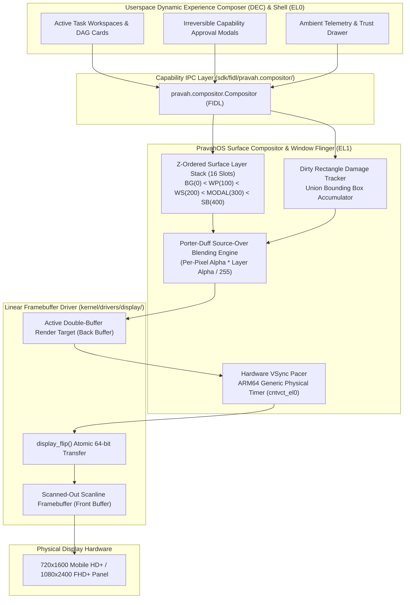
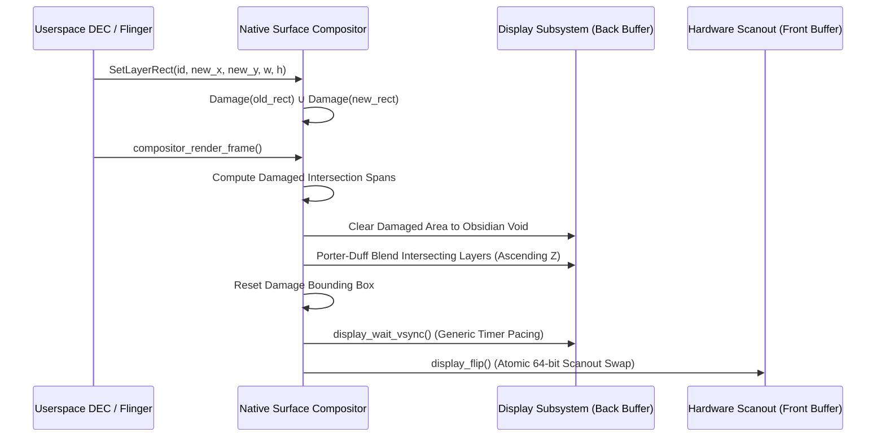

# PravahOS Native Surface Compositor & Window Flinger

> **Target Architecture:** ARM64 (AArch64) • **Target Machines:** Bare-Metal & QEMU `virt` (GICv3)  
> **Subsystem Locations:** `kernel/compositor/` & `kernel/include/kernel/compositor.h`  
> **FIDL Interface:** `sdk/fidl/pravah.compositor/compositor.fidl`  
> **Display Pipeline:** Coupled directly to `kernel/drivers/display/` via `display_flip()`

---

## 1. Executive Summary & Architectural Overview

The **PravahOS Native Surface Compositor & Window Flinger** is the core visual presentation engine of PravahOS. Operating under microkernel principles with deterministic zero-copy capability backing, it coordinates the multi-layer visual stack across boot, kernel diagnostics, and userland **Dynamic Experience Composer (DEC)** environments.

The compositor provides:
1. **Z-Ordered Surface Hierarchy:** Strict stacking model ensuring foundational background canvas, system wallpapers, dynamic workspace cards, elevated capability modals, and top ambient overlays composite with mathematical precision.
2. **Porter-Duff Source-Over Alpha Blending:** Per-pixel ARGB8888 blending combined with per-layer global opacity ($0 \dots 255$) executed directly in physical DRAM surfaces.
3. **Dirty Rectangle Damage Tracking:** Union bounding box accumulation that restricts clearing and blending operations solely to invalid/damaged areas, minimizing memory bandwidth on high-resolution displays.
4. **Hardware VSync-Aligned Buffer Swapping:** ARM generic timer synchronization with vertical refresh pacing (60 Hz / 120 Hz) and atomic 64-bit frame buffer flipping.
5. **Capability-Backed FIDL Protocol:** Formal interface (`pravah.compositor.Compositor`) mediating layer creation, VMO buffer attachments, damage dispatch, and presentation events.



---

## 2. Surface Layer Hierarchy & Stacking Semantics

The compositor maintains a Z-ordered stack of up to **16 concurrent surface layers**. Each layer belongs to a standardized type with a guaranteed baseline Z-index, which can be dynamically adjusted for window flinging, modal transitions, and stacking gestures.

| Layer Type | Enum Constant | Default Z | Description | Typical Content |
| :--- | :--- | :--- | :--- | :--- |
| **Background** | `LAYER_TYPE_BACKGROUND` | `0` | Deep obsidian canvas | Base system void (`0xFF090D16`), full-screen clearing |
| **Wallpaper** | `LAYER_TYPE_WALLPAPER` | `100` | System wallpaper & ambient visualizer | Cybernetic grid lines, ambient gradients, live shaders |
| **Workspace** | `LAYER_TYPE_WORKSPACE` | `200` | Dynamic Experience Composer (DEC) cards | Task execution DAGs, agent cards, compiler logs, app views |
| **Modal** | `LAYER_TYPE_MODAL` | `300` | High-priority security gates | Level 2 approval gates, risk confirmations, security dialogs |
| **Status Bar** | `LAYER_TYPE_STATUS_BAR` | `400` | Ambient status & system overlay | Clock, battery badge, trust indicator, transient toasts |

### Dynamic Z-Index Sorting
During each composition pass, active layers are collected and sorted in ascending order using a stable sort algorithm. Layers with lower Z-indices are rendered into the back buffer first; layers with higher Z-indices composite over lower layers. Layers with identical Z-indices are sorted stably by `layer_id`.

---

## 3. Porter-Duff Source-Over Alpha Blending Mathematics

The compositor implements non-premultiplied **Porter-Duff Source-Over** compositing with support for both per-pixel source alpha ($S_a$) and a per-layer global opacity multiplier ($L_\alpha \in [0 \dots 255]$).

### Effective Source Alpha
$$\alpha_{\text{eff}} = \frac{S_a \times L_\alpha}{255}$$

### Fast Paths
- If $\alpha_{\text{eff}} = 0$: The source pixel is entirely transparent; the destination pixel $D$ remains unchanged.
- If $\alpha_{\text{eff}} = 255$: The source pixel is completely opaque; destination pixel becomes $S$ directly with zero arithmetic overhead.

### Color Channel Composition
For non-trivial $0 < \alpha_{\text{eff}} < 255$, the destination color channels are blended according to:

$$\text{inv\_}\alpha = 255 - \alpha_{\text{eff}}$$

$$R_{\text{out}} = \frac{S_r \times \alpha_{\text{eff}} + D_r \times \text{inv\_}\alpha}{255}$$

$$G_{\text{out}} = \frac{S_g \times \alpha_{\text{eff}} + D_g \times \text{inv\_}\alpha}{255}$$

$$B_{\text{out}} = \frac{S_b \times \alpha_{\text{eff}} + D_b \times \text{inv\_}\alpha}{255}$$

$$A_{\text{out}} = \alpha_{\text{eff}} + \frac{D_a \times \text{inv\_}\alpha}{255}$$

$$\text{Pixel}_{\text{out}} = (A_{\text{out}} \ll 24) \mid (R_{\text{out}} \ll 16) \mid (G_{\text{out}} \ll 8) \mid B_{\text{out}}$$

---

## 4. Dirty Rectangle Damage Tracking & Pacing

To optimize frame composition and prevent redundant memory bus bandwidth consumption on mobile DRAM, the compositor tracks dirty damage rectangles.



### Damage Accumulation Mechanics
1. **Layer Geometry Mutation:** When a layer is repositioned or resized via `compositor_set_layer_rect()`, both the vacated bounding box and the new bounding box are automatically merged into the screen's accumulated damage box.
2. **Layer Destruction:** When a layer is destroyed via `compositor_destroy_layer()`, its bounding box is invalidated so the layers underneath are redrawn.
3. **Content Invalidation:** Clients call `compositor_damage_layer()` or `compositor_damage_rect()` to mark modified regions.
4. **Bounding Box Union:** The global accumulator merges dirty bounds:
   $$x_0' = \min(x_0^{\text{acc}}, x_0^{\text{dirty}}), \quad y_0' = \min(y_0^{\text{acc}}, y_0^{\text{dirty}})$$
   $$x_1' = \max(x_1^{\text{acc}}, x_1^{\text{dirty}}), \quad y_1' = \max(y_1^{\text{acc}}, y_1^{\text{dirty}})$$

---

## 5. Dynamic Layer Lifecycle & C API Reference

The C API is exposed via `kernel/include/kernel/compositor.h`:

### Subsystem Initialization
```c
zx_status_t compositor_init(void);
```
Initializes the layer table, queries screen geometry from `display_get_info()`, and resets telemetry counters.

### Layer Creation & Destruction
```c
zx_status_t compositor_create_layer(const char *name,
                                    compositor_layer_type_t type,
                                    int32_t x, int32_t y,
                                    uint32_t width, uint32_t height,
                                    compositor_layer_id_t *out_layer_id);

zx_status_t compositor_destroy_layer(compositor_layer_id_t layer_id);
```
- Allocates contiguous physical memory frames via PMM bitmap allocator.
- Automatically sets the default Z-index for the specified layer type.
- Reclaims DRAM pages on destruction and invalidates screen damage.

### Dynamic Property Mutators
```c
zx_status_t compositor_set_layer_z(compositor_layer_id_t layer_id, int32_t z_index);
zx_status_t compositor_set_layer_rect(compositor_layer_id_t layer_id, int32_t x, int32_t y, uint32_t width, uint32_t height);
zx_status_t compositor_set_layer_alpha(compositor_layer_id_t layer_id, uint8_t alpha);
zx_status_t compositor_set_layer_visible(compositor_layer_id_t layer_id, bool visible);
```

### Buffer Access & Zero-Copy Binding
```c
zx_status_t compositor_get_layer_buffer(compositor_layer_id_t layer_id, uint32_t **out_buffer, uint32_t *out_stride);
zx_status_t compositor_set_layer_buffer(compositor_layer_id_t layer_id, uint32_t *buffer, size_t size_bytes);
```

### Scene Presentation
```c
zx_status_t compositor_render_frame(void);
```
Sorts visible layers, composites intersecting scanlines within the accumulated damage rectangle into the display back buffer, waits for vertical refresh, and calls `display_flip()`.

---

## 6. FIDL Compositor Protocol Specification

The protocol definition in `sdk/fidl/pravah.compositor/compositor.fidl` governs the interface between userspace Dynamic Experience Composer (DEC) components and the kernel compositor:

```fidl
library pravah.compositor;

type LayerType = strict enum : uint8 {
    BACKGROUND = 0;
    WALLPAPER  = 1;
    WORKSPACE  = 2;
    MODAL      = 3;
    STATUS_BAR = 4;
};

type Rect = struct {
    x int32;
    y int32;
    width uint32;
    height uint32;
};

@discoverable
open protocol Compositor {
    flexible CreateLayer(struct {
        name string:32;
        type LayerType;
        rect Rect;
        initial_alpha uint8;
    }) -> (struct { layer_id uint32; }) error CompositorError;

    flexible DestroyLayer(struct { layer_id uint32; }) -> () error CompositorError;
    flexible SetLayerZ(struct { layer_id uint32; z_index int32; }) -> () error CompositorError;
    flexible SetLayerRect(struct { layer_id uint32; rect Rect; }) -> () error CompositorError;
    flexible SetLayerAlpha(struct { layer_id uint32; alpha uint8; }) -> () error CompositorError;
    flexible SetLayerVisibility(struct { layer_id uint32; visible bool; }) -> () error CompositorError;
    flexible AttachLayerBuffer(resource struct {
        layer_id uint32;
        buffer_vmo zx.Handle:VMO;
        width uint32;
        height uint32;
        stride uint32;
    }) -> () error CompositorError;

    flexible DamageLayer(struct { layer_id uint32; damage_rect Rect; }) -> () error CompositorError;
    flexible DamageScreen(struct { dirty_rect Rect; }) -> () error CompositorError;
    flexible DamageAll() -> () error CompositorError;
    flexible RenderFrame() -> (struct { telemetry CompositorTelemetry; }) error CompositorError;
    flexible GetLayers() -> (struct { layers vector<LayerDescriptor>:16; }) error CompositorError;
    flexible GetTelemetry() -> (struct { telemetry CompositorTelemetry; }) error CompositorError;
};
```

---

## 7. Multi-Layer Composition Test & Verification

The microkernel integrates a comprehensive multi-layer self-test in `kernel/compositor/compositor.c` invoked automatically from `kernel/main.c` during early system boot.

### Multi-Layer Composition Scene Setup
1. **Background Layer (`LAYER_TYPE_BACKGROUND`, Z: 0):** Full-screen $720 \times 1600$ obsidian clear surface (`COLOR_PRAVAH_BG`).
2. **Wallpaper Layer (`LAYER_TYPE_WALLPAPER`, Z: 100):** Ambient grid lines at 64 px intervals with glowing banner *"PRAVAHOS INTENT CORE * AUTONOMOUS AGENT ACTIVE"*.
3. **Workspace Card Layer (`LAYER_TYPE_WORKSPACE`, Z: 200):** Rounded surface card at $(32, 120, 656, 540)$ displaying:
   - Header: *"WORKSPACE #1: COMPILER PIPELINE"*
   - Child node card 1: *"LLVM IR Generator -> AArch64 Target"* with emerald completion bar.
   - Child node card 2: *"Native Surface Compositor Flinger"* with cyan running bar.
4. **Floating Modal Layer (`LAYER_TYPE_MODAL`, Z: 300):** High-priority confirmation gate at $(48, 700, 624, 340)$ with amber border:
   - Warning banner: *"POLICY RISK GATE * LEVEL 2 CAPABILITY REQUIRED"*
   - Impact summary: *"Impact: Grants Direct Video Memory Scanout Access"*
   - Semi-transparent glass opacity ($\alpha = 245$)
   - Interactive buttons: `[APPROVE INTENT]` (Emerald) and `[REJECT GATE]` (Crimson).
5. **Status Bar Layer (`LAYER_TYPE_STATUS_BAR`, Z: 400):** Translucent top bar $(0, 0, 720, 48)$ displaying clock `"09:41"`, `"PRAVAH SECURE ENCLAVE"`, and `"5G [98%]"`.

### Verification Checklist
- [x] **Subsystem Initialization:** Screen geometry acquired ($720 \times 1600$), 16 layer slots prepared.
- [x] **Porter-Duff Math:** $50\%$ alpha blending between black and white verified ($R \in [126 \dots 130]$).
- [x] **Layer Allocation:** 5 dynamic layers created and allocated via PMM contiguous pages.
- [x] **Z-Order Hierarchy:** Verified $BG(0) < WP(100) < WS(200) < MODAL(300) < SB(400)$.
- [x] **Damage Tracking:** Dirty bounding box accumulated across layer rects.
- [x] **Frame Presentation:** Porter-Duff blended into back buffer, VSync synchronized, and flipped.
- [x] **Dynamic Mutations:** Tested alpha adjustment ($\alpha = 220$), layer repositioning, and scratch layer creation/destruction.
