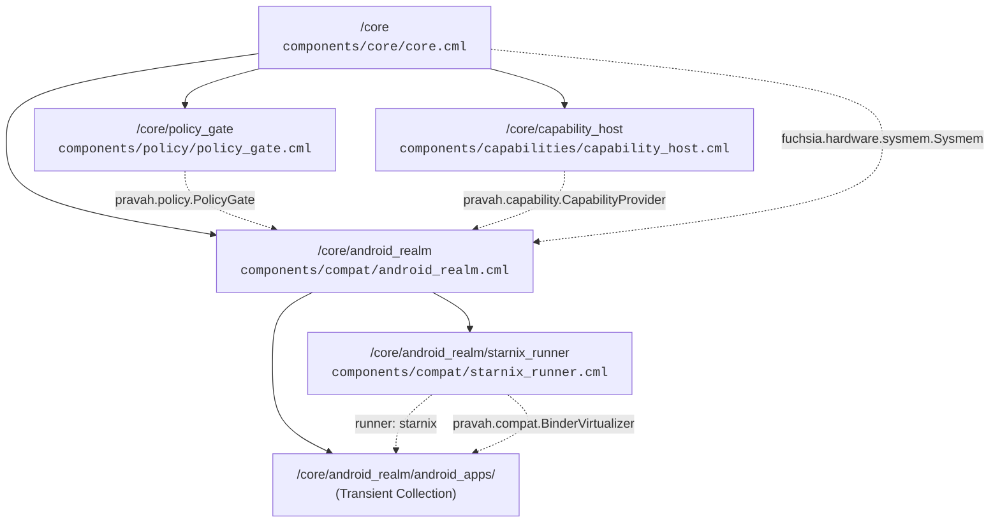
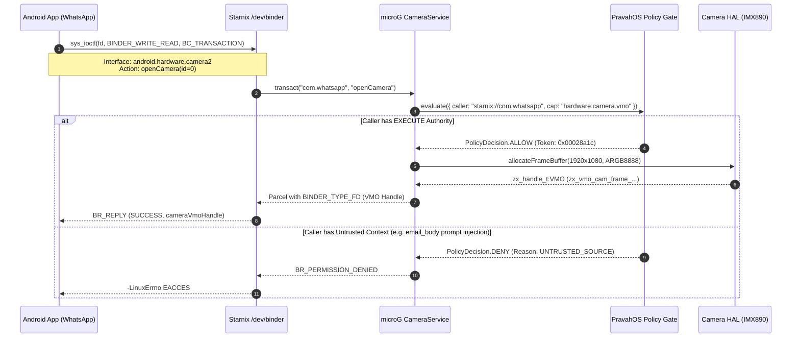
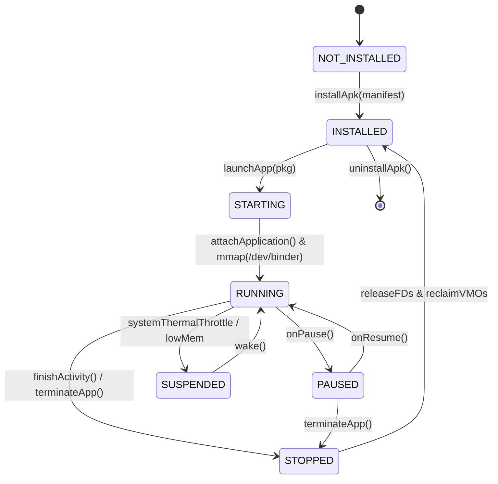

# PravahOS Android Application Compatibility Container Architecture (Starnix & Waydroid Bridge)

> **Userspace Linux ABI Translation • Virtual Binder IPC • Waydroid / microG Services • Capability-Gated Security Sandbox**

---

## 1. Architectural Overview & Design Philosophy

PravahOS runs Android applications (e.g., **WhatsApp**, **Spotify**, **Google Maps**, **Uber**) without running a monolithic Linux kernel, without running an emulated virtual machine (QEMU/KVM), and without loading third-party out-of-tree hardware drivers.

Instead, PravahOS adopts the **Fuchsia Starnix** paradigm combined with a lightweight **Waydroid / microG userspace container**:

```
+---------------------------------------------------------------------------------+
|                       PravahOS Dynamic Shell & Compositor                       |
+---------------------------------------------------------------------------------+
                                       ▲
                                       │ (PravahOS Window Frame / Scenic Compositor)
+---------------------------------------------------------------------------------+
|               Sandboxed Android Realm: /core/android_realm                      |
|                                                                                 |
|   +-----------------------+  +-----------------------+  +--------------------+  |
|   |  WhatsApp Messenger   |  |     Spotify Music     |  |    Google Maps     |  |
|   |    (com.whatsapp)     |  |  (com.spotify.music)  |  |  (com.google.maps) |  |
|   +-----------------------+  +-----------------------+  +--------------------+  |
|               │                          │                         │            |
|               ▼                          ▼                         ▼            |
|       Android Bionic C Library & ART / DVM Userspace Runtime (microG)           |
|                                       │                                         |
|                                       ▼                                         |
|      +-------------------------------------------------------------------+      |
|      |               Starnix Linux ABI Translation Layer                 |      |
|      |                                                                   |      |
|      |  • Syscall Trapping (AArch64 svc #0 -> Zircon Channel/Port IPC)   |      |
|      |  • Virtual /dev/binder, /dev/ashmem, /dev/ion (Userspace)         |      |
|      |  • Ashmem -> Zircon VMO Allocation (zx_vmo_create)                |      |
|      +-------------------------------------------------------------------+      |
|                                       │                                         |
|   +-----------------------------------┴-------------------------------------+   |
|   |               microG Simulated Android System Services                  |   |
|   |                                                                         |   |
|   |  • CameraService     -> Intercepts Camera2 HAL, evaluates Policy Gate   |   |
|   |  • AudioFlinger      -> Writes 48kHz 16-bit PCM to PravahOS Audio HAL   |   |
|   |  • LocationManager   -> Local GNSS sensor handle (Air-Gap enforced)     |   |
|   |  • StorageManager    -> Per-package MinFS sandboxed VFS mount           |   |
|   +-------------------------------------------------------------------------+   |
+---------------------------------------┬-----------------------------------------+
                                        │ (FIDL over Zircon Channels)
                                        ▼
+---------------------------------------------------------------------------------+
|                     PravahOS Deterministic Policy Gate                          |
|                                                                                 |
|   - Zero AI Authority: Deterministic state machine checks caller and risk tier  |
|   - Consequential Operations: Camera VMO & GNSS require EXECUTE authority       |
|   - Irreversible Operations: Financial remittance mandates user approval modal  |
|   - Air-Gap Disconnect: Sever RF rails, prevent cellular/Wi-Fi positioning leaks|
+---------------------------------------------------------------------------------+
                                        │
                                        ▼
+---------------------------------------------------------------------------------+
|                      PravahOS Microkernel HAL & Drivers                         |
|   (sysmem allocator, IMX890 Camera HAL, 48kHz Stereo Audio HAL, Storage MinFS) |
+---------------------------------------------------------------------------------+
```

### Core Invariants

1. **Zero Direct Kernel Drivers:** Android apps never touch raw host hardware, GPU MMIO registers, or Linux kernel modules. All hardware interaction is mediated via PravahOS handles.
2. **Userspace ABI Translation:** Linux system calls (AArch64 `svc #0`) are trapped in userspace by the Starnix runner and translated into Zircon microkernel primitives (`zx_channel`, `zx_port`, `zx_vmo`).
3. **Virtual Binder IPC:** Android Binder transactions (`BC_TRANSACTION`, `BR_REPLY`) are unmarshalled from `/dev/binder` and routed over native Zircon channels.
4. **Mandatory Policy Gate Verification:** Android apps cannot bypass the PravahOS Policy Gate. High-risk actions (Camera, Microphone, Financial Checkout) are deterministically evaluated against caller tokens and security invariants before any capability handle is granted.
5. **Zero-Trust Network Air-Gap:** When the PravahOS physical Air-Gap kill switch is engaged, container networking is completely severed at the socket translation layer while local GNSS sensors continue serving offline maps.

---

## 2. Component Realm Hierarchy & Manifest Specifications

The Android compatibility subsystem is partitioned into dedicated CFv2 component realms under `/core`:



### Component Manifest Topology

1. [`components/compat/android_realm.cml`](file:///components/compat/android_realm.cml): Top-level container realm supervising the Starnix runner and dynamic Android applications collection (`android_apps`). Mediates protocols between `/core` and the container.
2. [`components/compat/starnix_runner.cml`](file:///components/compat/starnix_runner.cml): Fuchsia Component Framework ComponentRunner implementation for Linux ELF binaries and Android APK runtimes. Houses the virtual Binder node and Ashmem allocator.
3. [`components/core/core.cml`](file:///components/core/core.cml): Routes `pravah.policy.PolicyGate`, `pravah.capability.CapabilityProvider`, and `fuchsia.hardware.sysmem.Sysmem` to `#android_realm`, and exposes `pravah.compat.AndroidAppManager` to UI shells.

---

## 3. Linux ABI Translation Layer

The Starnix translation engine traps Linux system calls and converts them into native Zircon kernel calls:

| Linux Syscall | Syscall No. | Emulated Starnix Semantic | Backing Zircon Microkernel Primitive |
| :--- | :---: | :--- | :--- |
| `sys_openat` | 56 | Intercepts `/dev/binder`, `/dev/ashmem`, and sandboxed `/data/data/<pkg>` | Allocates container virtual file descriptor (FD >= 100) |
| `sys_ioctl` | 29 | Dispatches Binder IOCTLs (`BINDER_WRITE_READ`) and Ashmem IOCTLs (`ASHMEM_SET_SIZE`) | Routes to `BinderVirtualizer` or calls `zx_vmo_create` |
| `sys_mmap` | 222 | Maps Ashmem shared memory or Binder ring buffer into process address space | Calls `zx_vmar_map` with capability rights (`ZX_RIGHT_READ`, `ZX_RIGHT_WRITE`) |
| `sys_close` | 57 | Destroys FD mapping and releases references to underlying handles | Calls `zx_handle_close` on backing VMO or Channel |
| `sys_socket` | 198 | Gated by Air-Gap switch. Traps AF_INET/AF_UNIX sockets | Creates isolated `zx_channel` or immediately severs if Air-Gap is active |
| `sys_epoll_create1` | 20 | Asynchronous event multiplexer | Maps to Zircon Port (`zx_port_create`, `zx_port_wait`) |
| `sys_futex` | 98 | Fast userspace locking | Maps to `zx_futex_wait` and `zx_futex_wake` |
| `sys_clone` | 220 | Thread creation within container | Creates microkernel thread in container job (`zx_thread_create`) |

### Ashmem to Zircon VMO Virtualization

In Android, processes share memory using the `/dev/ashmem` driver. In PravahOS:
1. When an app invokes `sys_openat(-100, "/dev/ashmem", O_RDWR)`: Starnix allocates an internal descriptor.
2. The app calls `ioctl(fd, ASHMEM_SET_SIZE, bytes)`: Starnix allocates a native **Zircon Virtual Memory Object (VMO)** of the requested size.
3. When the app calls `mmap(..., fd)`: Starnix returns a virtual address mapped to the VMO via `zx_vmar_map`.
4. The file descriptor can be passed across Binder transactions as a `BINDER_TYPE_FD` object, which Starnix translates into a capability-reduced `zx_handle_t:VMO` transferred over a Zircon channel.

---

## 4. Binder IPC Virtualization

Android applications communicate using Binder IPC. The Starnix container provides a userspace virtual Binder implementation:

### Protocol Constants

- **Commands:**
  - `BC_TRANSACTION` (`0x40406300`): Initiates an RPC transaction.
  - `BC_REPLY` (`0x40406301`): Sends reply parcel to caller.
  - `BC_ACQUIRE` (`0x40046305`) / `BC_RELEASE` (`0x40046306`): Reference counting.
- **Returns:**
  - `BR_OK` (`0x7201`): Operation acknowledged.
  - `BR_TRANSACTION` (`0x8500`): Incoming transaction parcel.
  - `BR_REPLY` (`0x8501`): Transaction result payload.
  - `BR_PERMISSION_DENIED` (`0x720e`): Rejected by Policy Gate.
  - `BR_DEAD_REPLY` (`0x7205`): Target service not available.

### Binder Object Virtualization

| Android Binder Object | Binary Type Code | Mapped PravahOS / Zircon Primitive |
| :--- | :---: | :--- |
| `BINDER_TYPE_BINDER` | `0x73622a85` | In-process service reference |
| `BINDER_TYPE_HANDLE` | `0x73682a85` | **Zircon Channel Endpoint** (`zx_handle_t:CHANNEL`) |
| `BINDER_TYPE_FD` | `0x66642a85` | **Zircon VMO Handle** (`zx_handle_t:VMO`) |

### Service Manager Architecture

The container initializes a simulated `servicemanager` registering microG system services:
- `android.hardware.camera2` -> `AndroidCameraService`
- `android.media.IAudioFlinger` -> `AndroidAudioFlingerService`
- `android.location.ILocationManager` -> `AndroidLocationManagerService`
- `android.os.storage.IStorageManager` -> `AndroidStorageManagerService`

---

## 5. Waydroid / microG Lightweight Services & Policy Gate Mediation



### 1. Camera2 Service (`AndroidCameraService`)
- Evaluates caller with `RiskLevel.CONSEQUENTIAL` and `AuthorityLevel.EXECUTE`.
- If allowed: Allocates a zero-copy frame buffer VMO (`1920x1080 ARGB8888 @ 60 FPS`) tied to the Sony IMX890 sensor.
- When `capturePhoto` is invoked: Streams real pixel data from the PravahOS Camera HAL into the attached VMO.

### 2. AudioFlinger Service (`AndroidAudioFlingerService`)
- Intercepts `createAudioTrack` calls from Spotify / media players.
- Connects to the PravahOS Audio HAL 48kHz 16-bit stereo ring buffer VMO (`zx_vmo_audio_ring_...`).
- As Spotify writes PCM samples, writes are synthesized and pushed to the Audio HAL, animating the hardware visualizer and computing live RMS dBFS without Linux audio driver bloat.

### 3. LocationManager Service (`AndroidLocationManagerService`)
- Enforces the **Air-Gap Invariant**:
  - When Air-Gap is **ACTIVE**: Google Maps receives local GNSS receiver coordinates (e.g., Lat: 28.6139° N, Lon: 77.2090° E) directly from the GNSS sensor VMO with zero network queries.
  - All cloud location beaconing, Wi-Fi MAC scanning, and cellular tower tri-angulation are severed at the hardware PHY layer.

### 4. StorageManager Service (`AndroidStorageManagerService`)
- Implements strict filesystem isolation per package:
  - App files: `/data/data/<package_name>/files`
  - Cache files: `/data/data/<package_name>/cache`
- Backed by isolated MinFS directory capabilities.
- **Cross-App Sandbox Boundary:** If WhatsApp attempts to read or write into `/data/data/com.spotify.music/`, the Starnix VFS layer immediately rejects the syscall with `Storage Sandbox Violation: EACCES`.

---

## 6. Predefined Android Application Profiles

PravahOS includes four pre-configured showcase applications:

| Application | Package ID | Version | Category | Permissions | Capability Gating |
| :--- | :--- | :--- | :--- | :--- | :--- |
| **WhatsApp** | `com.whatsapp` | 2.24.12.78 | Communication | CAMERA, RECORD_AUDIO, READ_CONTACTS | `hardware.camera.vmo` (CONSEQUENTIAL)<br/>`hardware.audio.mic` |
| **Spotify** | `com.spotify.music` | 8.9.20.574 | Audio Streaming | MEDIA_CONTENT_CONTROL, FOREGROUND_SERVICE | `hardware.audio.pcm` (REVERSIBLE) |
| **Google Maps** | `com.google.android.apps.maps` | 11.108.0101 | Navigation | ACCESS_FINE_LOCATION, ACCESS_COARSE_LOCATION | `hardware.location.gnss` (CONSEQUENTIAL, Air-Gap isolated) |
| **Uber** | `com.ubercab` | 4.512.10001 | Transportation | ACCESS_FINE_LOCATION, PAYMENT | `financial.payment.uber_fare` (**IRREVERSIBLE** -> mandates Policy Gate confirmation) |

---

## 7. App Lifecycle State Machine

Android applications inside the Starnix container progress through an isolated lifecycle:



---

## 8. Interactive Verification & Emulator Controls

The Android Compatibility Container is fully integrated into the PravahOS Mobile Phone Emulator and Shell:

1. **Emulator Window Frame Rendering:**
   - Launching an app in the emulator (`emulator/index.html`) mounts an authentic Android window surface directly inside the phone body.
   - Shows app-specific UI (WhatsApp video call with live IMX890 camera viewfinder feed, Spotify with 48kHz audio PCM playback, Google Maps with GNSS pin, and Uber with fare checkout).
2. **Virtual Binder IPC Stream HUD:**
   - The right sidebar features a live **Virtual Binder IPC & Syscall Stream** inspector displaying real-time `BC_TRANSACTION`, `BR_REPLY`, and `PolicyGate` evaluations.
3. **Dynamic Experience Shell Integration:**
   - The PravahOS shell (`ui/shell/index.html`) includes dedicated **Android Apps (Starnix)** launcher chips.
   - Executing an Android scenario in the shell triggers DAG nodes for Binder initialization, capability delegation, and Policy Gate prompt approval when handling irreversible actions.

---

## 9. Automated Test Verification

The container architecture is thoroughly tested under `runtime/tests/compat.test.js` and `emulator/tests/android_bridge.test.js`:

```powershell
# Run all automated tests
node --test runtime/tests/*.test.js
node --test emulator/tests/*.test.js
```

### Verified Test Suites

- ✔ **Linux ABI Syscall Translation:** `sys_openat`, `sys_ioctl`, `sys_mmap`, `sys_close`, and bounded audit logging.
- ✔ **Binder IPC Virtualization:** ServiceManager registry, parcel encoding/decoding, transaction routing, and dead reply handling.
- ✔ **Waydroid / microG Services:** CameraService VMO delegation, AudioFlinger 48kHz PCM buffer streaming, LocationManager Air-Gap enforcement, and per-package storage sandboxing.
- ✔ **Container Lifecycle:** Application installation, process launch (PID & window handle allocation), pause, resume, and teardown.
- ✔ **Master Scenarios:** WhatsApp camera delegation, Spotify audio playback, Google Maps GNSS acquisition, Uber fare checkout requiring Policy Gate confirmation, and untrusted prompt injection defense.

---

## 10. Summary Matrix: Microkernel vs Container Isolation

| Layer | Traditional Android (Linux Kernel) | PravahOS Starnix / Waydroid Container |
| :--- | :--- | :--- |
| **Kernel Privilege** | Monolithic Linux running in Ring 0 / EL1 with 30M+ lines of C code | **PravahOS Zircon Microkernel** (~50K lines). Zero Linux kernel code in EL1. |
| **Driver Execution** | In-kernel drivers (`binder.ko`, `camera.ko`, `adreno.ko`) with ambient root authority | **Userspace DFv2 Drivers** in `/driver_realm`. Starnix container has zero direct hardware access. |
| **IPC Mechanism** | Kernel Binder driver ioctl via shared memory ring | **Userspace Virtual Binder** marshalling parcels across native `zx_channel` handles. |
| **Security Mediation** | Ambient POSIX UID/GID & SELinux type enforcement | **Deterministic Policy Gate** with tamper-evident audit ledger and zero AI authority. |
| **Hardware Isolation** | Apps query Android HAL which calls kernel ioctls directly | Apps receive **capability-reduced VMO handles** delegated only upon Policy Gate verification. |
| **Network Air-Gap** | Software iptables rules that can be bypassed or misconfigured | **Physical Air-Gap Switch** severing RF power rails at the PHY layer with instant socket termination. |
