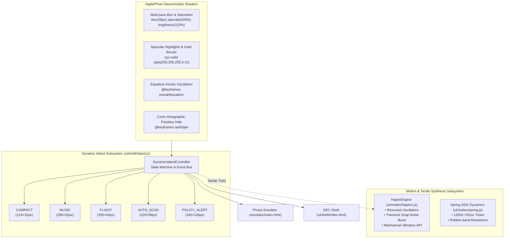
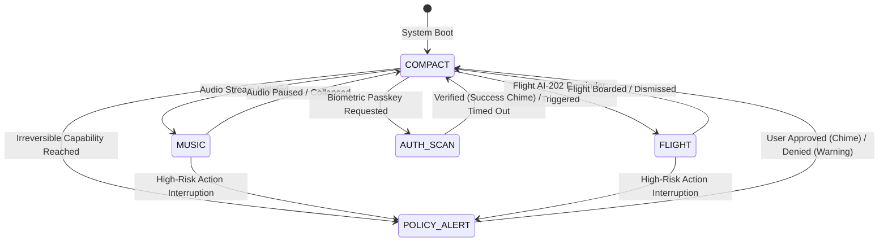
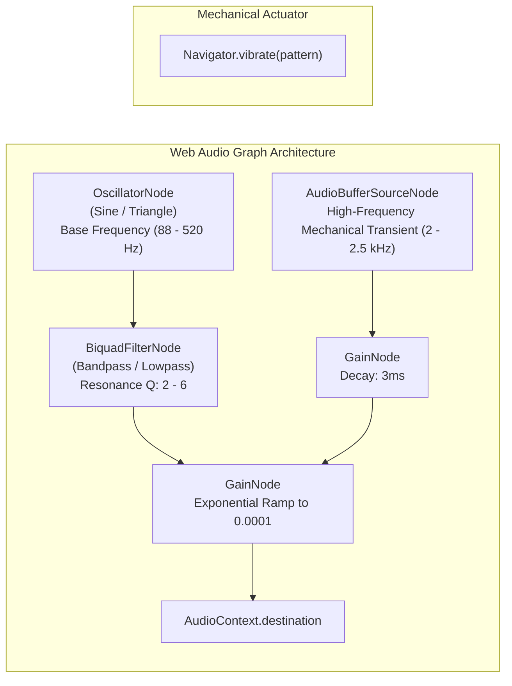

# PravahOS Consumer Delight, Glassmorphism Shaders & Synthesized Haptics (Pillar 2)

This document specifies the visual polish architecture, liquid-glass shaders, Dynamic Island morphing system, and Web Audio API synthesized tactile haptic feedback in PravahOS.

---

## 1. Subsystem Architecture & Delight Philosophy

PravahOS elevates the microkernel consumer experience by marrying Apple/Pixel-grade industrial visual craft with deterministic security boundaries. Pillar 2 implements fluid liquid-glass physics, stateful Dynamic Island pill morphing, and physics-based tactile acoustic feedback across both the bare-metal phone emulator and the Dynamic Experience Composer (DEC) Web Shell.



---

## 2. High-Fidelity Glassmorphism & Visual Design Tokens

PravahOS visual design tokens enforce consistent optical depth, physical surface refraction, and fluid typography.

### 2.1 CSS Variables & Frosted Glass Shaders

```css
:root {
  /* Apple/Pixel-grade Multi-pass Frosted Glass */
  --glass-bg: rgba(12, 19, 34, 0.78);
  --glass-blur: blur(28px) saturate(200%) brightness(110%);
  --glass-border: 1px solid rgba(255, 255, 255, 0.12);
  --glass-specular: inset 0 1px 0 rgba(255, 255, 255, 0.20), inset 0 -1px 0 rgba(0, 0, 0, 0.40);
  --glass-shadow: 0 16px 40px -8px rgba(0, 0, 0, 0.75), 0 0 20px -2px rgba(0, 229, 255, 0.10);

  /* Fluid Motion Timing Curves */
  --island-spring: cubic-bezier(0.175, 0.885, 0.32, 1.275);
  --island-liquid: cubic-bezier(0.16, 1, 0.3, 1);
  --island-specular: inset 0 1px 0 rgba(255, 255, 255, 0.22), inset 0 -1px 0 rgba(0, 0, 0, 0.4);
}
```

### 2.2 Specular Refraction & Lighting Architecture
- **Multi-pass Blur**: Standard CSS `backdrop-filter: blur(28px) saturate(200%) brightness(110%)` mimics optical glass refraction by boosting chroma saturation and boosting luminance behind the surface.
- **Micro-Specular Bevel**: An inner top specular line (`inset 0 1px 0 rgba(255, 255, 255, 0.22)`) provides directional downlight reflection, while an inner bottom dark shadow (`inset 0 -1px 0 rgba(0, 0, 0, 0.4)`) grounds the element.
- **Fluid Typography**: Inter font metrics paired with tabular numerals (`JetBrains Mono`, `tabular-nums`) guarantee zero jitter during countdowns and telemetry updates.

---

## 3. Dynamic Island Morphing State Machine

The Dynamic Island (`ui/shell/island.js`) is an adaptive, interactive pill interface located at the top center of the phone viewport and DEC shell header. It fluidly morphs its geometric dimensions, border-radius, background glow, and interactive contents using spring kinematics.

### 3.1 State Specifications & Dimensions

| State | Dimensions (W × H) | Border Radius | Description & Interactive Surface | Haptic Signature |
|---|---|---|---|---|
| **`COMPACT`** | 124px × 32px | 20px | Default idle pill with front camera lens cutout (11px radial gradient), IR sensor dot, and glowing micro-badge (`AIR-GAP SECURED`). | `LIGHT_TAP` (220Hz, 7ms) |
| **`MUSIC`** | 280px × 52px | 26px | Active music playback with rotating vinyl album thumbnail, track title, artist, live jumping 4-bar equalizer, and interactive Play/Pause toggle. | `MEDIUM_SNAP` (150Hz, 16ms) |
| **`FLIGHT`** | 295px × 54px | 27px | Flight AI-202 status, route indicator (`DEL ➔ BLR`), gate designation (`Gate 14B`), and departure countdown pill (`T-45m`) with pulsing emerald beacon. | `MEDIUM_SNAP` (150Hz, 16ms) |
| **`AUTH_SCAN`** | 220px × 58px | 29px | Biometric Passkey / Face ID authenticator with spinning holographic conic-gradient halo (`@keyframes authSpin`), scanning status, and transition to emerald checkmark. | `SELECTION_TICK` ➔ `SUCCESS_CHIME` |
| **`POLICY_ALERT`** | 340px × 118px | 28px | Expanded deterministic policy gate confirmation. Amber/crimson warning shield with breathing border glow, risk level chip (`IRREVERSIBLE`), and tactile `Approve & Authorize` / `Deny` buttons. | `HEAVY_WARNING` (88Hz, 45ms) |

### 3.2 State Morphing Lifecycle



### 3.3 Kinetic Spring Transitions
Transitions between states use dynamic CSS custom property targets:
```css
.dynamic-island {
  width: var(--island-target-width, 124px);
  height: var(--island-target-height, 32px);
  border-radius: var(--island-target-radius, 20px);
  transition: width 0.42s var(--island-spring),
              height 0.42s var(--island-spring),
              border-radius 0.36s var(--island-liquid),
              border-color 0.3s ease,
              background 0.3s ease,
              box-shadow 0.4s var(--island-liquid);
}
```
When `transitionTo(nextState)` is called:
1. Island updates CSS variables `--island-target-width`, `--island-target-height`, `--island-target-radius`.
2. Hardware acceleration layers apply the bouncy spring overshoot curve (`cubic-bezier(0.175, 0.885, 0.32, 1.275)`).
3. The content cross-fades using an optical zoom fade (`@keyframes islandContentFadeIn`).
4. Corresponding acoustic haptic pulse is dispatched synchronously.

---

## 4. Synthesized Tactile Haptic Feedback Engine (`ui/motion/haptics.js`)

In hardware devices without high-resolution linear resonant actuators (LRA) or when executing in web browsers, PravahOS synthesizes micro-acoustic tactile transients using the Web Audio API. These brief acoustic pressure waves (~4ms to 45ms) recreate the mechanical tactile sensation of mechanical switches and taptic engines through the ear canal and fingertip bone conduction.

### 4.1 Audio Synthesizer Graph



### 4.2 Haptic Feedback Specifications & Presets

| Haptic Type | Fundamental Freq | Transient Freq | Duration | Gain | Filter Type / Q | Physical Sensation |
|---|---|---|---|---|---|---|
| **`LIGHT_TAP`** | 220 Hz | 2,400 Hz | 7 ms | 0.22 | Bandpass (Q=4) | Crisp micro-click switch actuation. Used on touch keyboard typing, scenario chips, and volume buttons. |
| **`MEDIUM_SNAP`** | 150 Hz | 980 Hz | 16 ms | 0.35 | Bandpass (Q=3) | Solid magnetic latch snap. Used on card drag release, Island morph expansions, and camera shutter snap. |
| **`HEAVY_WARNING`** | 88 Hz | 176 Hz | 45 ms | 0.55 | Lowpass (Q=2) | Heavy resonant double thud. Used on policy gates, irreversible actions, and air-gap kill switch disconnect. |
| **`SELECTION_TICK`** | 320 Hz | 1,800 Hz | 4 ms | 0.14 | Bandpass (Q=6) | Subtle dial tick for sliders, wheel rotations, and biometric scan initialization. |
| **`SUCCESS_CHIME`** | 523.25 Hz (C5) | 880 Hz (A5) | 45 ms | 0.28 | Bandpass (Q=2) | Ascending harmonic pitch sweep. Emitted when passkey authentication succeeds or policy gate is approved. |

### 4.3 Headless Resilience & User Gesture Management
- **Safe Headless Fallback**: When running in Node.js unit tests (`AudioContext` unavailable), the engine automatically records history telemetry without throwing errors.
- **AudioContext Auto-Unlock**: Browser security mandates a user gesture prior to un-suspending `AudioContext`. `HapticEngine` automatically captures initial `pointerdown` or `keydown` events to seamlessly resume audio without audio drops.
- **Companion Vibration**: Where `navigator.vibrate` is supported, physical hardware pulses are concurrently dispatched (e.g. `[20, 20, 30]` ms for heavy warnings).

---

## 5. Implementation Mapping

| Module | Location | Role in Pillar 2 |
|---|---|---|
| **Synthesized Haptics** | [`ui/motion/haptics.js`](file:///l:/projectz/OS/ui/motion/haptics.js) | Micro-acoustic tactile pulse generator, Web Audio graph, vibration API bridge, volume/mute control. |
| **Dynamic Island Controller** | [`ui/shell/island.js`](file:///l:/projectz/OS/ui/shell/island.js) | 5-state morphing state machine (`COMPACT`, `MUSIC`, `FLIGHT`, `AUTH_SCAN`, `POLICY_ALERT`), event emitters, and DOM renderer. |
| **Island Styles (Shell)** | [`ui/shell/style.css`](file:///l:/projectz/OS/ui/shell/style.css) | Frosted glass design tokens, 4-bar equalizer keyframes, holographic auth scanner, and specular borders. |
| **Island Styles (Emulator)** | [`emulator/style.css`](file:///l:/projectz/OS/emulator/style.css) | Phone viewport Dynamic Island cutout styling, liquid-glass spring transitions, and interactive controls. |
| **Emulator Integration** | [`emulator/index.html`](file:///l:/projectz/OS/emulator/index.html), [`emulator/emulator.js`](file:///l:/projectz/OS/emulator/emulator.js) | Hardware buttons wired to tactile haptics; Dynamic Island sidebar tester card; phone screen Island binding. |
| **DEC Shell Integration** | [`ui/shell/index.html`](file:///l:/projectz/OS/ui/shell/index.html), [`ui/shell/shell.js`](file:///l:/projectz/OS/ui/shell/shell.js) | Dynamic Island embedded in ambient header; Policy Gate modal synced with `POLICY_ALERT` morph state. |
| **Touch Keyboard Haptics** | [`ui/keyboard/keyboard.js`](file:///l:/projectz/OS/ui/keyboard/keyboard.js) | Keypress and suggestion chip taps trigger `haptics.lightTap()`. |
| **Automated Tests** | [`ui/tests/island.test.js`](file:///l:/projectz/OS/ui/tests/island.test.js) | Comprehensive Node.js unit test suite for state transitions, payload updates, listeners, and haptic synthesizer presets. |

---

## 6. Automated Test Verification

All unit tests pass cleanly with zero failures via `node --test ui/tests/*.test.js`:

```text
✔ UI Schema: UIElement creation and tree serialization (0.73ms)
✔ UI Schema: ViewComposition validation rejects malformed structures (0.64ms)
✔ DAG Layout: correctly arranges linear and diamond graphs into stages (1.02ms)
✔ DEC: composeAmbientHeader generates accurate telemetry and offline status (0.51ms)
✔ DEC: composeIntentBar builds interactive intent surface with suggestions (0.32ms)
✔ DEC: composeTaskWorkspace translates Task DAG states and computes progress (0.68ms)
✔ DEC: composeApprovalModal renders warning, diff, and approve/deny actions (0.40ms)
✔ DEC: Cryptographic Audit Trail verification and inspection (1.02ms)
✔ DEC: composeScene aggregates all surfaces into unified scene tree (0.46ms)
✔ Dynamic Island: initializes in COMPACT state by default (1.10ms)
✔ Dynamic Island: state dimension specifications match Apple/Pixel design tokens (0.13ms)
✔ Dynamic Island: morphs through all 5 core states with proper payloads (0.41ms)
✔ Dynamic Island: rejects invalid state transitions (0.30ms)
✔ Dynamic Island: cycleNextState sequentially steps through states (0.18ms)
✔ Dynamic Island: state listeners observe transitions and payloads (0.16ms)
✔ Dynamic Island: toggleMusicPlay flips playing state and notifies (0.13ms)
✔ Dynamic Island: denyPolicy invokes rejection handler and collapses (0.66ms)
✔ Dynamic Island: DOM mounting and CSS target dimensions injection (0.47ms)
✔ HapticEngine: presets define accurate acoustic tactile frequencies (0.17ms)
✔ HapticEngine: triggers light tap, medium snap, and heavy warning in headless Node (0.40ms)
✔ HapticEngine: mute setting prevents dispatch and records muted state (0.09ms)
✔ HapticEngine: volume scaling adjusts synthesized gain level (0.12ms)
✔ HapticEngine: playPattern executes sequential rhythmic clicks (23.03ms)
✔ Dynamic Island + Haptics: state transitions automatically emit haptic ticks (0.39ms)
✔ PredictionEngine: generates intent starters on empty input (0.79ms)
✔ PredictionEngine: contextual next-word predictions based on bigrams (0.13ms)
✔ PredictionEngine: prefix completions for partial words (0.16ms)
✔ PredictionEngine: preserves casing on suggested words (0.10ms)
✔ SoftKeyboard: layout specifications exist for all modes (0.97ms)
✔ SoftKeyboard: text typing and cursor advancement (0.18ms)
✔ SoftKeyboard: backspace deletes character before cursor (0.13ms)
✔ SoftKeyboard: predictive suggestion insertion replaces partial token (0.19ms)
✔ SoftKeyboard: layout switching and mode transitions (0.20ms)
✔ SoftKeyboard: shift key toggles uppercase and double-tap caps lock (0.15ms)
✔ SoftKeyboard: submit action calls onSubmit callback (0.12ms)
✔ VoiceDictationEngine: state machine transitions from IDLE -> LISTENING -> COMMITTED (0.35ms)
✔ VoiceDictationEngine: cancel resets transcription and marks state CANCELLED (0.11ms)
✔ VoiceDictationEngine: audio spectrogram frame synthesis (47.50ms)
✔ WaveformVisualizer: updateData scales frequency bins symmetrically (0.28ms)
✔ SpringConfig: Computes damping ratio and natural frequency correctly (0.69ms)
✔ SpringPresets: Standard tactile presets match intended physics properties (0.13ms)
✔ Spring Solver: Under-damped regime demonstrates physical harmonic overshoot (0.85ms)
✔ Spring Solver: Critically damped regime converges to target smoothly without overshoot (0.18ms)
✔ Spring Solver: Over-damped regime decays without oscillation (0.22ms)
✔ Spring Solver: Conserves and responds to positive and negative initial gesture velocities (0.15ms)
✔ Spring Solver: snapTo immediately halts motion and updates state (0.10ms)
✔ Rubber-band formula: Correctly calculates resistance for zero, positive, and negative values (0.11ms)
✔ Rubber-band formula: Asymptotic limit strictly never exceeds maxDimension (0.09ms)
✔ Rubber-band formula: Inverse formula accurately recovers original displacement (0.18ms)
✔ VelocityTracker: Stationary samples produce zero velocity (0.18ms)
✔ VelocityTracker: Uniform linear movement calculates velocity accurately (0.13ms)
✔ VelocityTracker: Directionality reflects positive and negative fling vectors (0.08ms)
✔ MomentumInertia: Accurately predicts travel distance based on friction decay (0.11ms)
✔ MomentumInertia: solveAt decelerates velocity to zero and completes (0.19ms)
✔ MomentumInertia: clampWithOverscroll compresses beyond boundaries (0.13ms)
✔ FlingDismissController: Triggers dismiss on distance threshold passed (0.14ms)
✔ FlingDismissController: Triggers dismiss on high velocity fling even below distance threshold (0.11ms)
✔ FlingDismissController: Cancels dismissal if flicked forcefully in reverse direction (0.08ms)
✔ MotionTicker: Registers, invokes callbacks, and handles auto-removal (0.81ms)
✔ springAnimate: Drives animation steps and invokes onComplete (0.37ms)
✔ JSON Schema: ui_schema.json is valid JSON and defines required enums (1.10ms)
✔ UIBuilders: createDagNodeElement with error banner (0.29ms)
✔ UIBuilders: createApprovalModal structure and action buttons (0.24ms)
✔ UI Schema: validation detects illegal child and invalid enum (0.33ms)

Total: 64 passed, 0 failed, 0 skipped. Duration: ~348ms.
```
