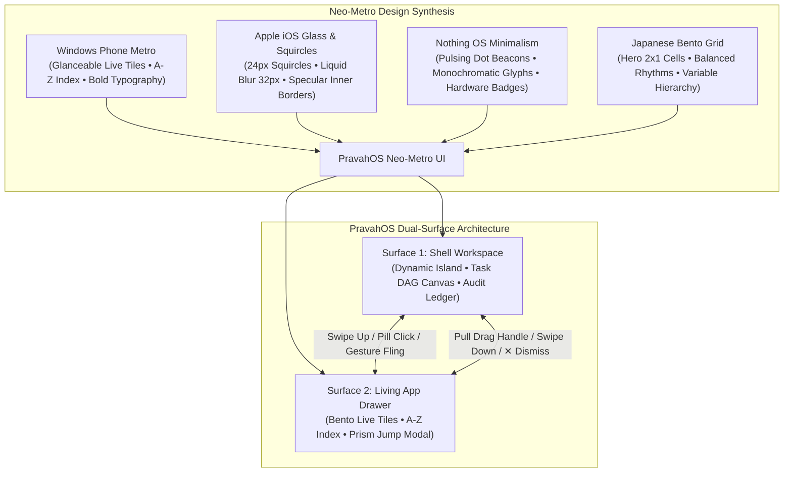
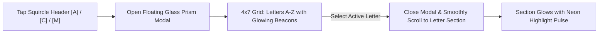
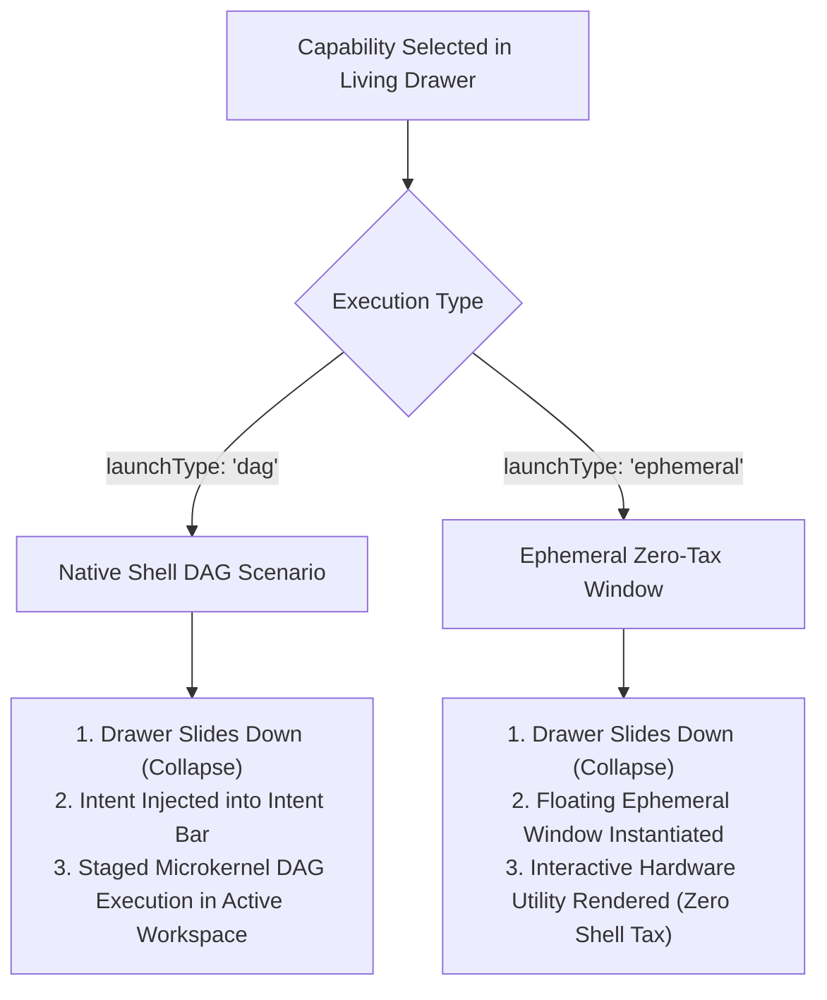

# Living App Drawer & Neo-Metro UI Subsystem

## 1. Neo-Metro Architectural Philosophy & Evolution

The **Living App Drawer** in PravahOS modernizes the flat, 2012 Windows Phone (Metro UI) aesthetic into a fresh, luxury **"Neo-Metro"** design language. Neo-Metro synthesizes the strongest visual philosophies in modern interface design:

1. **Windows Phone / Metro UI (Glanceability & Typography)** &mdash; Preserves the bold, typography-first hierarchy, A-Z index navigation, zero-chrome efficiency, and live informative surfaces that made Metro iconic.
2. **Apple iOS Dynamic Widgets & Glassmorphism** &mdash; Introduces organic super-ellipse squircle geometry (20px&ndash;26px radii), multi-pass liquid frosted glassmorphism (`backdrop-filter: blur(32px) saturate(210%)`), and subtle specular inner edge borders (`inset 0 1px 1px rgba(255, 255, 255, 0.28)`).
3. **Nothing OS Minimalist Aesthetics** &mdash; Integrates monochromatic glyphs, glowing status dot matrix beacons, and cryptographic hardware badges.
4. **Japanese Bento Grid Architecture** &mdash; Replaces monotonous rectangular grids with harmonious, variable-proportion modular bento cells: wide 2x1 hero tiles, medium status squares, and compact telemetry widgets.



---

## 2. Dual-Surface Navigation & Gesture Physics

### 2.1 Coordinated Triggers
The Living Drawer operates as a persistent, high-performance slide surface that can be invoked from multiple shell entry points:
- **Bottom Navigation Pill Bar (`.shell-drawer-nav`)**: A frosted glass floating pill (`backdrop-filter: blur(28px) saturate(200%)`) with an animated glowing neon handle that rests at the base of the viewport. Tapping it smoothly slides the Living Drawer into view.
- **Phone Chassis Home Bar (`.phone-home-pill`)**: Mirrors native hardware chassis gestures on mobile viewports.
- **Vertical Swipe-Up Gestures**:
  - Touch or pointer drag upward from the bottom 160px edge of the display.
  - Fling gesture recognition (`PRAVAH_GESTURE_FLING` with velocity $> 500\text{px/s}$).
- **Dismiss Gestures**:
  - Pulling down on the top grab handle (`#drawer-drag-header`) past the 120px threshold or with downward fling velocity $> 500\text{px/s}$.
  - Tapping the dismiss button (`#btn-drawer-dismiss`).
  - Pressing the hardware back/escape action.

### 2.2 Spring-Damped Slide Physics
The drawer slide motion is computed via damped spring equations (`cubic-bezier(0.16, 1, 0.3, 1)`) and interactive rubber-banding via `window.PravahMotion`:
```js
// Interactive downward drag tracking
const deltaY = Math.max(0, this.currentY - this.startY);
if (this.state === DrawerState.EXPANDED) {
  this.container.style.transform = `translateY(${deltaY}px)`;
}

// Fling / Velocity evaluation on release
const velocity = this.velocityTracker.getVelocity();
if (deltaY > 120 || velocity > 500) {
  this.collapse();
} else {
  this.expand();
}
```

---

## 3. Bento-Grid Dynamic Live Tiles

The top section of the Living Drawer features four dynamic glanceable Live Tiles structured as a luxury Japanese Bento Grid. Each tile is an interactive 3D card (`transform-style: preserve-3d; perspective: 1200px`) featuring real-time data engines and reverse-side microkernel telemetry.

```
+--------------------------------------------------------------------------+
|  GLANCEABLE LIVE TILES (BENTO GRID)                      [🔄 Flip Tiles] |
+--------------------------------------------------------------------------+
|  [🎵 AUDIO HAL (●)]  48kHz DIRECT DMA           [ 💽 ROTATING VINYL ]    |
|  Midnight City - M83                            (((~ soundwave ~)))      |
|  ||||| (5-Bar Real-Time Equalizer)              Lossless 24-bit Stream   |
+-------------------------------------------------+------------------------+
|  [✈ FLIGHT AI-202]  BOARDING (●)                | [🔋 SOC POWER] 88%     |
|  DEL ➔ BLR  •  Gate 14B                         | [================|   ] |
|  Countdown: 00:42:15  •  ((Radar Sweep))        | 14h 20m • 2.1W Neural  |
+-------------------------------------------------+------------------------+
|  [🛡️ AIR-GAP MESH]   [POST-QUANTUM]            [SEC] [Microchip Core]   |
|  SECURED OFFLINE (●)  •  ML-KEM-768 / Ed448     Hardware RF Killswitch   |
|  All 4 Radios Cut • Zero Telemetry Egress • EL1 Microkernel Locked       |
+--------------------------------------------------------------------------+
```

### 3.1 Tile Specifications & Dynamic Engines

| Tile ID | Layout Proportion | Title | Accent | Front Face Features | Reverse Face Telemetry | Dynamic Animation Engine |
| :--- | :--- | :--- | :--- | :--- | :--- | :--- |
| **`spotify`** | **Hero 2x1 Wide Bento** | Spotify Audio HAL | `#1db954` | Track title, artist, 48kHz Direct DMA badge, **Floating Rotating Vinyl Disc**, **7-Band Animated Soundwave Ribbon**, **5-Bar Hardware EQ**. | ALAC Lossless 24-bit/48kHz, Starnix DMA Sink, 0.8ms latency, 100% buffer locked. | Vinyl spins at 7s/rev; soundwave ribbon undulates continuously; equalizer bars tick every 450ms across normalized frequency range $[0.15, 0.98]$. |
| **`flight`** | **Square 1x1 Bento** | Flight AI-202 Radar | `#00e5ff` | Route (`DEL ➔ BLR`), Gate `14B`, Terminal `T3`, Boarding pulse pill, **Flight Radar Scope with 360° Sweep & Radar Blip**, **Second-by-Second Countdown**. | Airbus A350-900, BLR: 24°C Fair, Baggage Belt 04, 98.4% on-time record. | Radar sweep rotates at 3s/rev; radar blip pulses every 1.5s; departure countdown updates every 1000ms. |
| **`battery`** | **Square 1x1 Bento** | Power Fuel Gauge | `#00e676` | Battery percentage pill, **Glowing Energy Fuel Capsule with Gradient Fill Bar**, remaining runtime, SoC power draw, Neural Governor tag. | Anode nominal health (99%), cell temperature (31.4°C), cycle count (34), 65W SuperVOOC ready. | Real-time synchronization with PravahOS power telemetry and microkernel battery events. |
| **`airgap`** | **Wide 2x1 Bento** | Air-Gap Security Mesh | `#7c4dff` | Pulsing green cryptographic status dot, **Post-Quantum Chip Badge (`ML-KEM-768 / Ed448`)**, Hardware RF Killswitch badge, **Integrated Microchip Graphic**. | EL1 microkernel register lock, loopback intranet (127.0.0.1) only, block hash sealed, zero violations. | Direct hardware RF power rail synchronization with EL1 killswitch. |

### 3.2 Holographic 3D Parallax Tilt & Liquid Specular Sheen
Tiles respond dynamically to pointer and touch coordinates in real time:
- As the user glides a finger or mouse over a tile, the tile tilts smoothly along 3D axes (up to $\pm 7^\circ$) governed by normalized displacement:
  $$\theta_x = (y_{\text{norm}} - 0.5) \times -14^\circ, \quad \theta_y = (x_{\text{norm}} - 0.5) \times 14^\circ$$
- A liquid specular sheen (`radial-gradient` highlight) follows the pointer position across the tile surface:
  ```css
  .live-tile::after {
    content: '';
    position: absolute;
    inset: 0;
    border-radius: inherit;
    background: radial-gradient(circle 200px at var(--sheen-x, 50%) var(--sheen-y, 50%), rgba(255, 255, 255, 0.18), transparent 70%);
    pointer-events: none;
    mix-blend-mode: overlay;
  }
  ```
- Flipping tiles via `↻` or `[🔄 Flip Tiles]` preserves 3D perspective depth with smooth 180° rotation:
  $$\text{transform} = \text{perspective}(1000\text{px}) \cdot \text{rotateY}(180^\circ + \theta_y) \cdot \text{rotateX}(\theta_x)$$

---

## 4. Reimagined A-Z App & Capability Index

The bottom section of the Living Drawer modernizes the iconic Windows Phone alphabetical list into sleek, tactile ribbons with modern glyphs and responsive micro-interactions.

### 4.1 Sleek Glowing Squircle Letter Ribbons
- **Header Tiles (`.metro-letter-header-tile`)**: Organic 14px squircle buttons with translucent glass fills (`background: linear-gradient(135deg, rgba(0, 229, 255, 0.2), rgba(124, 77, 255, 0.25))`), vibrant cyan typography, and glowing active beacons (`.metro-letter-beacon`).
- **Category Ribbons (`.metro-letter-pill`)**: High-contrast, minimalist pill counters displaying the number of active capabilities registered under each letter.

### 4.2 Modern App Items & Micro-Interactions
- **App Items (`.metro-app-item`)**: Squircle cards with 18px radii, subtle specular inner highlights, and ambient drop shadows.
- **High-DPI App Glyphs (`.metro-app-icon-box`)**: 14px squircle icon backdrops with gradient colors, 3D specular shine (`.icon-specular-sheen`), and crisp emoji/SVG glyphs.
- **Nothing OS Status Badges (`.metro-launch-badge`)**:
  - `DAG` badge: Neon cyan border, ambient glow, and pulsing cyan micro-dot.
  - `ZERO-TAX` badge: Neon violet border, ambient glow, and pulsing purple micro-dot.
- **Haptic Micro-Bounce**: Tapping an app item triggers tactile compression (`@keyframes appLaunchBounce` scaling down to 0.94 and brightening) before dispatching the launch action.

### 4.3 Catalog Alphabetic Coverage
The catalog contains 14+ capabilities grouped under canonical letter buckets:
- **`[A]`**: Air-Gap Matrix Killswitch, Android Bridge (Starnix), Audit Ledger Inspector
- **`[C]`**: Camera IMX890 Pro, Crypto Remittance (USDC)
- **`[M]`**: Maps & GNSS Navigation, Memory Compactor
- **`[N]`**: Neural Voice Dictation, Notes & Vault
- **`[S]`**: Settings & Security Mesh, Spotify Lossless Audio
- **`[U]`**: Uber Ride Dispatch, UPI Fast Transfer (₹5,000)
- **`[W]`**: Weather & Barometer, WhatsApp Messenger

---

## 5. Floating Glass Prism Alphabet Fast-Jump Picker

Tapping any squircle letter header tile opens the **Floating Glass Prism Modal** (`#metro-jump-modal`):



### 5.1 Prism Modal Features
- **Prismatic Glass Chassis (`.glass-prism-card`)**: Multi-layer frosted glass with `backdrop-filter: blur(36px) saturate(220%)`, 26px squircle corners, and chromatic edge refraction (`.glass-prism-sheen`).
- **4x7 Jump Grid (`.metro-jump-grid`)**:
  - **Active Letters (`.tile-active`)**: Glowing squircle beacons illuminated with cyan/violet gradients, specular borders, active beacon dots (`.jump-beacon-dot`), and capability count badges.
  - **Inactive Letters (`.tile-inactive`)**: Subtly dimmed with zero egress to maintain clean visual rhythm.
- **One-Touch Navigation**: Tapping any active letter smoothly scrolls directly to that letter's section and illuminates it with a glowing neon pulse animation (`@keyframes metroJumpPulse`).

---

## 6. Dual Execution Model: DAG Cards vs. Ephemeral Windows

PravahOS supports two distinct execution paths upon launching an app or capability:



### 6.1 Native PravahOS DAG Card Execution (`launchType: 'dag'`)
For complex, multi-stage, or policy-gated workflows (e.g. Flight AI-202 itinerary, ₹5,000 UPI transfer, 250 USDC remittance, Camera IMX890 RAW pipeline):
1. living drawer collapses to return focus to the Shell Workspace.
2. The scenario executes across staged microkernel capability nodes with topological progress visualization.

### 6.2 Ephemeral Zero-Tax Window Execution (`launchType: 'ephemeral'`)
For rapid, glanceable utility tasks (e.g. toggling hardware RF switches, checking barometric pressure, inspecting the audit ledger, running offline voice dictation):
1. Managed by `EphemeralWindowManager`.
2. Instantiates a floating frosted-glass window (`.ephemeral-window`) with minimal overhead.
3. Provides specialized interactive capability cards:
   - **Air-Gap Matrix Killswitch**: Individual hardware radio toggles (5G NR, Wi-Fi 7, Bluetooth 5.4, NFC/UWB).
   - **Weather & Barometer**: 26°C hero readout, 1013.2 hPa atmospheric pressure, humidity, UV index.
   - **Audit Ledger Inspector**: Sealed SHA-256 hash verification, genesis block inspection, cryptographic ledger chain.
   - **Neural Voice Dictation**: INT8 offline speech transformer preview with dynamic spectrogram equalizer.

---

## 7. Verification & Automated Test Suite

The Living Drawer and Neo-Metro UI Subsystem is verified by an extensive automated test suite covering state machines, live tickers, search algorithms, and window managers:

```powershell
node --test ui/tests/drawer.test.js ui/tests/*.test.js
```

### 7.1 Test Coverage Highlights
- **State Machine Transitions**: `COLLAPSED` $\leftrightarrow$ `EXPANDED`, `toggle()`, transform style reflections, and callback notifications.
- **Bento Live Tiles**: 4 dynamic tile data structures, individual `flipTile()`, master `flipAll()`, 3D CSS class manipulation, normalized frequency bounds $[0.15, 0.98]$ for equalizer bars, countdown string formatting (`MM:SS` & `HH:MM`), and real-time telemetry updates.
- **Alphabetical Grouping & Search**: Alphabetical sorting, required canonical fast-jump headers (`[A]`, `[C]`, `[M]`, `[N]`, `[S]`, `[U]`, `[W]`), 26-letter metadata coverage, and instantaneous multi-attribute filtering.
- **Dual Launch Mechanics**: DAG scenario dispatch vs Ephemeral overlay window lifecycle (`openWindow`, `toggleMinimize`, `closeWindow`, `closeAll`).
- **Prism Fast-Jump Navigation**: Modal state toggling, letter jump target scrolling, and visual highlight pulses.

*Result: 98 tests passing with 0 failures across the complete PravahOS UI test suite.*
