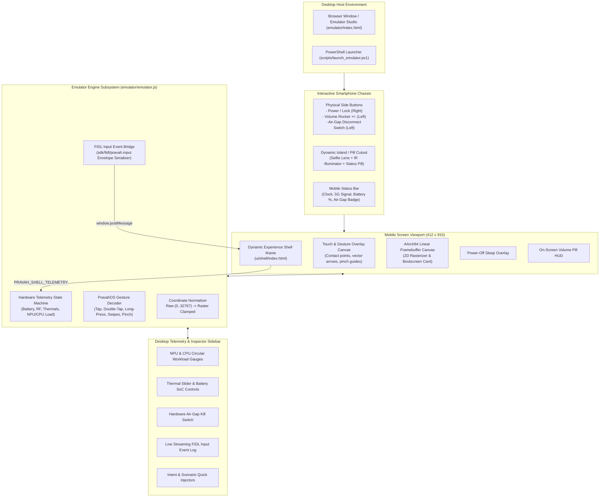

# PravahOS Graphical Mobile Phone Emulator & Device Shell

> **Target Platform:** Mobile-First Ambient Autonomous Systems  
> **Subsystem Location:** `emulator/` & `scripts/launch_emulator.ps1`  
> **Connected Subsystems:** [`ui/shell/`](file:///ui/shell/) (Dynamic Experience Shell), [`sdk/fidl/pravah.input/`](file:///sdk/fidl/pravah.input/) (FIDL Input Protocol), [`kernel/drivers/display/`](file:///kernel/drivers/display/) (Linear Framebuffer Rasterizer)

---

## 1. Executive Summary & Architectural Role

The **PravahOS Graphical Mobile Phone Emulator** provides an authentic, high-fidelity smartphone device window and interactive emulation environment on the desktop. It bridges the bare-metal microkernel input/display specifications directly to the **Dynamic Experience Composer (DEC)** and user-space shell.

Engineered with a flagship mobile hardware form-factor, the emulator provides:
1. **Interactive Flagship Hardware Chassis:** Dark titanium chassis with 44px rounded glass corners, stereo speaker acoustic grilles, Dynamic Island pill cutout with state expansion animations, and tactile hardware buttons (Power/Lock, Volume Rockers, and Physical Air-Gap Disconnect switch).
2. **True Mobile Viewport & Presets:** Native support for standard smartphone screen aspect ratios (**412 × 915** 20:9 default, **390 × 844** 19.5:9 compact, and **720 × 1600** HD+ panel) with high-DPI scaling and orientation toggling.
3. **PravahOS Multi-Touch Gesture Engine:** Hardware coordinate normalization ($0 \dots 32767 \to 412 \times 915$) and integer-only gesture recognition tracking single and multi-touch contacts for Tap, Double-Tap, Long-Press, High-Speed Directional Swipes, and Two-Finger Pinch-to-Zoom.
4. **Live Hardware Telemetry HUD:** Real-time monitoring and control of physical battery state of charge (SoC), 5G RF signal status, SoC thermal sensor with dynamic throttling state detection, dual circular NPU/CPU load gauges, and hardware air-gap isolation.
5. **Bidirectional DEC Shell Bridge:** Seamless two-way integration with [`ui/shell/`](file:///ui/shell/), allowing desktop mouse and touch interactions to drive DAG task execution, policy gate approval modals, tamper-evident audit ledger inspection, and authority level transitions.
6. **Dual Display Modes:** Instant toggle between interactive live user-space DEC Shell and EL1 bare-metal linear framebuffer scanout rendering bootscreen telemetry cards.

---

## 2. System Architecture



---

## 3. Physical Device Chassis & Display Geometry

### 3.1 Hardware Enclosure Specifications

| Element | Geometry / Styling | Functional Behavior |
| :--- | :--- | :--- |
| **Chassis Body** | Brushed titanium rim (`#242c3d` to `#0d1118`), 56px outer radius, beveled specular edge | Hosts tactile side buttons, speaker ports, and high-DPI display |
| **Screen Glass** | 44px inner radius, anti-reflective OLED black boundary (`#070b12`) | Displays mobile applications at true smartphone aspect ratio |
| **Dynamic Island** | 120px × 32px pill cutout with dual camera lens and IR flood illuminator | Expands dynamically to 220px on events (Air-gap cut, gestures, voice listening); click expands hardware security sheet |
| **Power Button** | 5px × 64px physical button on right rail | Tap: Screen sleep/wake with fade transition; Long-press (>=850ms): Pops PravahOS Power Menu ("Lock Device", "Reboot Microkernel", "Air-Gap Cut") |
| **Volume Rocker** | Dual 5px × 52px buttons on left rail | Click: Modifies system audio level (0..100) and summons floating iOS/Android-style side volume pill HUD |
| **Air-Gap Switch** | 6px × 48px tactile toggle switch with integrated dual-state LED | Physical kill switch: Disconnects 5G/Wi-Fi/Bluetooth at PHY layer; LED glows emerald green when isolated, crimson red when active |

### 3.2 Display Viewport Presets

The emulator supports multiple standardized mobile device presets:

```javascript
const DevicePresets = {
  'pixel8':   { name: 'Pravah Phone 1 (Default)', width: 412, height: 915,  ratio: '20:9',   radius: 44 },
  'iphone15': { name: 'Pravah Mini',              width: 390, height: 844,  ratio: '19.5:9', radius: 48 },
  'hdplus':   { name: 'Pravah HD+ Panel',         width: 720, height: 1600, ratio: '20:9',   radius: 40 }
};
```

---

## 4. Multi-Modal Touch & Gesture Decoding Engine

The emulator implements the mathematical specifications defined in [`INPUT.md`](file:///INPUT.md):

### 4.1 Coordinate Normalization Formula

Digitizer hardware coordinates ($0 \dots 32767$) are clamped and translated to physical screen pixels:

$$\text{screen}_x = \left\lfloor \frac{(\text{clamp}(\text{raw}_x, \min_x, \max_x) - \min_x) \times (\text{display}_w - 1)}{\max_x - \min_x} \right\rfloor$$

$$\text{screen}_y = \left\lfloor \frac{(\text{clamp}(\text{raw}_y, \min_y, \max_y) - \min_y) \times (\text{display}_h - 1)}{\max_y - \min_y} \right\rfloor$$

### 4.2 Integer Distance Formula

To maintain strict parity with bare-metal kernel code compiled under `-mgeneral-regs-only`, distances are evaluated using integer Euclidean distance:

$$\text{dist}(P_1, P_2) = \text{round}\left( \sqrt{(x_2 - x_1)^2 + (y_2 - y_1)^2} \right)$$

### 4.3 Gesture Recognition Thresholds & State Machine

| Gesture | Parameters & Preconditions | Recognition Logic | FIDL Event Emitted |
| :--- | :--- | :--- | :--- |
| **Tap** | $\Delta d \le 25\text{ px}$, duration $t \le 300\text{ ms}$ | Finger released without significant movement | `GestureType::TAP` |
| **Double-Tap** | Preceded by Tap within $\Delta t \le 350\text{ ms}$, $\Delta d \le 35\text{ px}$ | Second sequential tap within bounding box | `GestureType::DOUBLE_TAP` |
| **Long-Press** | Stationary touch with drift $\Delta d \le 25\text{ px}$ | Timer expires after $t \ge 500\text{ ms}$ of continuous contact | `GestureType::LONG_PRESS` |
| **Swipe Right** | $\Delta d \ge 60\text{ px}$, $t \le 600\text{ ms}$, $|\Delta x| \ge |\Delta y|$, $\Delta x > 0$ | High-speed horizontal sweep | `GestureType::SWIPE_RIGHT` |
| **Swipe Left** | $\Delta d \ge 60\text{ px}$, $t \le 600\text{ ms}$, $|\Delta x| \ge |\Delta y|$, $\Delta x < 0$ | High-speed horizontal sweep | `GestureType::SWIPE_LEFT` |
| **Swipe Down** | $\Delta d \ge 60\text{ px}$, $t \le 600\text{ ms}$, $|\Delta y| > |\Delta x|$, $\Delta y > 0$ | High-speed vertical sweep | `GestureType::SWIPE_DOWN` |
| **Swipe Up** | $\Delta d \ge 60\text{ px}$, $t \le 600\text{ ms}$, $|\Delta y| > |\Delta x|$, $\Delta y < 0$ | High-speed vertical sweep | `GestureType::SWIPE_UP` |
| **Pinch-to-Zoom** | Two active contact slots, distance change $|\Delta D| \ge 20\text{ px}$ | Ratio of current distance to initial distance | `GestureType::PINCH_ZOOM` ($\text{scale} \times 1000$) |

### 4.4 Desktop Multi-Touch Pinch Simulation

Because desktop development environments utilize single-pointer mice, the emulator provides two simulation vectors:
1. **Alt / Shift Key Drag:** Holding the `Alt` or `Shift` key while clicking and dragging automatically spawns two symmetric touch contact points around the cursor, simulating physical two-finger pinch-in (zoom out) and pinch-out (zoom in).
2. **Mouse Wheel / Trackpad Gesture:** Rolling the mouse wheel with `Ctrl` or `Alt` held emits high-resolution `PINCH_ZOOM` gesture events with focal point positioning.
3. **Pinch Mode Toggle Button:** A dedicated toolbar button latches pinch mode for touchpads without multi-touch driver support.

---

## 5. Live Hardware Status HUD & Physical Air-Gap Disconnect

### 5.1 Telemetry Components

1. **Air-Gap Physical Isolation Indicator:**
   - Default: **`SECURED OFFLINE`** (Strict PravahOS architectural mandate).
   - In offline mode, the mobile status bar displays `✕ RADIO CUT`, and the physical Air-Gap LED illuminates emerald green.
   - When toggled online, network switches to `5G UW` with 4-bar signal representation, and the LED switches to red.
2. **Neural Processing Unit (NPU) Load Dial:**
   - SVG circular progress dial displaying 0..100% active tensor engine utilization.
   - Fluctuates dynamically during on-device LLM reasoning and DAG task planning.
3. **CPU Load & SoC Thermal Sensor:**
   - Real-time ARM Cortex-A78 load dial.
   - SoC temperature slider ($30^\circ\text{C} \dots 85^\circ\text{C}$) driving automatic thermal throttling classification:
     - $< 48^\circ\text{C}$: **`NOMINAL`** (Normal execution)
     - $48^\circ\text{C} \dots 61^\circ\text{C}$: **`WARM`** (Slight clock downclocking)
     - $62^\circ\text{C} \dots 74^\circ\text{C}$: **`THROTTLING`** (Heavy throttling, duty-cycled inference)
     - $\ge 75^\circ\text{C}$: **`CRITICAL`** (Emergency load shed)
4. **Battery SoC & Fast-Charging Simulation:**
   - 0..100% State-of-Charge (SoC) slider.
   - Color-coded battery icon: Crimson red at $\le 20\%$, emerald green when fast charging (USB-C PD 65W active).

---

## 6. Dynamic Shell (`ui/shell/`) Integration & IPC Bridge

The emulator establishes a bidirectional postMessage and DOM event bridge with the embedded PravahOS Dynamic Experience Shell:

### 6.1 Emulator-to-Shell Command Protocol

| Message Type | Payload Structure | Action in DEC Shell |
| :--- | :--- | :--- |
| `PRAVAH_SET_AIRGAP` | `{ offline: boolean }` | Toggles air-gap indicator badge and local-only network routing |
| `PRAVAH_SET_AUTHORITY` | `{ authority: 'OBSERVE'\|'PREPARE'\|'EXECUTE'\|'MANAGE' }` | Updates runtime authorization tier |
| `PRAVAH_SET_TELEMETRY` | `{ telemetry: { npu, cpu, temp } }` | Updates shell ambient telemetry header readings |
| `PRAVAH_TRIGGER_SCENARIO`| `{ scenario: 'flight'\|'payment'\|'memory'\|'ocr' }` | Loads scenario DAG and executes topological task planning |
| `PRAVAH_EXECUTE_INTENT` | `{ intent: string }` | Injects natural language intent into input bar and submits |
| `PRAVAH_DECISION` | `{ approved: boolean }` | Submits approval or denial for consequential policy gates |
| `PRAVAH_INPUT_EVENT` | `{ event: InputEvent }` | Dispatches typed FIDL input event into shell event stream |

### 6.2 Shell-to-Emulator Telemetry Feedback

When the shell executes tasks or undergoes autonomous status updates, it transmits a `PRAVAH_SHELL_TELEMETRY` message back to the phone emulator window:

```json
{
  "type": "PRAVAH_SHELL_TELEMETRY",
  "state": {
    "offline": true,
    "authority": "EXECUTE",
    "telemetry": {
      "npu": 68,
      "cpu": 34,
      "temp": 44,
      "memUsed": 512,
      "memTotal": 2048
    },
    "currentTask": "Flight AI-202 Status & Departure Calendar Notification"
  }
}
```

The emulator instantly updates the Dynamic Island text, battery gauges, and circular dials to match.

---

## 7. Linear Framebuffer Canvas Scanout Mode

In addition to hosting the user-space DEC Shell, the emulator features an integrated **AArch64 Linear Framebuffer Rasterizer** (`FramebufferRenderer`).

When switched to `⊞ Framebuffer` mode via the top toolbar:
- The emulator switches scanout to a hardware-accelerated 2D canvas running at device native resolution ($412 \times 915 \times \text{DPI}$).
- Renders the authentic early-boot diagnostics display conforming to [`DISPLAY.md`](file:///DISPLAY.md):
  - Geometric Hexagon Ring Emblem & PravahOS brand logo
  - Microgrid matrix raster background
  - Diagnostic hardware validation card (ARMv9 Cortex-A78, PMM DRAM, GICv3 interrupt controller, ARGB8888 60Hz double buffer)
  - Framebuffer boot progress indicator

---

## 8. Standalone Launcher & Quick Start

### 8.1 Launch via PowerShell

To start the emulator in your default web browser:

```powershell
# Default launch (Pravah Phone 1, 412x915, Port 8085)
.\scripts\launch_emulator.ps1

# Launch Compact Flagship Profile (390x844)
.\scripts\launch_emulator.ps1 -Preset iphone15

# Launch HD+ Panel Profile (720x1600)
.\scripts\launch_emulator.ps1 -Preset hdplus

# Direct File Mode (opens index.html directly without background server)
.\scripts\launch_emulator.ps1 -DirectFile
```

### 8.2 Launcher Dashboard Landing Page

Access the launcher dashboard at:
```
emulator/launch.html
```
Provides visual cards to launch any preset resolution with a single click.

---

## 9. Automated Test Verification

The emulator includes an automated test suite verifying all math, gesture decoding, FIDL envelope serialization, and hardware HUD state transitions.

Run the test suite using Node.js:

```bash
node --test emulator/tests/emulator.test.js
```

### Test Suite Coverage Summary

| Test Suite | Test Cases | Status |
| :--- | :--- | :--- |
| **Coordinate Normalization & Math** | Boundary mapping ($0 \dots 32767 \to 412 \times 915$), hardware clamping, axis inversion, integer Euclidean distance | **PASS** (4/4) |
| **Gesture Recognition Engine** | Single Tap, Double-Tap separation, Long-Press hold & timer, Long-Press drift cancellation, Directional Swipes (Up/Down/Left/Right) with velocity, Multi-Touch Pinch-to-Zoom | **PASS** (6/6) |
| **FIDL Input Event Bridge** | Typed `TouchEvent` packet, `GestureEvent` union packing, circular bounded log buffer resilience | **PASS** (3/3) |
| **Hardware HUD & Telemetry** | Default air-gap enforcement, physical kill switch toggling, 4-tier thermal throttle states, battery SoC clamping, NPU/CPU dial clamping, screen power toggle | **PASS** (6/6) |
| **Device Presets** | Pixel 8 (412x915), iPhone 15 Pro (390x844), HD+ Panel (720x1600) | **PASS** (1/1) |
| **Total Test Pass Rate** | **20 / 20 Tests Passed (100%)** | **PASS** |

---

## 10. File Inventory & Locations

- [`emulator/index.html`](file:///emulator/index.html): Phone chassis, Dynamic Island, hardware buttons, mobile status bar, and desktop telemetry sidebar.
- [`emulator/style.css`](file:///emulator/style.css): Titanium frame styling, realistic beveled edges, Dynamic Island animations, and dark desktop engineering theme.
- [`emulator/emulator.js`](file:///emulator/emulator.js): Core emulator application controller, `GestureDecoder`, `HardwareHUD`, `InputEventBridge`, and `FramebufferRenderer`.
- [`emulator/launch.html`](file:///emulator/launch.html): Quick-start landing dashboard.
- [`emulator/tests/emulator.test.js`](file:///emulator/tests/emulator.test.js): Automated unit test suite with 20 test cases.
- [`scripts/launch_emulator.ps1`](file:///scripts/launch_emulator.ps1): Cross-platform PowerShell launcher script with Node.js and .NET HTTP server fallbacks.
- [`ui/shell/style.css`](file:///ui/shell/style.css): Mobile responsive rules for seamless 412px viewport scaling.
- [`ui/shell/shell.js`](file:///ui/shell/shell.js): Bidirectional IPC bridge listener and telemetry synchronization.
