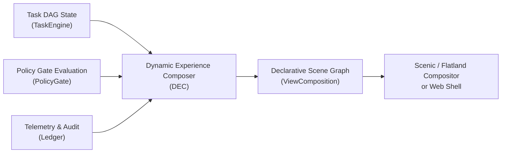
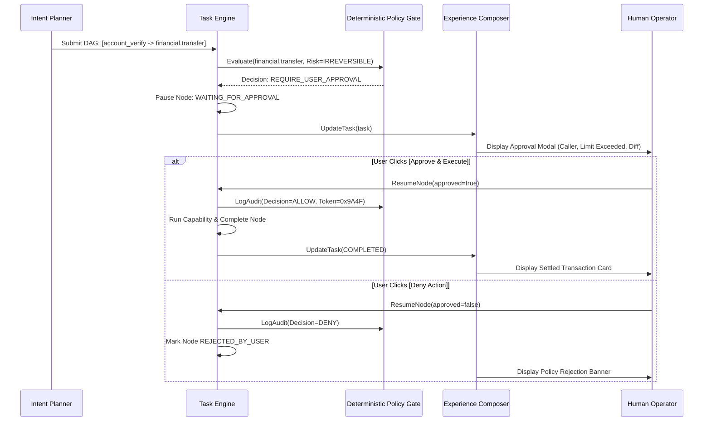

# PravahOS Dynamic Experience Composer (DEC) & UI Architecture

> **Declarative • Dynamic Workspaces • Deterministic Safety Gates • Tamper-Evident**

---

## 1. Architectural Philosophy

Traditional operating systems structure user experience around rigid application silos and static desktop windows. When an agentic or autonomous system operates within such a legacy paradigm, user agency is degraded: either tasks run invisibly in a "black box" background terminal, or the user is overwhelmed with disjointed application windows and uncontrolled prompts.

**PravahOS eliminates the application silo.** 

Instead of launching separate applications for flights, calendars, banking, and system settings, the user declares a high-level goal in the **Unified Intent Bar**. The **Dynamic Experience Composer (DEC)** dynamically constructs an ephemeral visual **Workspace** composed directly from the **Task Directed Acyclic Graph (DAG)**.

```
+-----------------------------------------------------------------------------------+
|                        DYNAMIC EXPERIENCE COMPOSER (DEC)                          |
|         Ambient Views  •  Intent Inputs  •  Dynamic Workspaces  •  Scenic/Flatland|
+-----------------------------------------------------------------------------------+
                                          ▲
                                          │ FIDL: pravah.ui.ExperienceComposer
+-----------------------------------------┴-----------------------------------------+
|                        UNIFIED INTELLIGENCE AUTHORITY (UIA)                       |
|   Deterministic Policy Engine • Task Graph Runtime • Context/Memory Coordinator   |
+-----------------------------------------┬-----------------------------------------+
       │ FIDL                                    │ FIDL                        │ FIDL
       ▼                                         ▼                             ▼
+-----------------------------+   +-----------------------------+   +---------------+
| SPECIALIST INFERENCE FABRIC |   |  CAPABILITY & RESOURCE FABRIC|   | CONTEXT/MEMORY|
+-----------------------------+   +-----------------------------+   +---------------+
```

### Core Design Tenets
1. **Explainable Autonomy:** Every multi-step autonomous plan is presented visually as a topological DAG, showing step dependencies, execution state (`PENDING`, `RUNNING`, `COMPLETED`, `WAITING_FOR_APPROVAL`), and output cards.
2. **Deterministic Human-in-the-Loop:** Actions classified as `IRREVERSIBLE` or `CONSEQUENTIAL` deterministically halt execution and raise a high-contrast **Policy Gate Approval Modal** containing exact parameter diffs, caller attribution, and risk assessments.
3. **Ambient Privacy & Integrity:** The system continuously displays air-gapped status, active authority bounds, on-device hardware telemetry, and a cryptographically linked SHA-256 audit ledger.

---

## 2. Declarative UI Component Specification

All UI visual trees generated by the DEC conform to a formal declarative contract defined in:
- **FIDL Protocol:** [`sdk/fidl/pravah.ui/ui.fidl`](file:///L:/projectz/OS/sdk/fidl/pravah.ui/ui.fidl)
- **JSON Schema:** [`ui/schema/ui_schema.json`](file:///L:/projectz/OS/ui/schema/ui_schema.json)
- **JavaScript Core:** [`ui/schema/components.js`](file:///L:/projectz/OS/ui/schema/components.js)

### 2.1 Core Component Types

| Component Type | Description | Target Surface |
| :--- | :--- | :--- |
| `ROOT_CONTAINER` | Scene graph container aggregating multiple surfaces | System Canvas |
| `AMBIENT_HEADER` | Always-visible air-gap indicator, authority level, and hardware telemetry | Ambient Bar |
| `INTENT_BAR` | Natural language voice & text intent capture with contextual chips | Intent Surface |
| `WORKSPACE` | Dynamically composed visual container for an active task DAG | Workspace Canvas |
| `DAG_VIEW` | Topological layout container organizing execution steps into dependency stages | Workspace Canvas |
| `DAG_NODE` | Individual capability execution card displaying status, risk, and output | DAG View |
| `CAPABILITY_CARD` | Formatted visual card for capability output (flights, receipts, reminders) | DAG Node |
| `APPROVAL_MODAL` | Modal dialog blocking irreversible operations until human confirmation | Modal Layer |
| `DIFF_VIEWER` | Key-value parameter diff displaying caller identity, reasons, and tokens | Approval Modal |
| `AUDIT_VIEWER` | Tamper-evident ledger inspector verifying cryptographic hash chains | Audit Drawer |

### 2.2 Visual Semantic Safety Hierarchy

To prevent cognitive ambiguity during autonomous execution, PravahOS strictly enforces a visual color taxonomy:

| Visual Variant | Semantics | Typical Usage |
| :--- | :--- | :--- |
| `DEFAULT` / `NEUTRAL` | Passive metadata | Borders, stage labels, structural containers |
| `PRIMARY` | Primary system interaction | Default intent buttons, standard metrics |
| `ACCENT` (`#00e5ff`) | Active computation | Running DAG node, pulsing voice mic, glow states |
| `SUCCESS` (`#00e676`) | Completed / Verified | Completed DAG nodes, valid SHA-256 audit chains, Air-gap active |
| `WARNING` (`#ffab00`) | Gated execution / Caution | `WAITING_FOR_APPROVAL`, consequential mutation warnings |
| `DANGER` (`#ff1744`) | Irreversible risk / Policy denial | Blocked nodes, tampered hash chains, destructive operation gates |

---

## 3. Dynamic Experience Composer (`ui/composer/`)

The DEC is implemented in [`ui/composer/composer.js`](file:///L:/projectz/OS/ui/composer/composer.js) with topological layout calculations in [`ui/composer/dag_layout.js`](file:///L:/projectz/OS/ui/composer/dag_layout.js).



### 3.1 Topological DAG Stage Leveling
The composer calculates the depth of each node in the DAG using dependency graph traversal:
$$\text{Depth}(u) = \begin{cases} 0 & \text{if } \text{dependencies}(u) = \emptyset \\ \max_{v \in \text{dependencies}(u)} \left(\text{Depth}(v) + 1\right) & \text{otherwise} \end{cases}$$

Nodes with identical depths are grouped into parallel visual stages, guaranteeing clean horizontal flow without tangled dependency crossings.

### 3.2 Dynamic State Transitions
As the TaskEngine advances a task, the DEC continuously emits updated visual elements:
- `PENDING`: Displayed with a dashed border and dimmed opacity.
- `RUNNING`: Highlighted with an active cyan glow and animated pulse.
- `WAITING_FOR_APPROVAL`: Highlights the node with amber warning styling and automatically opens the Policy Gate Approval Modal.
- `COMPLETED`: Renders a green success badge and transforms the node's output into a domain-specific capability card (e.g. flight boarding card, financial transaction receipt, calendar reminder).
- `FAILED` / `BLOCKED_BY_POLICY`: Displays an error banner specifying the policy constraint or capability exception.

---

## 4. Policy Gate Human Confirmation Flow

For operations where safety or financial integrity is consequential:



---

## 5. Tamper-Evident Cryptographic Audit Ledger

The DEC includes an integrated cryptographic audit inspector. Every policy evaluation and capability execution creates a sequentially linked block with a SHA-256 hash:
$$H_i = \text{SHA256}(\text{seq}_i \mathbin{\Vert} \text{timestamp}_i \mathbin{\Vert} \text{caller}_i \mathbin{\Vert} \text{action}_i \mathbin{\Vert} \text{decision}_i \mathbin{\Vert} \text{token}_i \mathbin{\Vert} H_{i-1})$$

The DEC verifies this chain on every render. If any entry is modified out-of-band:
1. The chain breaks at the corrupted block index.
2. The UI instantly flips the audit badge to `✖ TAMPER DETECTED`.
3. The affected block is highlighted in red, proving non-repudiation.

---

## 6. Standalone Interactive OS Web Shell (`ui/shell/`)

The web shell in [`ui/shell/index.html`](file:///L:/projectz/OS/ui/shell/index.html) is an interactive demonstration of PravahOS. It operates with zero external dependencies and includes:

1. **Ambient Header:**
   - Air-Gap Toggle ("SECURED OFFLINE" / "ONLINE")
   - Authority Level Selector (`OBSERVE`, `PREPARE`, `EXECUTE`, `MANAGE`)
   - Real-time ticking hardware telemetry (NPU load, CPU temperature, Secure RAM).
2. **Intent Bar:**
   - Text input supporting natural language goals.
   - Microphone button simulating on-device voice recognition.
   - Pre-packaged scenario chips:
     - *Flight AI-202 & Reminder:* Multi-step autonomous flow.
     - *Transfer ₹5,000:* Consequential mutation triggering Policy Gate.
     - *Compact Secure Memory:* On-device autonomous maintenance.
     - *Receipt OCR & Privacy Redact:* Neural document vision with PII redaction.
3. **Task Workspace:**
   - Live topological DAG stages with animated state transitions.
   - Capability result cards displaying structured outputs.
4. **Policy Gate Approval Modal:**
   - High-contrast alert with parameter diff and deterministic reason.
   - Interactive `[Approve & Execute]` and `[Deny Action]` buttons.
5. **Tamper-Evident Audit Inspector:**
   - Real-time SHA-256 blockchain-style log.
   - `[Simulate Tamper]` button demonstrating instantaneous tamper detection.
   - `[Re-seal Ledger]` button demonstrating integrity restoration.

---

## 7. Verification & Automated Test Suite

The Dynamic Experience Composer and UI schemas are verified through Node.js test suites:

```powershell
# Run DEC & UI Schema unit tests
node --test ui/tests/*.test.js

# Run full system test suite (Runtime + Inference + Memory + UI)
node --test runtime/tests/*.test.js ui/tests/*.test.js
```

### Test Coverage Highlights:
- **UI Element Serialization:** Verifies JSON export and schema conformances.
- **DAG Layout Topological Stage Calculation:** Validates linear and fan-out/diamond graphs.
- **Dynamic Task State Rendering:** Tests transitions across `PENDING`, `RUNNING`, `WAITING_FOR_APPROVAL`, `COMPLETED`, and `BLOCKED_BY_POLICY`.
- **Policy Gate Modal Composition:** Verifies risk badges, parameter diffs, and action triggers.
- **Cryptographic Audit Chain Integrity:** Tests valid hash chains and detects simulated block corruptions.
