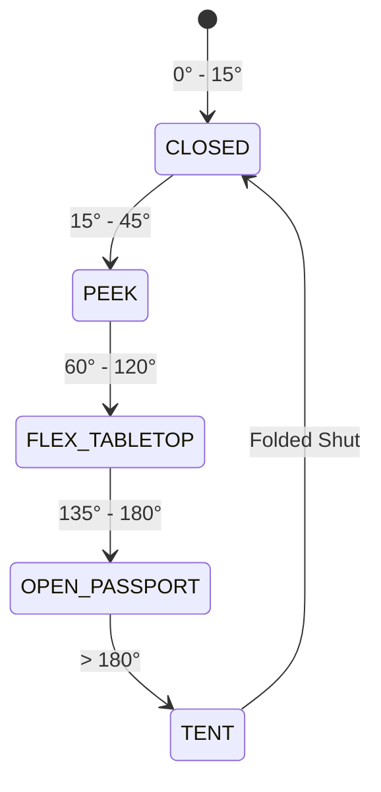

# PravahOS Foldable, Flip & Passport Form Factor Architecture

## 1. Executive Summary

Traditional mobile platforms treat foldable hardware as an afterthought, stretching single-column mobile UIs over wide tablet screens or relying on fragile application-level letterboxing.

**PravahOS** introduces a first-class, microkernel-integrated **Foldable & Passport Architecture** designed for continuous hinge state tracking, zero-idle-power display rail gating, and dual-spine adaptive capability orchestration.

---

## 2. Hardware Hinge Subsystem (`kernel/include/kernel/hal/hinge.h`)

The Hinge HAL interfaces with physical hall-effect angle sensors and IMU sensors on the chassis to calculate real-time angular metrics with hardware hysteresis:



### Discrete Posture States:
1. **`HINGE_POSTURE_CLOSED` ($0^\circ \dots 15^\circ$)**:
   - The device is folded shut.
   - Microkernel gates the inner LTPO OLED power rail to **0.0V**, guaranteeing 0 active watts when idle.
   - The outer cover screen renders the primary single-column shell.
2. **`HINGE_POSTURE_PEEK` ($15^\circ \dots 45^\circ$)**:
   - Slight opening of the hinge.
   - Used for quick glanceable notifications or discreet edge tickers without waking the full panel.
3. **`HINGE_POSTURE_FLEX_TABLETOP` ($60^\circ \dots 120^\circ$)**:
   - The device is rested on a table in an L-shape posture.
   - Viewport automatically bisects along the horizontal crease:
     - *Top Viewport*: Camera viewfinder, media playback, or video stream.
     - *Bottom Deck*: Virtual touch keyboard, trackpad, or telemetry controls.
4. **`HINGE_POSTURE_OPEN_PASSPORT` ($135^\circ \dots 180^\circ$)**:
   - The device is fully unfolded into the wide 4:3 Passport booklet canvas.
   - Activates the **Dual-Spine Adaptive Canvas**.
5. **`HINGE_POSTURE_TENT` ($> 180^\circ$)**:
   - Reverse fold rested on chassis edges for hands-free presentations or bedside clock mode.

---

## 3. Why the "Passport" (4:3) Aspect Ratio?

Modern "tall" smartphones ($20:9$ or $22:9$) are engineered primarily for infinite vertical feeds (TikTok, Instagram Reels). They are suboptimal for:
- Reading long documents or technical documentation without eye fatigue.
- Inspecting cryptographic hash chains and audit ledgers.
- Comparing parallel capability outputs side-by-side.
- Intent planning and interactive DAG inspection.

The **Passport Booklet Form Factor** ($780 \times 680$, aspect ratio $1.15 \dots 1.33$) recreates the ergonomic dimensions of a classic passport or pocket notebook:
- Wide enough to display full tabular data without horizontal clipping.
- Expansive enough to present AI intent planning on the left while simultaneously interacting with real-time outputs on the right.

---

## 4. Dual-Spine Adaptive Canvas (`ui/shell/style.css`)

When `body.passport-mode` is activated (via hardware sensor or emulator toggle), the UI Composer reorganizes the DOM into two complementary spines separated by a central OLED seam:

```
+-----------------------------------------------------------------------------------+
|                         AMBIENT STATUS HEADER & TELEMETRY                         |
+-----------------------------------------------------------------------------------+
|               ASK PRAVAH INTENT BAR (Full-Width Natural Language Input)           |
+-----------------------------------------┬---┬-------------------------------------+
|         SPINE A (Left Canvas)           | S |        SPINE B (Right Canvas)       |
| • Dynamic Island                        | E | • Interactive Boarding Pass & QR    |
| • Task DAG Planning Canvas              | A | • 48kHz Spotify Lossless Vinyl      |
| • Dependency Node Checkpoints           | M | • Physical Air-Gap Killswitch Grid  |
| • Execution Progress Fill Track         |   | • Tamper-Evident SHA-256 Ledger     |
+-----------------------------------------┴---┴-------------------------------------+
```

### Crease Mitigation Shader:
At the central fold seam ($x = 50\%$), the display compositor renders a specular gradient shadow (`.hinge-bezel-shadow`) with anti-crease OLED pixel warping to prevent optical distortion across the physical fold curve.

---

## 5. FIDL Display Protocol (`sdk/fidl/pravah.display/display.fidl`)

```fidl
type DisplayAspectRatio = strict enum : uint8 {
    RATIO_20_9           = 0;  // Standard modern mobile (412x915)
    RATIO_19_5_9         = 1;  // Compact mobile (390x844)
    RATIO_16_9           = 2;  // Desktop widescreen
    RATIO_16_10          = 3;  // Tablet
    RATIO_CUSTOM         = 4;  // Arbitrary custom geometry
    RATIO_PASSPORT_4_3   = 5;  // Unfolded Passport Booklet (780x680, 4:3)
    RATIO_PASSPORT_1_1   = 6;  // Square Passport (1:1)
    RATIO_FOLD_TABLETOP  = 7;  // 90° Flex tabletop split
};

type HingePosture = strict enum : uint8 {
    CLOSED          = 0;
    PEEK            = 1;
    FLEX_TABLETOP   = 2;
    OPEN_PASSPORT   = 3;
    TENT            = 4;
};
```

---

## 6. Testing & Emulation

Run the automated foldable test suite:
```powershell
node --test ui/tests/foldable.test.js
```

In the interactive emulator ([`emulator/index.html`](emulator/index.html)):
- Click **`[ 📱 Slab ]`** to test standard monolithic candybar mode ($412 \times 915$).
- Click **`[ 📖 Passport ]`** to test the 4:3 unfolded dual-spine canvas ($780 \times 680$).
- Click **`[ 📐 Flex ]`** to test the 90° tabletop mode with 3D perspective tilt.
