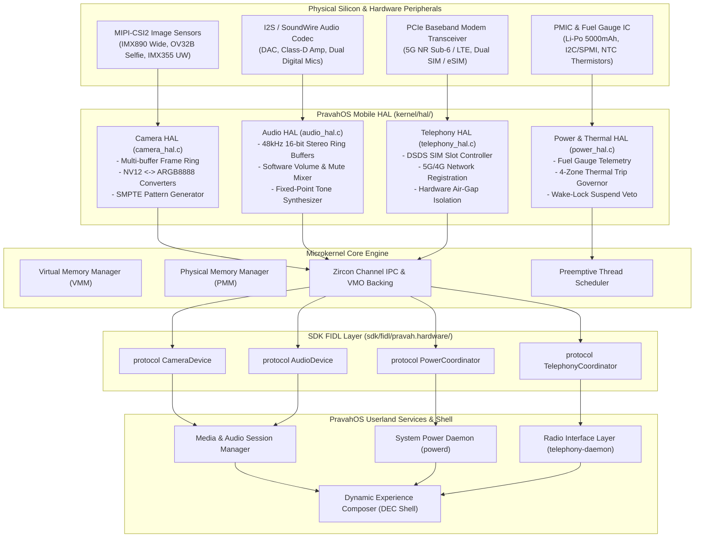

# PravahOS Mobile Hardware Abstraction Layer (HAL) & Device Interfaces

## 1. Executive Summary

The **PravahOS Mobile Hardware Abstraction Layer (HAL)** establishes a clean, decoupled boundary between bare-metal silicon drivers and user-space intent services. Operating within a Zircon-compatible microkernel architecture on ARM64 (`aarch64-none-elf`), the Mobile HAL encapsulates mobile-native peripherals:
- **Camera Sensor Stream & ISP Capture Pipeline (`camera_hal.c` / `camera.h`):** Multi-sensor frame buffer pools, format conversion (NV12 semi-planar YUV420 $\leftrightarrow$ ARGB8888), exposure/ISO tuning, and SMPTE test pattern synthesis.
- **Audio PCM Subsystem & Mixer (`audio_hal.c` / `audio.h`):** 48kHz 16-bit signed stereo playback and capture ring buffers, multi-endpoint routing (Speaker, Earpiece, Headset, Bluetooth), software volume scaling, and integer fixed-point acoustic sine synthesis.
- **Power Management & Thermal Governor (`power_hal.c` / `power.h`):** Battery fuel-gauge telemetry (SoC %, terminal mV, charge current mA, health), 4-zone thermal governor (CPU, GPU, Battery, Skin) with multi-tier trip points, and dynamic power states (`ACTIVE`, `IDLE`, `SUSPEND`) arbitrated via kernel wake-locks.
- **Cellular Telephony & Baseband Modem (`telephony_hal.c` / `telephony.h`):** Dual-SIM Dual-Standby (DSDS), 5G-NR Sub-6 / 4G-LTE network registration, 3GPP RSSI signal bar mapping, and hardware-isolated offline air-gap (flight) mode for zero-click radio defense.
- **Declarative FIDL Hardware Protocols (`sdk/fidl/pravah.hardware/hardware.fidl`):** Type-safe IPC interfaces for `CameraDevice`, `AudioDevice`, `PowerCoordinator`, and `TelephonyCoordinator`.

---

## 2. Subsystem Architecture



---

## 3. Camera Sensor & ISP Capture Pipeline

The Camera HAL ([`camera.h`](file:///kernel/include/kernel/hal/camera.h) and [`camera_hal.c`](file:///kernel/hal/camera_hal.c)) models modern mobile multi-camera systems.

### Sensor Topology
PravahOS enumerates 3 physical sensors at boot:
1. `CAMERA_ID_BACK_PRIMARY` (0): Sony IMX890 50MP Wide Sensor ($3840 \times 2160$ @ 60 FPS, Auto-Focus, Dual LED Flash).
2. `CAMERA_ID_FRONT_SELFIE` (1): OmniVision OV32B 32MP Front Sensor ($1920 \times 1080$ @ 60 FPS, Fixed-Focus).
3. `CAMERA_ID_BACK_ULTRAWIDE` (2): Sony IMX355 12MP Ultra-Wide ($3840 \times 2160$ @ 30 FPS, $120^\circ$ FOV).

### NV12 $\leftrightarrow$ ARGB8888 Color Conversion
NV12 is the industry-standard semi-planar YUV420 format used by hardware Image Signal Processors (ISPs) and hardware video encoders. It features a contiguous full-resolution luma ($Y$) plane, followed by an interleaved chroma ($UV$) plane at half vertical and horizontal resolution.

The conversion to ARGB8888 ($32$-bit display compositor format) follows standard ITU-R BT.601 integer fixed-point arithmetic:

$$C = Y - 16$$
$$D = U - 128$$
$$E = V - 128$$

$$\text{Red} = \text{clamp}_{0}^{255}\left(\frac{298 \times C + 409 \times E + 128}{256}\right)$$
$$\text{Green} = \text{clamp}_{0}^{255}\left(\frac{298 \times C - 100 \times D - 208 \times E + 128}{256}\right)$$
$$\text{Blue} = \text{clamp}_{0}^{255}\left(\frac{298 \times C + 516 \times D + 128}{256}\right)$$

### Synthetic Pattern Synthesis
For bare-metal and headless CI environments where physical camera hardware is absent, `camera_generate_test_pattern()` synthesizes standard 8-color SMPTE color bars (White, Yellow, Cyan, Green, Magenta, Red, Blue, Black) directly into NV12 buffers, with monotonic frame counters and hardware-paced timestamps.

---

## 4. Audio PCM Subsystem & Software Mixer

The Audio HAL ([`audio.h`](file:///kernel/include/kernel/hal/audio.h) and [`audio_hal.c`](file:///kernel/hal/audio_hal.c)) implements deterministic low-latency PCM audio streaming.

### Audio Pipeline Parameters
- **Sample Rate:** $48,000 \text{ Hz}$ (`AUDIO_SAMPLE_RATE_48K`).
- **Bit Depth:** $16\text{-bit signed integer PCM}$ (Little-Endian).
- **Channels:** $2\text{ channels (Stereo interleaved } [L, R, L, R \dots])$.
- **Frame Size:** $4 \text{ bytes}$ ($2 \times 2$ bytes).
- **Buffer Ring:** Circular power-of-two buffer of 4,096 frames ($\approx 85.3\text{ ms}$ at $48\text{ kHz}$).

### Endpoint Routing Matrix
- **Outputs:**
  - `AUDIO_ENDPOINT_OUT_SPEAKER`: Loudspeaker (bottom/stereo chassis speakers).
  - `AUDIO_ENDPOINT_OUT_EARPIECE`: Receiver speaker for voice calls.
  - `AUDIO_ENDPOINT_OUT_HEADSET`: Wired 3.5mm or USB-C digital audio sink.
  - `AUDIO_ENDPOINT_OUT_BLUETOOTH`: Wireless A2DP / LE Audio sink.
- **Inputs:**
  - `AUDIO_ENDPOINT_IN_MIC_MAIN`: Primary bottom speech microphone.
  - `AUDIO_ENDPOINT_IN_MIC_TOP`: Secondary noise-cancellation / ambient microphone.
  - `AUDIO_ENDPOINT_IN_HEADSET`: In-line headset microphone.

### Integer Fixed-Point Sine Tone Generator
Because the microkernel compiles with `-mgeneral-regs-only` (disabling ARM NEON/FPU registers during supervisor execution), floating-point math functions (`sin()`, `cos()`) are unavailable. The Audio HAL features an integer quarter-wave sine lookup table (`s_sine_table[65]`) providing pure-tone synthesis ($440\text{ Hz}$ concert pitch A, DTMF tones, alert chimes) without floating point instructions.

---

## 5. Power Management, Fuel Gauge & Thermal Governor

The Power HAL ([`power.h`](file:///kernel/include/kernel/hal/power.h) and [`power_hal.c`](file:///kernel/hal/power_hal.c)) delivers enterprise-grade energy efficiency and thermal safety.

### Battery Fuel Gauge Telemetry
- **State of Charge (SoC):** $0 \dots 100\%$.
- **Terminal Voltage:** In millivolts (nominal $3850\text{ mV}$, full $4350\text{ mV}$, cutoff $3400\text{ mV}$).
- **Charge / Discharge Current:** In milliamperes (positive during charging, negative during discharge).
- **Pack Chemistry Health:** `GOOD`, `OVERHEAT`, `DEAD`, `OVER_VOLTAGE`, `COLD`.
- **Charging Status:** `DISCHARGING`, `CHARGING_USB`, `CHARGING_FAST_PD` (Power Delivery), `CHARGING_WIRELESS`, `FULL`.

### Multi-Zone Thermal Governor
Monitors 4 hardware thermal zones via millidegree Celsius telemetry:
1. `THERMAL_ZONE_CPU_CLUSTER0`: High-performance ARM64 big cores.
2. `THERMAL_ZONE_GPU`: 2D/3D Rasterization GPU core.
3. `THERMAL_ZONE_BATTERY`: Li-Po battery pack thermistor.
4. `THERMAL_ZONE_SKIN_SURFACE`: Exterior touch chassis thermal envelope.

#### Multi-Tier Trip Points
```
[ 0°C ] ---------- NORMAL (Max Clock / Unthrottled)
                       |
[ 65°C ] --------- PASSIVE (DVFS Frequency Step-Down)
                       |
[ 80°C ] --------- WARNING (Display FPS capped to 60, Camera HDR disabled)
                       |
[ 95°C ] --------- CRITICAL (Auxiliary Big Cores offlined, Brightness 50%)
                       |
[ 105°C ] -------- EMERGENCY_SHUTDOWN (Immediate Hardware Thermal Safe Halt)
```

### Dynamic Power States & Wake-Lock Arbitration
- `POWER_STATE_ACTIVE`: Cores running, display backlight on.
- `POWER_STATE_IDLE`: Cores clock-gated using `WFI` / `WFE` instructions.
- `POWER_STATE_SUSPEND`: Deep system sleep, DRAM self-refresh, wake on IRQ (RTC / baseband / capacitive touch).

> [!IMPORTANT]
> **Wake-Lock Suspend Veto:** Any call to `power_set_power_state(POWER_STATE_SUSPEND)` is rejected with `ZX_ERR_UNAVAILABLE` if active kernel or userspace wake-locks are held (`active_wake_locks > 0`).

---

## 6. Cellular Telephony & Baseband Modem Subsystem

The Telephony HAL ([`telephony.h`](file:///kernel/include/kernel/hal/telephony.h) and [`telephony_hal.c`](file:///kernel/hal/telephony_hal.c)) provides cellular baseband modem controls and privacy security.

### Dual-SIM Dual-Standby (DSDS)
- **Slot 0 (Primary SIM):** Physical nano-SIM slot. Active 5G-NR Sub-6 subscription on home network.
- **Slot 1 (Secondary SIM):** Embedded eSIM profile. Standby 4G-LTE roaming subscription.
- Tracks ICCID ($20\text{ digits}$), IMSI ($15\text{ digits}$), carrier name, and network registration status (`REGISTERED_HOME`, `REGISTERED_ROAMING`, `SEARCHING`, `DENIED`).

### 3GPP Signal Bar Calculation
Translates raw Received Signal Strength Indicator (RSSI in dBm) to 0–5 visual user-interface bars:

| RSSI Range (dBm) | Signal Bars | Connection Quality |
| :--- | :--- | :--- |
| $\ge -70\text{ dBm}$ | **5 Bars** | Excellent / Near Tower |
| $-79 \dots -71\text{ dBm}$ | **4 Bars** | Good / Standard Urban |
| $-89 \dots -80\text{ dBm}$ | **3 Bars** | Moderate / Suburban |
| $-99 \dots -90\text{ dBm}$ | **2 Bars** | Weak / Fringe Cell Edge |
| $-109 \dots -100\text{ dBm}$ | **1 Bar** | Poor / High Packet Drop |
| $< -110\text{ dBm}$ | **0 Bars** | No Service / Out of Coverage |

### Hardware Baseband Air-Gap (Flight Mode)
When airplane flight mode is toggled via `telephony_set_airplane_mode(true)`:
1. Power rails to the PCIe baseband transceiver and RF front-end are disconnected.
2. Modem power state transitions to `MODEM_POWER_AIRGAP`.
3. SIM registration is cleanly torn down (`REG_STATE_NOT_REGISTERED`), signal is zeroed (`-120 dBm`), and DMA channels between modem and host AP are isolated.
4. Prevents unauthorized cellular tracking, zero-click IMSI catcher attacks, and baseband exploits.

---

## 7. FIDL Hardware Protocol Specifications

The Mobile HAL interfaces are declared in [`sdk/fidl/pravah.hardware/hardware.fidl`](file:///sdk/fidl/pravah.hardware/hardware.fidl):

### Protocols Overview
```fidl
library pravah.hardware;

@discoverable
open protocol CameraDevice {
    flexible GetSensorCount() -> (struct { count uint32; }) error zx.Status;
    flexible GetSensorInfo(struct { sensor_id uint32; }) -> (struct { info CameraSensorInfo; }) error zx.Status;
    flexible Configure(struct { config CameraConfig; }) -> () error zx.Status;
    flexible StartStream(struct { sensor_id uint32; }) -> () error zx.Status;
    flexible StopStream(struct { sensor_id uint32; }) -> () error zx.Status;
    flexible SetExposure(struct { sensor_id uint32; exposure_time_us uint32; iso_gain uint32; }) -> () error zx.Status;
    flexible RegisterFrameListener(resource struct { sensor_id uint32; listener client_end:CameraFrameListener; }) -> () error zx.Status;
};

@discoverable
open protocol AudioDevice {
    flexible SetMasterVolume(struct { volume_percent uint8; }) -> () error zx.Status;
    flexible GetMasterVolume() -> (struct { volume_percent uint8; }) error zx.Status;
    flexible SetMute(struct { muted bool; }) -> () error zx.Status;
    flexible SetOutputEndpoint(struct { endpoint AudioEndpointOut; }) -> () error zx.Status;
    flexible SetInputEndpoint(struct { endpoint AudioEndpointIn; }) -> () error zx.Status;
    flexible StartPlayback() -> () error zx.Status;
    flexible StopPlayback() -> () error zx.Status;
    flexible WritePcm(struct { samples vector<int16>:8192; }) -> (struct { frames_written uint64; }) error zx.Status;
    flexible StartCapture() -> () error zx.Status;
    flexible StopCapture() -> () error zx.Status;
    flexible ReadPcm(struct { max_frames uint32; }) -> (struct { samples vector<int16>:8192; frames_read uint64; }) error zx.Status;
    flexible GetTelemetry() -> (struct { telemetry AudioTelemetry; }) error zx.Status;
};

@discoverable
open protocol PowerCoordinator {
    flexible GetBatteryInfo() -> (struct { info BatteryInfo; }) error zx.Status;
    flexible GetThermalZone(struct { zone_id ThermalZoneId; }) -> (struct { info ThermalZoneInfo; }) error zx.Status;
    flexible SetPowerState(struct { state PowerState; }) -> () error zx.Status;
    flexible GetPowerState() -> (struct { state PowerState; });
    flexible AcquireWakeLock(struct { name string:32; }) -> (struct { lock_id uint32; }) error zx.Status;
    flexible ReleaseWakeLock(struct { lock_id uint32; }) -> () error zx.Status;
    flexible GetActiveWakeLocks() -> (struct { count uint32; });
};

@discoverable
open protocol TelephonyCoordinator {
    flexible GetModemInfo() -> (struct { info ModemInfo; }) error zx.Status;
    flexible GetSimInfo(struct { slot_id uint32; }) -> (struct { info SimCardInfo; }) error zx.Status;
    flexible GetSignalStrength(struct { slot_id uint32; }) -> (struct { signal CellularSignalInfo; }) error zx.Status;
    flexible SetAirplaneMode(struct { enable bool; }) -> () error zx.Status;
    flexible GetAirplaneMode() -> (struct { enabled bool; });
};
```

---

## 8. Early Kernel Boot & Self-Test Verification

During early microkernel initialization in [`kernel/main.c`](file:///kernel/main.c), `run_mobile_hal_tests()` is invoked as **Test Suite 9**:

```
--- [Test Suite 9: Mobile Hardware Abstraction Layer (HAL)] ---
  [CAMERA] Testing Sensor Enumeration & Capture Pipeline...
  [PASS] Camera Sensors Enumerated: 3 sensors available
  [PASS] Sensor 0 Profile: "Primary Wide (IMX890)" (Max Res: 3840x2160 at 60 fps, AF/Flash: OK)
  [PASS] Camera Frame Acquired: Frame #1 (640x480 NV12, Timestamp: 33 ms)
  [PASS] NV12 -> ARGB8888 Color Space Converter Verified (White Pixel ARGB: 0xFFFFFFFF)
  [PASS] Camera Exposure & ISO Dynamic Tuning: 20000 us, ISO 400
  [AUDIO] Testing 48kHz Stereo PCM Audio Subsystem...
  [PASS] Master Volume Set & Readback: 85%
  [PASS] PCM Playback Stream Queued: 128 frames (48kHz 16-bit Stereo Sine Wave, 440 Hz)
  [PASS] Audio Telemetry Verified (Output: Loudspeaker, Underruns: 0)
  [POWER] Testing Battery Gauge, Thermal Governor & Wake-Locks...
  [PASS] Battery Fuel Gauge: 85% (3980 mV, Capacity: 4250 / 5000 mAh, Health: GOOD)
  [PASS] CPU Thermal Zone: 41.2 C (Trip Level: NORMAL)
  [PASS] Thermal Trip Trigger: 82.5 C elevated -> Governor State WARNING
  [PASS] Wake-Lock Acquired: "display_backlight" (Lock Handle: 1)
  [PASS] Suspend Veto Verified: POWER_STATE_SUSPEND Blocked (Active Wake-Locks: 1)
  [PASS] Dynamic Power Transition: ACTIVE -> IDLE Clock-Gating
  [TELEPHONY] Testing Modem, Dual-SIM & Offline Air-Gap Mode...
  [PASS] Modem Baseband Online: "Pravah Secure Baseband X65" (FW: MODEM-FW-2026.11, Dual-SIM: OK)
  [PASS] SIM 1 Registered: Carrier "Pravah Telecom", RAT: 5G-NR Sub-6, RSSI: -76 dBm (4 / 5 Bars)
  [PASS] Offline Air-Gap Mode Activated: Baseband Hardware Isolated, RF Power Cut
  [PASS] Cellular Baseband Re-attached: 5G-NR Sub-6 Re-established
```

---

## 9. Source Code Map

| File Path | Description |
| :--- | :--- |
| [`kernel/include/kernel/hal/camera.h`](file:///kernel/include/kernel/hal/camera.h) | Camera HAL interface, NV12/ARGB formats, sensor descriptors, and exposure control. |
| [`kernel/hal/camera_hal.c`](file:///kernel/hal/camera_hal.c) | Camera driver abstraction, multi-buffer frame queue, BT.601 color conversion, SMPTE generator. |
| [`kernel/include/kernel/hal/audio.h`](file:///kernel/include/kernel/hal/audio.h) | Audio HAL interface, 48kHz 16-bit stereo PCM buffers, volume, routing endpoints. |
| [`kernel/hal/audio_hal.c`](file:///kernel/hal/audio_hal.c) | Circular PCM playback/capture ring buffers, software mixer, fixed-point sine generator. |
| [`kernel/include/kernel/hal/power.h`](file:///kernel/include/kernel/hal/power.h) | Power management interface, battery fuel gauge, 4-zone thermal governor, dynamic states. |
| [`kernel/hal/power_hal.c`](file:///kernel/hal/power_hal.c) | Battery telemetry, thermal trip evaluation, wake-lock registration and suspend veto logic. |
| [`kernel/include/kernel/hal/telephony.h`](file:///kernel/include/kernel/hal/telephony.h) | Telephony HAL interface, Dual-SIM states, 5G-NR/4G-LTE metrics, airplane air-gap mode. |
| [`kernel/hal/telephony_hal.c`](file:///kernel/hal/telephony_hal.c) | Baseband controller emulation, 3GPP RSSI bar translation, hardware RF power isolation. |
| [`sdk/fidl/pravah.hardware/hardware.fidl`](file:///sdk/fidl/pravah.hardware/hardware.fidl) | FIDL protocols for Camera, Audio, Power, and Telephony. |
| [`kernel/main.c`](file:///kernel/main.c) | Subsystem bootstrap and comprehensive early self-test suite (Test Suite 9). |
| [`kernel/Makefile`](file:///kernel/Makefile) | Build configuration including HAL sources and object directory rules. |
| [`kernel/CMakeLists.txt`](file:///kernel/CMakeLists.txt) | CMake build definition tracking HAL sources. |
| [`HAL.md`](file:///HAL.md) | Architectural documentation and implementation guide. |
