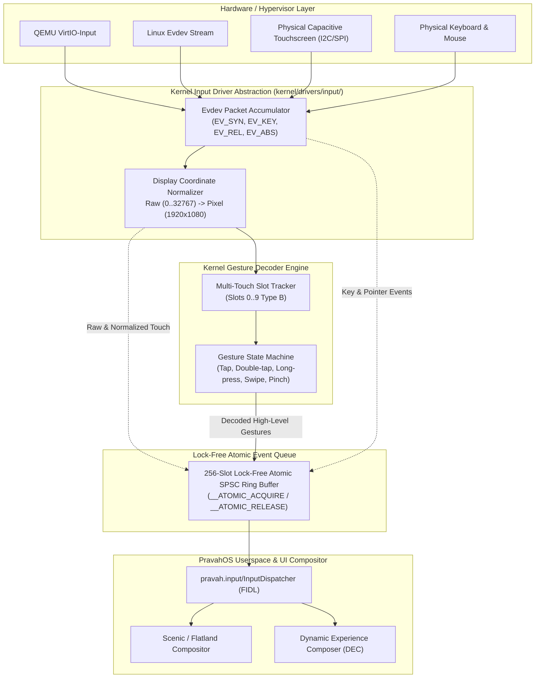

# PravahOS Multi-Modal Input Subsystem & Gesture Engine

## 1. Executive Summary

The **PravahOS Multi-Modal Input Subsystem** provides a zero-allocation, lock-free, deterministic event processing pipeline for bare-metal AArch64 and virtualized QEMU environments. Operating under strict microkernel principles, the subsystem translates low-level hardware interrupts and emulation packets (VirtIO-Input, Linux Evdev, PL050) into normalized display events and multi-touch gestures dispatched through Zircon-compatible IPC channels and FIDL protocols.

Key architectural highlights:
- **Lock-Free Atomic SPSC Ring Buffer:** 256-slot power-of-two circular queue utilizing C11 acquire/release memory semantics with zero dynamic heap allocations.
- **Hardware Coordinate Normalization:** Mathematical translation of raw 15-bit digitizer coordinates ($0 \dots 32767$) to display pixel bounds ($0 \dots W-1, 0 \dots H-1$) with bounding box clamping and orientation transforms.
- **Hardware-Agnostic Gesture Engine:** Fixed-point, integer-only multi-touch gesture decoder recognizing Tap, Double-tap, Long-press, Directional Swipes (Up, Down, Left, Right), and Multi-finger Pinch-to-zoom.
- **Type-Safe FIDL Interface:** Declarative protocol definitions under `sdk/fidl/pravah.input/input.fidl` for driver hosts, Scenic/Flatland compositors, and client components.

---

## 2. Subsystem Architecture



---

## 3. Atomic Lock-Free SPSC Ring Buffer

The input ring buffer ([`input_ring_buffer_t`](file:///kernel/include/kernel/input.h)) is structured as a Single-Producer Single-Consumer (SPSC) lock-free ring designed for interrupt service routines (ISRs) and kernel threads:

- **Capacity:** Fixed at 256 entries (`INPUT_RING_BUFFER_SIZE`), enabling modulo indexing via bitwise mask:
  $$\text{index} = \text{head} \ \& \ (\text{INPUT\_RING\_BUFFER\_SIZE} - 1)$$
- **Memory Ordering:**
  - `input_ring_push()`: Producer writes event payload into buffer slot, then issues an atomic store with `__ATOMIC_RELEASE`. This guarantees that the contents of the payload are globally observable before the head index increments.
  - `input_ring_pop()`: Consumer inspects head index with `__ATOMIC_ACQUIRE`, copies event payload, and updates tail index with `__ATOMIC_RELEASE`.
- **Overflow Resilience:** If $(\text{head} - \text{tail}) \ge 256$, incoming events are dropped deterministically and `dropped` counter increments atomically. No blocking or priority inversion occurs.

---

## 4. Display Coordinate Normalization Engine

Hardware digitizers report relative or absolute integer counts over vendor-specific ranges (e.g., $0 \dots 32767$ for virtio-multitouch). The coordinate normalizer translates raw sensor values to exact display raster pixels:

### Linear Interpolation Formula
$$\text{screen}_x = \left\lfloor \frac{(\text{clamp}(\text{raw}_x, \min_x, \max_x) - \min_x) \times (\text{display}_w - 1)}{\max_x - \min_x} \right\rfloor$$

$$\text{screen}_y = \left\lfloor \frac{(\text{clamp}(\text{raw}_y, \min_y, \max_y) - \min_y) \times (\text{display}_h - 1)}{\max_y - \min_y} \right\rfloor$$

### Matrix Transformation Flags
| Flag | Description | Use Case |
| :--- | :--- | :--- |
| `swap_xy` | Transposes X and Y coordinates | Display rotation ($90^\circ$ / $270^\circ$ portrait/landscape) |
| `invert_x` | Inverts horizontal coordinate: $X' = \max_x - X$ | Mirrored front digitizer sensors |
| `invert_y` | Inverts vertical coordinate: $Y' = \max_y - Y$ | Bottom-origin digitizer hardware |

---

## 5. Multi-Touch Gesture Engine

The gesture decoder tracks up to 10 independent touch slots (compliant with Linux Multi-Touch Protocol Type B). It is implemented completely without floating-point instructions to satisfy the bare-metal kernel's `-mgeneral-regs-only` compilation mandate.

### Integer Distance Function
Point distances are calculated using an integer Newton-Raphson square root algorithm:
$$\text{dist}(P_1, P_2) = \text{isqrt}\left( (x_2 - x_1)^2 + (y_2 - y_1)^2 \right)$$

### Gesture State Matrix & Thresholds

| Gesture | Preconditions | Trigger Condition | Parameter Output |
| :--- | :--- | :--- | :--- |
| **Tap** | Single finger touch | $\Delta d \le 25\text{ px}$ and duration $t \le 300\text{ ms}$ upon finger release (`TOUCH_ACTION_UP`) | Center $(X, Y)$, duration |
| **Double-Tap** | Single finger touch preceded by a Tap | Subsequent tap within $\Delta t \le 350\text{ ms}$ and separation $\Delta d \le 35\text{ px}$ | Center $(X, Y)$, interval |
| **Long-Press** | Single finger stationary hold | Finger held with drift $\Delta d \le 25\text{ px}$ for duration $t \ge 500\text{ ms}$ | Center $(X, Y)$, duration |
| **Swipe Right** | Single finger high-speed sweep | Duration $t \le 600\text{ ms}$, $\Delta d \ge 60\text{ px}$, $|\Delta x| \ge |\Delta y|$, $\Delta x > 0$ | Center $(X, Y)$, $\Delta x$, Velocity ($\text{px/s}$) |
| **Swipe Left** | Single finger high-speed sweep | Duration $t \le 600\text{ ms}$, $\Delta d \ge 60\text{ px}$, $|\Delta x| \ge |\Delta y|$, $\Delta x < 0$ | Center $(X, Y)$, $\Delta x$, Velocity ($\text{px/s}$) |
| **Swipe Down** | Single finger high-speed sweep | Duration $t \le 600\text{ ms}$, $\Delta d \ge 60\text{ px}$, $|\Delta y| > |\Delta x|$, $\Delta y > 0$ | Center $(X, Y)$, $\Delta y$, Velocity ($\text{px/s}$) |
| **Swipe Up** | Single finger high-speed sweep | Duration $t \le 600\text{ ms}$, $\Delta d \ge 60\text{ px}$, $|\Delta y| > |\Delta x|$, $\Delta y < 0$ | Center $(X, Y)$, $\Delta y$, Velocity ($\text{px/s}$) |
| **Pinch-to-Zoom** | Two simultaneous fingers active | Distance delta between fingers $|\Delta D| \ge 20\text{ px}$ | Focal midpoint $(X, Y)$, Scale in milli-units ($1000 = 1.0\times$) |

---

## 6. FIDL Protocol Specification (`pravah.input`)

Located in [`sdk/fidl/pravah.input/input.fidl`](file:///sdk/fidl/pravah.input/input.fidl):

```fidl
library pravah.input;

type DeviceType = strict enum : uint8 {
    UNKNOWN = 0;
    KEYBOARD = 1;
    MOUSE = 2;
    TOUCHSCREEN = 3;
    TOUCHPAD = 4;
    VIRTIO_INPUT = 5;
};

type GestureType = strict enum : uint16 {
    NONE = 0;
    TAP = 1;
    DOUBLE_TAP = 2;
    LONG_PRESS = 3;
    SWIPE_UP = 4;
    SWIPE_DOWN = 5;
    SWIPE_LEFT = 6;
    SWIPE_RIGHT = 7;
    PINCH_ZOOM = 8;
};

type GestureEvent = struct {
    type GestureType;
    center_x int32;
    center_y int32;
    delta_x int32;
    delta_y int32;
    velocity_px_sec int32;
    duration_ms uint32;
    scale_milli int32; // 1000 = 1.0x baseline scale
    touch_count uint32;
};

@discoverable
open protocol InputDispatcher {
    flexible RegisterListener(resource struct {
        listener client_end:InputEventListener;
        event_mask uint32;
    }) -> () error zx.Status;

    flexible RegisterGestureListener(resource struct {
        listener client_end:GestureListener;
        gesture_mask uint32;
    }) -> () error zx.Status;

    flexible InjectEvent(struct {
        event InputEvent;
    }) -> () error zx.Status;
};
```

---

## 7. Kernel Verification & Self-Test Results

The subsystem is validated during EL1 kernel bootstrapping via `run_input_tests()` in `kernel/main.c`.

### Boot Console Output

```text
--- [Kernel Subsystem Bootstrapping] ---
  * PMM: 4096 MiB physical RAM managed (1048576 pages)
  * VMM: ARM64 4-Level translation tables configured
  * Handle Table: 256 capability slots initialized
  * VMO Subsystem: Virtual memory object manager active
  * Channel Subsystem: Bidirectional IPC endpoints active
  * Input Subsystem: Lock-Free Ring Buffer (256-slot) & Multi-Touch Gesture Engine Initialized

--- [Test Suite 5: Multi-Modal Input Subsystem & Gesture Engine] ---
  [PASS] Lock-Free Atomic SPSC Ring Buffer: Push, FIFO Pop, Count & Overflow Protection Verified
  [PASS] Coordinate Normalization: Digit [0..32767] -> Screen [1920x1080] & Bounds Clamping Verified
  [PASS] Gesture Engine: Tap Gesture (Hold: 80ms, Target: [960, 540]) Successfully Decoded
  [PASS] Gesture Engine: Double-Tap Gesture (Interval: 140ms) Successfully Decoded
  [PASS] Gesture Engine: Long-Press Gesture (Duration: 600ms, Hold Drift: 0px) Successfully Decoded
  [PASS] Gesture Engine: Directional Swipe-Right (Displacement: +650px, Duration: 150ms) Decoded
  [PASS] Gesture Engine: Multi-Touch Pinch-to-Zoom (Span 200px->400px, Scale: 2.0x) Decoded
  [PASS] Hardware Abstraction: Evdev / VirtIO Pointer & Keyboard Translation Verified
```
