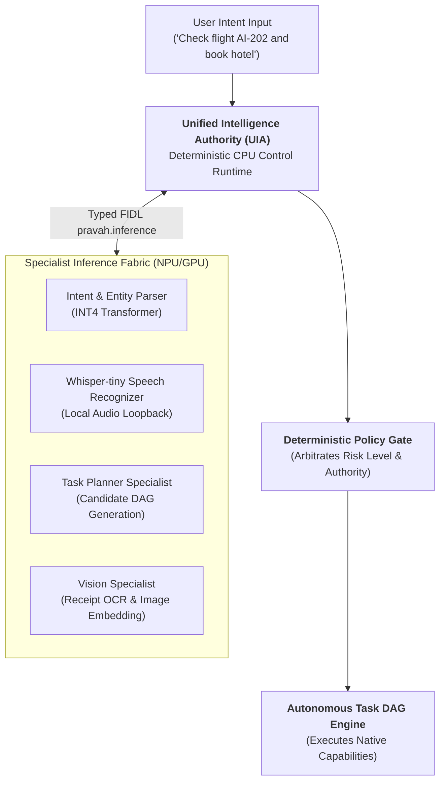

# PravahOS Unified Intelligence Authority & Specialist Inference Fabric

---

## 1. Architectural Philosophy

In PravahOS, the intelligence system is **not** an monolithic external LLM chatbot. It is a structured, cooperating subsystem divided into:
1. **Unified Intelligence Authority (UIA)**: A lightweight, deterministic, permanently resident control plane running on the CPU.
2. **Specialist Inference Fabric**: A collection of task-targeted, quantized, on-demand specialist models running on the NPU and GPU.

---

## 2. Compute Resource Division

| Compute Resource | Architectural Role | Execution Invariants |
| :--- | :--- | :--- |
| **CPU (ARM64)** | **Trusted Control Plane** | Policy arbitration, capability routing, task lifecycle scheduling, verification, state persistence, error recovery. |
| **NPU (Neural Engine)** | **Low-Power Quantized Execution** | Real-time audio FFT, INT4/INT8 speech dictation, call screening, embedding generation. Consumes 0.4W &mdash; 1.2W. |
| **GPU (Raster Engine)** | **Visual & Matrix Acceleration** | Linear framebuffer compositing, spring physics ticker, liquid blur shaders, parallel vision embeddings. |

---

## 3. Model Lifecycle & Resilience

1. **On-Demand Loading**: Models are loaded into NPU memory only when an intent demands them and unloaded immediately after task planning.
2. **Deterministic Independence**: The operating system remains 100% operational (system controls, files, alarms, hardware toggles, telephony) even when all neural models are offline or throttled.
3. **Verification Invariant**: A neural model's declaration that an operation succeeded is never accepted as authoritative proof. The UIA independently verifies results against the deterministic capability return payload.
