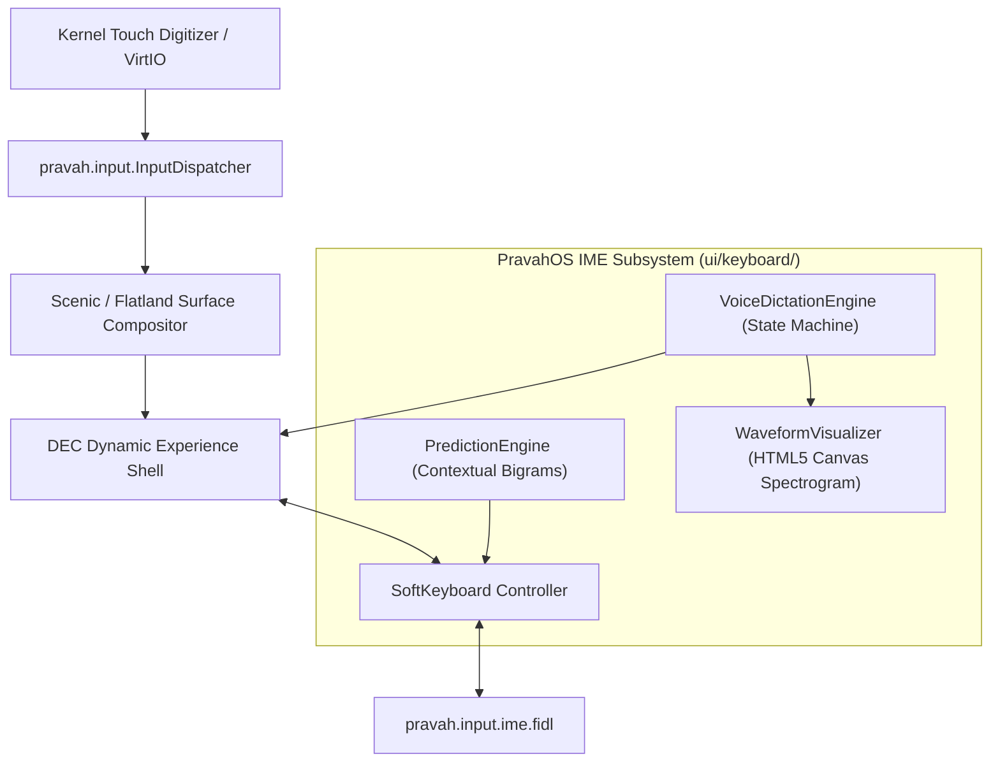
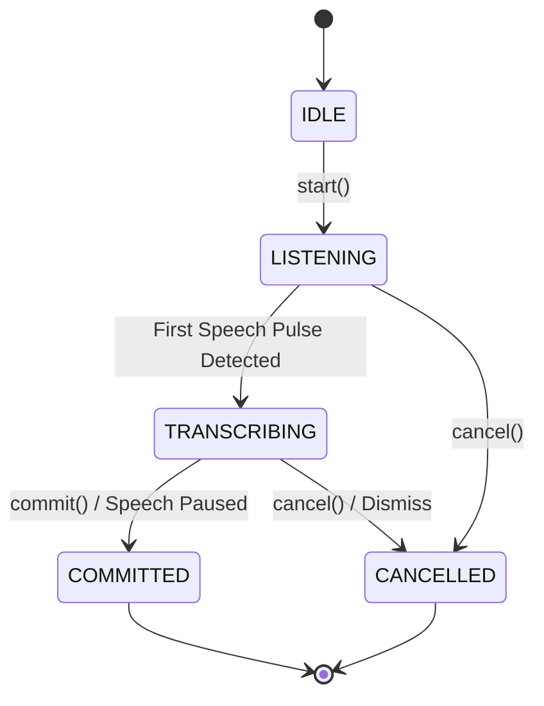

# PravahOS Native Mobile Touch Software Keyboard (IME) & Voice Pipeline

This document specifies the architecture, FIDL protocols, component design, predictive engine, and voice dictation pipeline for the PravahOS mobile touch input method editor (IME).

---

## 1. Subsystem Architecture

PravahOS decouples physical touch ingestion from semantic text composition through a layered architecture adhering to the microkernel zero-trust principle:



### Key Components

| Component | Path | Responsibility |
|---|---|---|
| **FIDL IME Interface** | `sdk/fidl/pravah.input/ime.fidl` | IPC contracts defining `InputMethodEditor`, `VirtualKeyboardManager`, `ImeService`, and audio spectrogram types. |
| **Touch QWERTY Keyboard** | `ui/keyboard/keyboard.js` | Multi-layer layout engine (lower, upper, caps lock, numeric, symbols), cursor management, and bubble preview. |
| **Keyboard Styles** | `ui/keyboard/keyboard.css` | Frosted dark glass theme, key matrices, tactile active glow, spring slide-up/down animations. |
| **Voice Dictation Visualizer** | `ui/keyboard/voice.js` | Speech-to-text state machine, simulated air-gapped on-device neural Whisper token streaming, and canvas audio spectrogram. |
| **DEC Shell Integration** | `ui/shell/shell.js`, `index.html` | Intent input bar binding, predictive suggestion tap insertion, and voice visualizer modal drawer. |
| **Emulator Integration** | `emulator/emulator.js`, `index.html` | Mobile emulator toolbar toggles, touch routing, and FIDL IME event stream inspection. |
| **Automated Tests** | `ui/tests/keyboard.test.js` | Node.js unit tests for layout layers, predictive suggestions, cursor editing, and audio synthesizers. |

---

## 2. FIDL IME Protocol (`pravah.input/ime.fidl`)

The FIDL definition establishes zero-copy, typed communication between input clients and the virtual keyboard daemon.

### Core Enums & Structs

- **`KeyboardLayoutMode`**: `QWERTY_LOWER`, `QWERTY_UPPER`, `QWERTY_CAPS_LOCK`, `NUMERIC`, `SYMBOLS`, `VOICE_DICTATION`.
- **`TextInputType`**: `TEXT`, `NUMBER`, `PHONE`, `DATETIME`, `EMAIL`, `URL`, `PASSWORD`, `INTENT`.
- **`InputMethodAction`**: `UNSPECIFIED`, `NONE`, `GO`, `SEARCH`, `SEND`, `NEXT`, `DONE`, `EXECUTE_INTENT`.
- **`KeyboardVisibility`**: `HIDDEN`, `SLIDING_UP`, `SHOWN`, `SLIDING_DOWN`.
- **`VoiceDictationState`**: `IDLE`, `LISTENING`, `TRANSCRIBING`, `COMMITTED`, `CANCELLED`, `ERROR`.
- **`AudioSpectrogramSample`**: 16-band normalized frequency bins with RMS amplitude for real-time visualization.

### Protocols

- **`InputMethodEditor`**:
  - `SetState(state: TextInputState)`
  - `CommitText(text: string, relative_cursor_position: int32)`
  - `DeleteSurroundingText(before_length: uint32, after_length: uint32)`
  - `PerformAction(action: InputMethodAction)`
- **`VirtualKeyboardManager`**:
  - `RequestShow(input_type, action)`
  - `RequestHide()`
  - `SetLayout(layout)`
  - `SetSuggestions(suggestions)`
  - `PushAudioSample(sample)`
- **`ImeService`**:
  - `BindEditor(editor_request, listener, initial_state, input_type, action)`
  - `CloseEditor()`

---

## 3. Touch Keyboard Layout & Interaction

### Layout Layers

1. **Lowercase QWERTY (`lower`)**: Standard lowercase alphanumeric grid with shift, backspace, numeric mode switcher (`?123`), microphone button, comma, spacebar, period, and action submit button (`Done`).
2. **Uppercase QWERTY (`upper`)**: Single-shift capital letters. Reverts automatically to lowercase after the next character keystroke.
3. **Caps Lock (`caps`)**: Double-tapping the shift key locks uppercase mode until tapped again.
4. **Numeric Layer (`numbers`)**: Top row digits (`1` to `0`), common punctuation and symbols (`@`, `#`, `₹`, `$`, `%`, `&`, `-`, `+`, `(`, `)`), and extended symbols toggle (`=\<`).
5. **Symbol Layer (`symbols`)**: Currency marks (`£`, `€`, `¥`), math operators (`~`, `•`, `√`, `π`, `÷`, `×`, `¶`, `∆`), and brackets (`[`, `]`, `{`, `}`, `«`, `»`).

### Predictive Text Engine & Suggestion Strip

- **Contextual Bigram Engine**: Evaluates preceding tokens to predict the most likely intent keywords (e.g., `"Check"` → `["flight", "audit", "status"]`; `"flight"` → `["AI-202", "status", "schedule"]`).
- **Prefix Matching**: Dynamically filters corpus words matching the partial word before the cursor (e.g., `"fl"` → `"flight"`).
- **One-Tap Insertion**: Tapping any pill in the `#keyboard-suggestion-strip` replaces the in-flight token, inserts a trailing space, updates cursor position, and queries subsequent word predictions.

### Tactile Feedback & Visual Preview

- **Pop-Up Preview Bubble**: While a key is pressed, a floating magnifying bubble (`.key-preview-bubble`) appears directly above the key showing the character in large, high-contrast typography.
- **Haptic Vibration**: Calls `navigator.vibrate(8)` for tactile feedback on capable touchscreens.
- **Spring Animations**: Keyboard slides smoothly from the screen bottom using a calibrated curve (`transform: translateY(0)`, `cubic-bezier(0.16, 1, 0.3, 1)`).

---

## 4. Voice Dictation Pipeline & Waveform Visualizer

### State Machine



### Animated Audio Waveform Spectrogram

- **Canvas 2D Spectrogram**: `WaveformVisualizer` renders 28 responsive audio bars with dynamic gradient fill (`#00f0ff` to `#a855f7` to `#ec4899`).
- **Harmonic Modulation**: Smoothly interpolates frequency bands and applies dynamic wave ripples matching simulated speech energy.
- **Audio Metering**: Displays live dB readings (e.g. `-24 dB`) in the visualizer container.
- **Incremental Transcription Streaming**: Transcribes spoken words token-by-token with natural speech cadence (120ms–220ms per token), updating the Intent Input Bar in real-time.

---

## 5. UI Shell & Phone Emulator Integration

### DEC Shell (`ui/shell/index.html`, `shell.js`)

- Focusing or tapping `#intent-input` activates and smoothly slides up the software keyboard.
- Clicking `#btn-mic` activates the full-screen frosted `VoiceDictationOverlay` with the animated waveform visualizer.
- Tapping outside the keyboard or clicking "Done" cleanly slides down and dismisses the keyboard.
- Emits `PRAVAH_IME_EVENT` notifications via `postMessage` to parent windows.

### Phone Emulator (`emulator/index.html`, `emulator.js`)

- **Dedicated Toolbar Toggles**:
  - `⌨ Keyboard`: Sends `PRAVAH_TOGGLE_KEYBOARD` postMessage to the embedded shell.
  - `🎤 Voice`: Sends `PRAVAH_TRIGGER_VOICE` postMessage to initiate the voice pipeline.
- **FIDL Event Stream HUD**:
  - Captures `PRAVAH_IME_EVENT` payloads and displays them inside the FIDL Event Stream log tab as `pravah.input.InputMethodEditor` events with timestamps.

---

## 6. Automated Testing

Run the test suite with Node's native test runner:

```powershell
node --test ui/tests/*.test.js
```

### Verified Test Cases (`ui/tests/keyboard.test.js`)

1. **PredictionEngine**:
   - Generates intent starters on empty input (`Check`, `Send`, `Compact`).
   - Contextual next-word predictions based on bigrams (`Check ` → `flight`).
   - Prefix completions for partial words (`fl` → `flight`).
   - Case preservation on suggested completions (`Fl` → `Flight`).
2. **SoftKeyboard**:
   - Layout specification validation for all 5 layout modes.
   - Text typing, cursor advancement, and selection deletion.
   - Backspace deletion before cursor.
   - Predictive suggestion insertion and cursor updating.
   - Mode switching (`?123` → numeric, `=\<` → symbols, `ABC` → lower).
   - Shift single-tap uppercase toggle and double-tap caps lock toggle.
   - Submit action triggers `onSubmit` callback.
3. **VoiceDictationEngine**:
   - State machine transitions (`IDLE` → `LISTENING` → `TRANSCRIBING` → `COMMITTED`).
   - Cancellation cleans up buffers and sets state to `CANCELLED`.
   - Audio spectrogram synthesis emits 16-band frequency bins and amplitude.
4. **WaveformVisualizer**:
   - Symmetrical bell-curve weighting and bounds validation `[0, 1]`.
