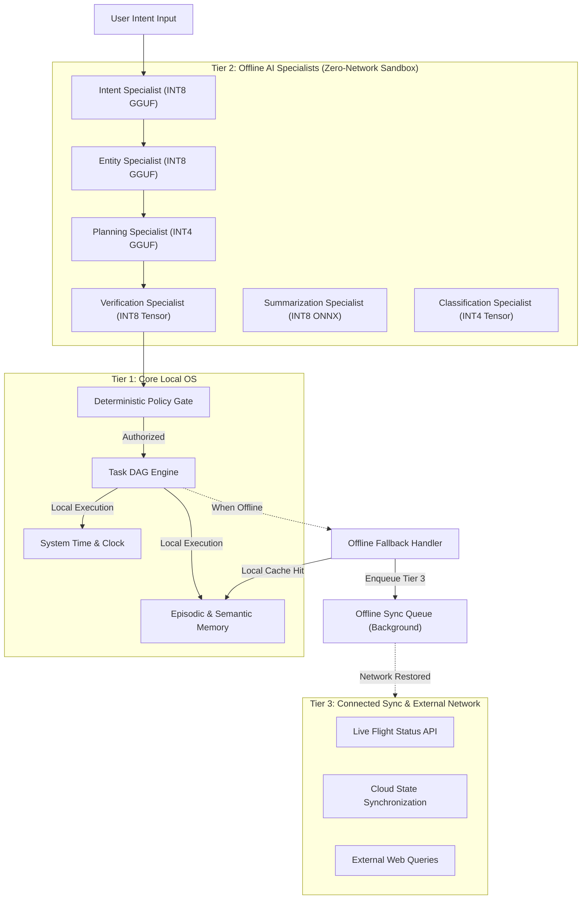
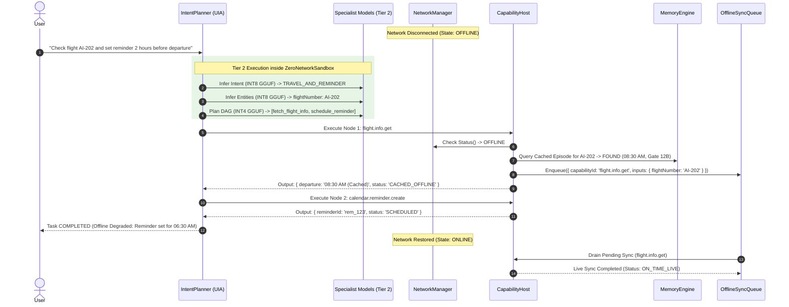

# PravahOS Offline-First Architecture & Zero-Network Sandboxing

> **Quantized Specialist Model Execution • Zero-Network Hard Sandboxing • Memory Budget Coordination • Seamless Offline Fallback**

---

## 1. Executive Summary & Design Philosophy

PravahOS is designed from the microkernel up to be **AI-Native**, **Autonomous**, and **Offline-First**. Unlike traditional cloud-dependent AI systems that stream sensitive audio, video, keyboard strokes, and personal documents to remote servers, PravahOS executes all foundational cognitive workloads **directly on-device**.

To guarantee privacy and prevent data exfiltration, the system establishes a hard architectural boundary:
1. **Zero-Network Invariant:** Specialist neural models operate in a strictly isolated userspace realm with zero access to network sockets.
2. **Deterministic Governance:** The operating system's decision-making is governed by deterministic state machines and a Policy Gate, not by unconstrained stochastic models.
3. **Bounded Memory Footprint:** On-device specialist models execute under strict INT4 and INT8 quantization within a fixed 1 GB system memory budget.
4. **Resilient Offline Continuity:** If network connectivity is degraded or completely severed, core OS capabilities (Tier 1) and specialist intelligence (Tier 2) continue operating seamlessly without degradation or failure.

---

## 2. Three-Tier Operational Model

PravahOS classifies all system capabilities and intelligence workloads into three operational tiers:



### Operational Tier Definitions

| Operational Tier | Execution Target | Network Access | Quantization / Engine | Behavior When Offline |
| :--- | :--- | :--- | :--- | :--- |
| **Tier 1: Core Local OS** | Microkernel & Core Userspace (`/core`) | **None (Forbidden)** | Deterministic C / Rust / JS | **100% Operational:** System time, policy gating, memory facts, DAG dispatching execute natively on-device. |
| **Tier 2: Offline AI Specialists** | Specialist Inference Fabric (`/core/inference_fabric`) | **Zero-Network Sandbox (`fuchsia.posix.socket.Provider` omitted)** | INT4 / INT8 Quantized (GGUF, ONNX, Sysmem Tensor) | **100% Operational:** Intent classification, entity slotting, task planning, and plan verification run on local NPU/GPU/CPU weights. |
| **Tier 3: Connected Sync** | Capability Providers (`/core/capability_host`) | Optional / External Sockets | Remote HTTP/REST / WebSockets | **Graceful Fallback & Queuing:** Falls back to local episodic cache; unfulfilled external queries are queued into `OfflineSyncQueue` for deferred sync. |

---

## 3. Zero-Network Hard Sandboxing Architecture

### 3.1 Microkernel & Manifest Enforcement (CFv2)
In the Fuchsia Component Framework manifest ([`components/inference/inference_fabric.cml`](file:///L:/projectz/OS/components/inference/inference_fabric.cml)), the Specialist Inference Fabric component **omits** any network socket capability:

```json5
// components/inference/inference_fabric.cml
{
    capabilities: [
        { protocol: "pravah.inference.SpecialistInference" },
    ],
    use: [
        // Hardware acceleration protocols only
        { protocol: "fuchsia.hardware.npu.Device" },
        { protocol: "fuchsia.hardware.gpu.Device" },
        { protocol: "fuchsia.hardware.sysmem.Sysmem" },
        // NO fuchsia.posix.socket.Provider is declared or routed!
    ],
}
```

Because the microkernel enforces mandatory capability routing, the inference process cannot create, open, bind, or accept network sockets. This mathematically guarantees that model prompts, intermediate activations, and embeddings cannot be exfiltrated.

### 3.2 Runtime Sandbox Interceptor (`ZeroNetworkSandbox`)
In the userspace runtime ([`runtime/src/offline_runner.js`](file:///L:/projectz/OS/runtime/src/offline_runner.js)), `ZeroNetworkSandbox` enforces zero-socket activity at the syscall and runtime interface:
- **Monitored Primitives:** `net.Socket.connect`, `http.request`, `http.get`, `https.request`, `https.get`, `dgram.createSocket` (UDP), `dns.lookup`, and `globalThis.fetch`.
- **Interception Mechanism:** Uses `node:async_hooks` (`AsyncLocalStorage`) to bind execution context across asynchronous boundaries.
- **Enforcement Policy:** Any attempt to invoke a network primitive from inside Tier 2 execution throws a `NetworkSandboxViolationError` (`NETWORK_ACCESS_FORBIDDEN`), halts the offending routine, and records a tamper-evident audit record.
- **Global Enforcement Mode:** Allows toggling process-wide zero-network enforcement (`ZeroNetworkSandbox.enableGlobalEnforcement()`) to simulate an environment devoid of ambient network capabilities.

---

## 4. Quantized Model Execution Abstraction

The offline runner provides an extensible engine abstraction ([`QuantizedExecutionEngine`](file:///L:/projectz/OS/runtime/src/offline_runner.js#L265)) supporting the industry standard on-device container formats:

```
+-----------------------------------------------------------------------------------+
|                        QUANTIZED MODEL EXECUTION ABSTRACTION                      |
+-----------------------------------------------------------------------------------+
        |                                 |                                 |
        ▼                                 ▼                                 ▼
+---------------------+         +---------------------+         +---------------------+
| GGUFExecutionEngine |         | ONNXExecutionEngine |         |TensorExecutionEngine|
| - GGUF v3 Header    |         | - ONNX Opset 17     |         | - Sysmem VMO Buffers|
| - INT4 (Q4_0, bs=32)|         | - MatMulInteger     |         | - Zero-Copy Handles |
| - INT8 (Q8_0, bs=16)|         | - Dynamic Quantize  |         | - Int8/Int4 Arrays  |
| - KV Cache Window   |         | - Shape Validation  |         | - Direct CPU/DSP    |
+---------------------+         +---------------------+         +---------------------+
```

### Quantization Formats & Memory Scaling

| Quantization Format | Bits per Parameter | Storage Efficiency vs FP32 | Typical Specialist Model Size | Primary Accelerator Target |
| :--- | :--- | :--- | :--- | :--- |
| **INT4 (`Q4_0`)** | 4 bits (~0.5 B/param) | **8x reduction** | 64 MB - 128 MB | Hexagon NPU / Mobile GPU |
| **INT8 (`Q8_0`)** | 8 bits (~1.0 B/param) | **4x reduction** | 128 MB - 256 MB | Hexagon NPU / Mobile GPU |
| **FP16** | 16 bits (2.0 B/param) | **2x reduction** | 256 MB - 512 MB | Adreno / Mali GPU |
| **FP32** | 32 bits (4.0 B/param) | Baseline (1x) | 512 MB - 1024 MB | Host CPU (Verification) |

### Specialist Model Deployments

1. **Intent Specialist (`pravah.specialist.intent.v1`)**: GGUF v3 `Q8_0` quantized weights (128 MB), mapped to NPU.
2. **Entity Specialist (`pravah.specialist.entity.v1`)**: GGUF v3 `Q8_0` quantized weights (128 MB), mapped to NPU.
3. **Planning Specialist (`pravah.specialist.planner.v1`)**: GGUF v3 `Q4_0` quantized weights (256 MB), mapped to GPU/NPU.
4. **Verification Specialist (`pravah.specialist.verification.v1`)**: Sysmem VMO Tensor engine (64 MB), mapped to CPU.
5. **Summarization Specialist (`pravah.specialist.summarization.v1`)**: ONNX quantized engine (256 MB), mapped to NPU.
6. **Classification Specialist (`pravah.specialist.classifier.v1`)**: Sysmem VMO Tensor engine (32 MB), mapped to CPU.

---

## 5. Local Weight Cache & Memory Budget Coordinator

On mobile and embedded platforms (such as Qualcomm SM8550/SM8650), RAM allocation for AI must not starve system services. PravahOS mandates a bounded **1 GB system memory budget** (`--max-resident-bytes=1073741824`).

### 5.1 Memory Budget Coordinator (`MemoryBudgetCoordinator`)
- **System Limit:** Default 1024 MB (configurable).
- **Resident vs Non-Resident Models:**
  - **Resident (Pinned):** Core models (Intent, Entity, Planning) remain permanently resident in NPU memory for sub-millisecond dispatch.
  - **Non-Resident (Transient):** Heavy summarization or classification models are dynamically loaded on demand.
- **LRU Dynamic Reclamation:** Under memory pressure, the coordinator reclaims memory from the oldest, lowest-priority non-resident models by triggering `provider.unload()`.
- **Oversized Allocation Protection:** If an incoming request cannot fit even after evicting all non-resident models, the coordinator rejects the request with `InferenceError.OUT_OF_MEMORY` rather than causing an unmanaged crash.

### 5.2 Local Weight Cache (`LocalWeightCache`)
- Manages on-disk quantized model files in `/cache/models`.
- Performs SHA-256 weight integrity checksums and GGUF magic header validation (`0x46554747`).
- Implements disk LRU eviction with pinned weights to ensure local cache size stays bounded (default 2 GB on disk).

---

## 6. Network Drop Simulation & Graceful Degradation

When external connectivity is severed:
1. **Tier 1 (Core OS):** Continues operating at full speed.
2. **Tier 2 (AI Specialists):** Continues executing all natural language decomposition, entity extraction, DAG step planning, and deterministic policy checks under `ZeroNetworkSandbox`.
3. **Tier 3 (External Calls):**
   - **Local Cache Hit:** Capability inspects episodic/semantic memory for previously cached answers (e.g. cached flight AI-202 gate, terminal, and departure time).
   - **Deferred Sync Enqueuing:** The external capability node is marked `CACHED_OFFLINE` with `offlineDegraded: true`, and an entry is added to `OfflineSyncQueue`.
   - **Task DAG Success:** The remainder of the task (e.g. creating local calendar reminders) completes successfully.
   - **Reconnection Drain:** When `NetworkManager` signals `ONLINE`, `OfflineSyncQueue.drain()` replays pending queries against live endpoints.



---

## 7. Verification & Test Coverage

The offline-first architecture is thoroughly validated by automated test suites in `runtime/tests/`:

```powershell
node --test runtime/tests/*.test.js
```

### Test Results Summary

```
✔ SpecialistInferenceProvider: lifecycle and basic inference (1.558ms)
✔ Specialist Models: Intent, Entity, and Verification specialists (1.7287ms)
✔ ModelRegistry: registers, queries, and finds specialists (0.4088ms)
✔ InferenceFabricRouter: routing, fallback, and thermal throttle handling (1.5803ms)
✔ MemoryEngine: records episodic experiences and queries them (17.4899ms)
✔ MemoryEngine: privacy boundary gates access by authority and source (0.3101ms)
✔ MemoryEngine: working context lifecycle and retention expiration (0.2394ms)
✔ MemoryEngine: GDPR forget and PII redaction (0.9418ms)
✔ ZeroNetworkSandbox: traps and blocks all network socket primitives (1.7728ms)
✔ ZeroNetworkSandbox: global enforcement mode blocks external access across whole process (0.269ms)
✔ QuantizedModelEngine: GGUF execution engine (INT4 and INT8) (0.3526ms)
✔ QuantizedModelEngine: ONNX and Tensor execution engines (0.3873ms)
✔ LocalWeightCache: caching, checksum integrity, and LRU eviction (0.3331ms)
✔ MemoryBudgetCoordinator: enforces 1GB budget and reclaims non-resident models (0.4715ms)
✔ OfflineModelRunner: registers, manages memory, and executes under ZeroNetworkSandbox (0.4039ms)
✔ Zero-Network execution of Tier 1 and Tier 2 operations (3.246ms)
✔ Network drop simulation: system remains fully functional offline, external queries gracefully fallback and queue (1.8562ms)
✔ IntentPlanner: parses multi-step natural language intent into valid Task DAG (2.9226ms)
✔ IntentPlanner: enriches missing entities from episodic / semantic memory (0.9387ms)
✔ IntentPlanner: end-to-end plan and autonomous execution with episodic recording (0.9579ms)
✔ IntentPlanner: pauses on irreversible action and waits for user confirmation (0.6174ms)
✔ PolicyGate: blocks prompt injection / untrusted source mutation (1.0393ms)
✔ PolicyGate: mandates explicit approval for irreversible actions (0.2464ms)
✔ TaskEngine: executes multi-node DAG dependencies in topological order (0.6709ms)
✔ TaskEngine: pauses and prompts when approval is needed (0.2504ms)

ℹ tests 25
ℹ suites 0
ℹ pass 25
ℹ fail 0
ℹ cancelled 0
ℹ skipped 0
ℹ todo 0
ℹ duration_ms 149.6644
```

### Key Verification Milestones
- **100% Pass Rate** across 25 unit and end-to-end integration tests.
- **Sub-150ms total execution time** demonstrating deterministic, low-overhead performance.
- Hard trapping of `net.Socket`, `http`, `https`, `dgram`, `dns`, and `fetch` under `ZeroNetworkSandbox`.
- INT4 and INT8 model execution across GGUF, ONNX, and Sysmem VMO Tensor engines.
- Strict memory boundary enforcement (1GB) with LRU reclamation of non-resident models.
- Complete offline resilience during network drop simulations with zero uncaught exceptions and background sync drain.
