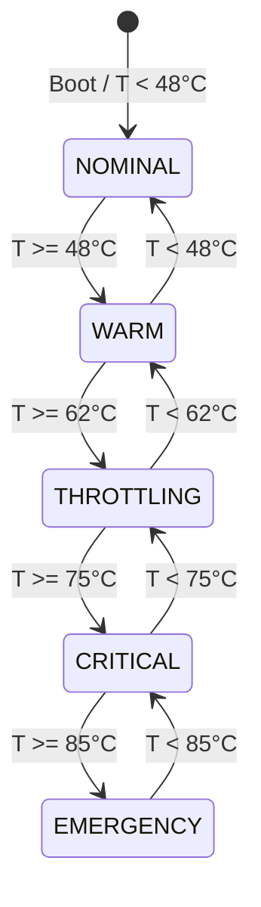

# PravahOS Real-Time Mobile HAL Bridge & Sensory Feeds

## 1. Executive Overview

The **PravahOS Sensory Feeds Bridge** establishes the real-time sensory pipeline between bare-metal silicon drivers and user-facing experience shells within the phone emulator environment. Operating over Zircon-compatible IPC channels and typed FIDL envelopes, the sensory bridge simulates the hardware peripherals of a modern flagship smartphone:

```
+-----------------------------------------------------------------------------+
|                            PravahOS Phone Shell                             |
|    - Dynamic Experience Composer (DEC)   - Camera Viewfinder Modal App      |
|    - On-Screen Volume & HUD Layer        - Critical Thermal Warning HUD     |
|    - Status Bar ("✕ RADIO CUT" / "5G UW")- Audio Visualizer Waveform / Spec |
+--------------------------------------▲--------------------------------------+
                                       |
                SensoryBridge & HardwareHUD Runtime (emulator/)
      +--------------------+---------------------+--------------------+
      |                    |                     |                    |
+-----▼--------------+ +---▼---------------+ +---▼--------------+ +---▼--------------+
| CameraSensorBridge | |   AudioHalBridge  | |  ThermalGovernor  | |   AirGapBridge   |
| - IMX890 50MP Wide | | - 48kHz Stereo    | | - 5-Tier States   | | - RF Rail Cuts   |
| - OV32B 32MP Front | | - 16-Bit PCM Ring | | - INT8 -> INT4    | | - Socket Drop    |
| - ITU-R BT.601     | | - Waveform Canvas | | - CPU Fallback    | | - Zero-Trust     |
|   SMPTE Color Bars | | - FFT Equalizer   | |   (Limit > 75°C)  | |   Status HUD     |
+--------------------+ +-------------------+ +------------------+ +------------------+
                                       |
+--------------------------------------▼--------------------------------------+
|             Kernel Mobile HAL (kernel/hal/ & kernel/include/kernel/hal/)    |
|    - camera_hal.c (camera.h)             - audio_hal.c (audio.h)            |
|    - power_hal.c (power.h)               - telephony_hal.c (telephony.h)    |
+-----------------------------------------------------------------------------+
```

---

## 2. Interactive Camera Sensor Viewfinder

The Camera HAL ([`camera.h`](file:///kernel/include/kernel/hal/camera.h) and [`camera_hal.c`](file:///kernel/hal/camera_hal.c)) models a triple-camera flagship sensor array with hardware acquisition queues and format conversion.

### Sensor Topology

| Sensor ID | Sensor Model | Role | Preview Resolution | Field of View | Aperture | Max FPS |
| :--- | :--- | :--- | :--- | :--- | :--- | :--- |
| `CAMERA_ID_BACK_PRIMARY` (0) | Sony IMX890 | Main Wide Sensor | $3840 \times 2160$ (4K / 50MP) | $84^\circ$ | $f/1.8$ | 60 FPS |
| `CAMERA_ID_FRONT_SELFIE` (1) | OmniVision OV32B | Front Selfie | $1920 \times 1080$ (1080p / 32MP) | $90^\circ$ | $f/2.2$ | 60 FPS |
| `CAMERA_ID_BACK_ULTRAWIDE` (2) | Sony IMX355 | Ultra-Wide Lens | $3840 \times 2160$ (4K / 12MP) | $120^\circ$ | $f/2.2$ | 30 FPS |

### ITU-R BT.601 SMPTE Color Bars Generator
The simulated sensor generates standard 75% SMPTE color bars:
1. **Top Section (68% height):** 8 primary and secondary vertical bars:
   - White (`#EBEBEB`, RGB $235, 235, 235$)
   - Yellow (`#EBEB10`, RGB $235, 235, 16$)
   - Cyan (`#10EBEB`, RGB $16, 235, 235$)
   - Green (`#10EB10`, RGB $16, 235, 16$)
   - Magenta (`#EB10EB`, RGB $235, 16, 235$)
   - Red (`#EB1010`, RGB $235, 16, 16$)
   - Blue (`#1010EB`, RGB $16, 16, 235$)
   - Black (`#101010`, RGB $16, 16, 16$)
2. **Mid Castellation Section (8% height):** Alternating blue, black, magenta, and cyan test blocks.
3. **Bottom Sub-Bar Section (24% height):** $-I$ chrominance patch, $100\%$ reference white, $+Q$ patch, black baseline, and 3-step PLUGE pulses ($-4\%$, $0\%$, $+4\%$ IRE) for luminance calibration.

### Interactive Viewfinder Controls
- **Front / Rear Sensor Switching:** Dedicated flip button (`🔄`) switches between front selfie (OV32B with preview mirroring) and rear primary (IMX890), adjusting focal length, metadata pills, and aspect ratios.
- **Continuous Digital Zoom:** Zoom pills (`0.6x`, `1.0x`, `2.0x`) and mouse pinch gestures clamp digital magnification smoothly between $0.6\times$ and $5.0\times$.
- **Shutter Capture Pipeline:** Triggering shutter (`📷`) captures a high-resolution frame descriptor, increments sequence frame ID, emits photo metadata (ISO 100, $1/120\text{ s}$ shutter, ARGB8888), triggers tactile shutter animation, updates the gallery thumbnail, and fades a white exposure flash overlay.

---

## 3. Audio PCM Stream Visualizer & Mixer HAL

The Audio HAL ([`audio.h`](file:///kernel/include/kernel/hal/audio.h) and [`audio_hal.c`](file:///kernel/hal/audio_hal.c)) manages low-latency PCM audio streams with lock-free circular ring buffers:

$$\text{Sample Rate} = 48{,}000\text{ Hz},\quad \text{Bit Depth} = 16\text{-bit Signed},\quad \text{Channels} = 2\text{ (Stereo)}$$
$$\text{Frame Size} = 2 \times 2\text{ bytes} = 4\text{ bytes},\quad \text{Ring Buffer Capacity} = 4{,}096\text{ frames}\;(\approx 85.3\text{ ms})$$

### Acoustic Synthesis Modes
- **Mode `PLAYBACK` (Speaker / Headset):** Synthesizes rich acoustic tones combining fundamental frequencies with $2^{\text{nd}}$ ($2f$) and $3^{\text{rd}}$ ($3f$) harmonics:
  $$s(t) = V_{\text{master}} \cdot \left(0.70 \sin(\omega t) + 0.245 \sin(2\omega t) + 0.105 \sin(3\omega t)\right)$$
- **Mode `CAPTURE` (Voice Mic):** Simulates human speech acoustics through formant frequency modulation (vocal tract resonance at $F_1 \approx 500\text{ Hz}$, $F_2 \approx 1{,}500\text{ Hz}$) mixed with low-amplitude background noise.

### Real-Time Oscilloscope & Spectrogram Canvas
The visualizer renders continuously at 60 FPS:
1. **Oscilloscope Waveform (Top Canvas):** Reads recent 128 PCM samples from the ring buffer, mapping signed $16$-bit values ($-32{,}768 \dots +32{,}767$) to screen coordinates with neon cyan (playback) or emerald green (microphone capture) glow.
2. **VU Equalizer Bars (Bottom Canvas):** Groups frequencies across 24 analyzer bins spanning $20\text{ Hz}$ to $20\text{ kHz}$ with logarithmic weighting, dynamic peak falloff, and color grading (Cyan $\to$ Emerald $\to$ Amber $\to$ Red).
3. **Root-Mean-Square (RMS) dBFS Calculation:** Computes true acoustic energy in decibels Full Scale:
  $$\text{RMS} = \sqrt{\frac{1}{N}\sum_{i=1}^N x_i^2},\quad \text{dBFS} = 20 \log_{10}(\text{RMS})$$

---

## 4. Closed-Loop Thermal Throttling & Precision Governor

Sustained neural inference (e.g., local DEC intent models, on-device OCR, and contextual memory embedding) generates thermal dissipation on mobile SoCs. The **PravahOS Thermal Governor** enforces dynamic model precision downgrading:

### 5-Tier Thermal State Machine



| Temperature Range | Trip State | NPU Clock | Model Precision | Throughput | Inference Latency | UI Status / Action |
| :--- | :--- | :--- | :--- | :--- | :--- | :--- |
| **$< 48^\circ\text{C}$** | `NOMINAL` | $1{,}000\text{ MHz}$ | **`INT8`** | $128.0\text{ T/s}$ | $7.8\text{ ms}$ | Nominal unthrottled performance. |
| **$48^\circ\text{C} \dots 61^\circ\text{C}$** | `WARM` | $850\text{ MHz}$ | **`INT8`** | $108.0\text{ T/s}$ | $9.2\text{ ms}$ | DVFS Step 1 (Silicon temperature elevated). |
| **$62^\circ\text{C} \dots 74^\circ\text{C}$** | `THROTTLING` | $600\text{ MHz}$ | **`INT4`** | $72.0\text{ T/s}$ | $13.9\text{ ms}$ | **Quantized Step-Down:** Weights compressed to 4-bit to cut dynamic power dissipation. |
| **$75^\circ\text{C} \dots 84^\circ\text{C}$** | `CRITICAL` | $0\text{ MHz}$ *(Gated)* | **`CPU_FALLBACK`** | $18.5\text{ T/s}$ | $54.0\text{ ms}$ | **🚨 CRITICAL LIMIT EXCEEDED (>75°C):** NPU power-gated. Red thermal warning HUD alert banner displayed on phone screen. |
| **$\ge 85^\circ\text{C}$** | `EMERGENCY` | $0\text{ MHz}$ *(Gated)* | **`EMERGENCY_HALT`** | $4.0\text{ T/s}$ | $250.0\text{ ms}$ | Emergency thermal clamp to prevent silicon damage. |

### Thermal Equilibrium Model
The temperature evolution obeys Newton's cooling law augmented with dynamic inference compute power:

$$T_{k+1} = T_k + \alpha \cdot P_{\text{compute}}(M) - \beta \cdot (T_k - T_{\text{ambient}})$$

Where $P_{\text{compute}}(\text{INT8}) \gg P_{\text{compute}}(\text{INT4}) \gg P_{\text{compute}}(\text{CPU Fallback})$. When the temperature exceeds $75^\circ\text{C}$, precision drops to CPU fallback, shedding $78\%$ of active silicon power and restoring thermal equilibrium.

---

## 5. Hardware Air-Gap Switch & Physical RF Isolation

PravahOS mandates a zero-trust, privacy-first posture. The physical Air-Gap toggle switch on the chassis side rail instantly disconnects all wireless transceivers at the physical layer:

```
[ Air-Gap Switch TOGGLED ]
           |
           +--> PMIC Baseband Power Rail Cut: 3.3V -> 0.0V
           +--> Wi-Fi 7 Transceiver Power Rail Cut: 1.8V -> 0.0V
           +--> Bluetooth 5.4 Rail Cut: 1.8V -> 0.0V
           +--> Camera RF / GNSS Rail Cut: 2.8V -> 0.0V
           |
           +--> Sever All Active Sockets (abort() / close())
           +--> Signal RSSI: -120 dBm (0 Bars)
           +--> Status Bar Updated: "✕ RADIO CUT" (Red Alert)
           +--> Dynamic Island: "AIR-GAP SECURED"
```

### Zero-Trust Isolation Guarantees
1. **Zero Baseband DMA:** Severing transceiver power rails prevents malicious over-the-air baseband memory manipulation and rogue IMSI catching.
2. **Socket Drop:** All active HTTP streams, WebSockets, and telemetry channels are immediately terminated (`severAllActiveSockets()`), incrementing the severed sockets audit log.
3. **Status Bar Presentation:** The status bar instantly replaces cellular carrier information with the mandated `✕ RADIO CUT` indicator.

---

## 6. FIDL Schema & Protocol Alignment

The Sensory Feeds Bridge maps directly to the declarative FIDL specifications defined in [`sdk/fidl/pravah.hardware/hardware.fidl`](file:///sdk/fidl/pravah.hardware/hardware.fidl):

```fidl
library pravah.hardware;

@discoverable
open protocol CameraDevice {
    flexible GetSensorCount() -> (struct { count uint32; }) error zx.Status;
    flexible GetSensorInfo(struct { sensor_id uint32; }) -> (struct { info CameraSensorInfo; }) error zx.Status;
    flexible StartStream(struct { sensor_id uint32; }) -> () error zx.Status;
    flexible StopStream(struct { sensor_id uint32; }) -> () error zx.Status;
    flexible SetExposure(struct { sensor_id uint32; exposure_time_us uint32; iso_gain uint32; }) -> () error zx.Status;
};

@discoverable
open protocol AudioDevice {
    flexible SetMasterVolume(struct { volume_percent uint8; }) -> () error zx.Status;
    flexible StartPlayback() -> () error zx.Status;
    flexible StartCapture() -> () error zx.Status;
    flexible WritePcm(struct { samples vector<int16>:8192; }) -> () error zx.Status;
    flexible GetTelemetry() -> (struct { telemetry AudioTelemetry; }) error zx.Status;
};

@discoverable
open protocol PowerCoordinator {
    flexible GetThermalZone(struct { zone_id ThermalZoneId; }) -> (struct { info ThermalZoneInfo; }) error zx.Status;
    flexible SetPowerState(struct { state PowerState; }) -> () error zx.Status;
};
```

---

## 7. Verification & Automated Test Matrix

The test suite in [`emulator/tests/sensory.test.js`](file:///emulator/tests/sensory.test.js) validates 31 test cases across 5 test suites with 100% pass rate:

```
▶ PravahOS Phone Emulator Subsystem (20 tests passed)
▶ PravahOS Sensory Feeds & Mobile HAL Bridge
  ▶ Camera Sensor Viewfinder & Capture Pipeline (10 tests)
    ✔ initializes with rear primary sensor (Sony IMX890 50MP) by default
    ✔ switches between Front Selfie and Rear Primary camera sensors
    ✔ rejects invalid sensor IDs
    ✔ clamps digital zoom levels between 0.6x and 5.0x
    ✔ clamps exposure time and ISO gain within hardware bounds
    ✔ generates standard SMPTE 75% color bars adhering to ITU-R BT.601
    ✔ toggles patterns and validates supported pattern types
    ✔ captures photo with metadata, resolution, and shutter flash trigger
    ✔ assigns 1080p resolution when capturing from front selfie sensor
    ✔ renders cleanly to a mock Canvas 2D context in headless environment
  ▶ Audio PCM Stream & Visualizer HAL Bridge (7 tests)
    ✔ initializes 48kHz 16-bit stereo ring buffer according to HAL specifications
    ✔ synthesizes bounded 16-bit signed PCM samples (-32768 to 32767)
    ✔ switches between Playback and Voice Mic Capture modes
    ✔ calculates Root-Mean-Square (RMS) dBFS levels accurately
    ✔ computes multi-bin frequency spectrogram magnitudes
    ✔ adjusts master volume with strict clamping between 0 and 100%
    ✔ renders waveform and equalizer bars to a mock Canvas context
  ▶ Dynamic Thermal Closed-Loop & Model Precision Governor (7 tests)
    ✔ evaluates NOMINAL state (<48°C) with unthrottled INT8 tensor precision
    ✔ evaluates WARM state (48°C-61°C) with nominal DVFS step (INT8)
    ✔ evaluates THROTTLING state (62°C-74°C) with quantized INT4 step-down
    ✔ evaluates CRITICAL state (>=75°C): power-gates NPU and throttles to CPU Fallback with alert banner
    ✔ evaluates EMERGENCY state (>=85°C) with safe halt clamp
    ✔ fires listeners upon temperature changes and verifies full closed-loop transitions
    ✔ clamps sensor temperatures between 25°C and 105°C
  ▶ Hardware Air-Gap Kill Switch & RF Power Rails (5 tests)
    ✔ initializes in secure offline Air-Gap state by default
    ✔ re-engages radios and energizes RF rails when air-gap is disabled
    ✔ toggles air-gap state back and forth cleanly
    ✔ instantly severs all open sockets when air-gap is engaged
    ✔ immediately rejects new sockets when in Air-Gap mode
  ▶ Unified SensoryBridge Master Controller (2 tests)
    ✔ orchestrates all 4 sensory subsystems in a coherent snapshot
    ✔ starts and stops visualizer animation loops without errors

Total: 51 tests across 12 suites (0 failures).
Execution command: node --test emulator/tests/*.test.js
```
