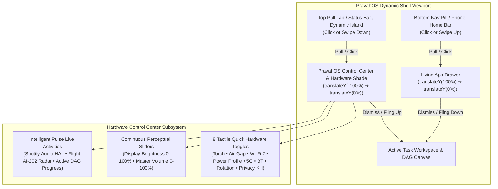
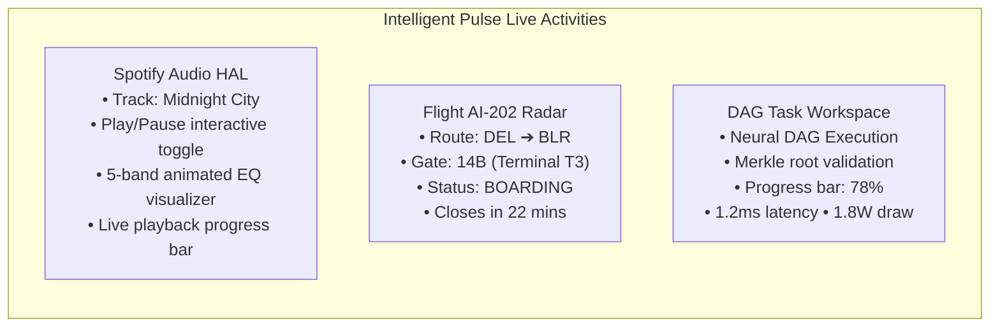

# Control Center & Hardware Shade Subsystem

## 1. Architectural Overview & System Design

The **PravahOS Control Center & Hardware Shade** provides a unified, instant-access control surface that drops down smoothly from the top of the display. It pairs tactile electronic hardware toggles with continuous perceptual sliders and real-time live activities, governed by second-order spring dynamics and strict hardware security boundaries.

Together with the **Living App Drawer** (which slides up from the bottom), the Control Center Shade establishes a balanced vertical interaction model for PravahOS:
- **Slide Up from Bottom (`Living Drawer`)**: Capability catalog, Metro A-Z launcher, and glanceable live tiles.
- **Slide Down from Top (`Control Center Shade`)**: Discrete hardware power rail gating, ambient sliders, and Intelligent Pulse live activities.



---

## 2. Pull-to-Reveal Interaction Model & Spring Physics

### 2.1 Interaction Triggers
The Hardware Shade can be invoked through multiple coordinated input channels:
1. **Top Pull Tab (`#shade-pull-trigger`)**: A frosted glass tab positioned at the top-center edge of the screen displaying a directional chevron (`▾ Control Center`).
2. **Top Ambient Header / Status Bar**: Tapping the top status bar or dynamic island immediately toggles the Control Center.
3. **Emulator Header Toolbar Button**: Dedicated `[ ▾ Control Shade ]` toolbar action in the device emulator header toolbar.
4. **Touch & Gesture Swipes**:
   - Swiping down from the top 160px edge of the viewport (`dy > 60px` within 500ms).
   - High-velocity downward fling gestures (`PRAVAH_GESTURE_FLING` with `SWIPE_DOWN`).
5. **Dismiss Mechanisms**:
   - Sliding up on the bottom grip bar (`#shade-drag-bar`) or flinging upward (`velocity < -400px/s`).
   - Tapping the top-right dismiss button (`#btn-shade-close`).
   - Tapping anywhere on the dimmed background backdrop (`#control-shade-backdrop`).
   - Pressing the physical keyboard `Escape` key.

### 2.2 Second-Order ODE Spring Solver
The shade motion runs on PravahOS's second-order differential equation physics solver (`Spring` with `SpringPresets.SNAPPY`), solving:

$$m \frac{d^2x}{dt^2} + c \frac{dx}{dt} + k (x(t) - x_{\text{target}}) = 0$$

- **Stiffness ($k$)**: $230\text{ N/m}$
- **Damping ($c$)**: $22\text{ N}\cdot\text{s/m}$
- **Mass ($m$)**: $1.0\text{ kg}$
- **Damping Ratio ($\zeta$)**: $\approx 0.725$ (rapid snap with subtle organic settling)

During interactive touch dragging, displacement beyond equilibrium is constrained using Apple/Pixel rubber-band overscroll resistance:

$$f(x) = \frac{x \times 0.55}{1 + \frac{x \times 0.55}{x_{\max}}}$$

---

## 3. 8 Tactile Quick Hardware Toggles & Power Rail Architecture

Each toggle directly controls simulated hardware power rails and microkernel bus transceivers:

| Toggle | Icon | Rail / Bus | Nominal Voltage | Isolated Voltage | Behavior & State Effect |
| :--- | :---: | :--- | :---: | :---: | :--- |
| **Torch / Flashlight** | 🔦 | Screen LED / Flash emitter | 3.3V | 0.0V | Activates high-CRI screen glow beam simulation and lights up physical LED on phone body |
| **Air-Gap Kill Switch** | ✈ | All RF transceivers | 1.8V | **0.0V** | Instant electronic drop of Wi-Fi, 5G cellular baseband, and Bluetooth rails to 0.0V |
| **Wi-Fi 7 (802.11be)** | 📶 | WLAN RF Rail | 1.2V | 0.0V | Controls 320MHz 6GHz mesh radio; automatically drops Air-Gap when activated |
| **Battery Power Mode** | ⚡ | NPU / Core Power Rail | 0.85V &ndash; 1.25V | Dynamic | Cycles `ECO` [INT4], `BALANCED` [INT8], and `BOOST` [FP16] profiles with clock gating |
| **5G Cellular Data** | 📡 | Baseband Modem Rail | 1.8V | 0.0V | Toggles Sub-6 & mmWave NR-DC modem transceiver |
| **Bluetooth 5.4** | ᛒ | BLE 2.4GHz Rail | 1.0V | 0.0V | Toggles peripheral scanning, Auracast broadcast, and LE Audio sink |
| **Auto-Rotate Lock** | 🔄 | IMU / Gyro Sensor Bus | 1.8V | Standby | Toggles between locked 0° Portrait and 360° sensor-driven Auto Rotation |
| **Sensor Privacy Kill** | 🛡️ | CMOS Sensor & MEMS Mic | 2.8V / 1.8V | **0.0V** | Hardware cut: isolates Camera VMO and Microphone audio stream rails to 0.0V |

### 3.1 Electronic Air-Gap Isolation
When the Air-Gap toggle is engaged, the system forces all RF power rails to strictly `0.0V`:
```js
if (this.toggles[ToggleId.AIRGAP]) {
  this.powerRails.rfRail = 0.0;
  this.powerRails.basebandRail = 0.0;
  this.powerRails.bleRail = 0.0;
  this.toggles.wifi = false;
  this.toggles.cellular = false;
  this.toggles.bluetooth = false;
}
```

### 3.2 Dynamic NPU Power Profiles
The Power Profile toggle cycles sequentially across three operational regimes:
1. **ECO (`INT4`)**: Clock-gated at 400 MHz, power draw 0.8W. Quantizes local neural inference models down to 4-bit integer weights.
2. **BALANCED (`INT8`)**: 1.2 GHz nominal clock, power draw 2.2W. Standard 8-bit quantization balancing latency and thermal efficiency.
3. **BOOST (`FP16`)**: 2.0 GHz maximum frequency, power draw 5.8W. Full unquantized half-precision FP16 tensors for zero accuracy loss during complex DAG synthesis.

### 3.3 Sensor Privacy Kill Switch
The Privacy Kill toggle simulates an electronic hardware disconnect directly at the power regulation stage:
- **Active (Kill Engaged)**: Camera CMOS rail = `0.0V`, MEMS microphone rail = `0.0V`. Zero electrical current flows to imaging/audio sensors.
- **Disengaged**: Camera CMOS rail restored to `2.8V`, MEMS microphone restored to `1.8V`.

---

## 4. Continuous Smooth Sliders

The Control Center incorporates continuous, high-precision slider tracks with live tactile feedback:

### 4.1 Display Brightness (0 &ndash; 100%)
- **Perceptual Curve**: Drives an ambient brightness dimming layer (`#shade-brightness-filter`) on the display surface.
- **Live Feedback**: Real-time percentage badge (`val-brightness`), luminous amber fill bar, and dynamic sun icons (`🔅` / `🔆`).
- **Interactive Dragging**: Supports touch drag and pointer capture with continuous normalization from mouse or finger positions.

### 4.2 Master Audio Volume (0 &ndash; 100%)
- **Audio HAL Bridge**: Communicates volume changes to the sensory audio pipeline (`sensory.audio.setMasterVolume`) and device emulator HUD.
- **Dynamic Icons**: Intelligently adapts icon based on level: `🔇` (0%), `🔉` (<40%), or `🔊` (≥40%).

---

## 5. Intelligent Pulse Live Activities Feed

The bottom section of the Control Center Shade renders real-time microkernel activities and contextual glanceable widgets:



1. **Spotify Audio HAL Player**:
   - Live playback status with responsive Play/Pause button (`▶` / `⏸`).
   - 5-band CSS animated equalizer bars that pulse during active audio streams and pause when playback halts.
   - Live time formatting (`2:22 / 4:04`) and progress scrubber track.
2. **Flight AI-202 Radar Alert**:
   - Displays real-time airport gate updates (`Gate 14B`, `Terminal T3`, `Seat 12A`).
   - Departure gate countdown indicator (`Closes in 22m • On Schedule`).
3. **Active Task Progress**:
   - Reflects the active execution status of microkernel DAG tasks.
   - Synchronizes directly with `renderTaskWorkspace()` progress in the dynamic shell.
   - Displays telemetry including stage verification and neural latency.

---

## 6. Cross-Process Interop & postMessage Protocol

The Control Center communicates bidirectionally across the phone emulator container, shell iframe, and microkernel subsystems:

| Message Type | Direction | Payload | Description |
| :--- | :---: | :--- | :--- |
| `PRAVAH_TOGGLE_SHADE` | Emulator ➔ Shell | `{}` | Toggles shade open or closed |
| `PRAVAH_OPEN_SHADE` | Emulator ➔ Shell | `{}` | Programmatically expands shade |
| `PRAVAH_CLOSE_SHADE` | Emulator ➔ Shell | `{}` | Programmatically collapses shade |
| `PRAVAH_TORCH_STATE` | Shell ➔ Emulator | `{ active: boolean }` | Lights up virtual flashlight beam on phone chassis |
| `PRAVAH_SET_POWER_PROFILE` | Shell ➔ Emulator | `{ profile, quantization, npuFreq, powerDraw }` | Updates NPU telemetry and status HUD |
| `PRAVAH_SET_AIRGAP` | Bidirectional | `{ offline: boolean }` | Synchronizes 0.0V power rail state between shell and phone switches |
| `PRAVAH_SET_VOLUME` | Shell ➔ Emulator | `{ volume: number }` | Updates audio master volume and on-screen volume HUD popup |
| `PRAVAH_SET_BRIGHTNESS` | Emulator ➔ Shell | `{ brightness: number }` | Updates display brightness level |

---

## 7. Verification & Automated Testing

The subsystem is validated via `ui/tests/shade.test.js` using Node.js's native test runner (`node --test ui/tests/*.test.js`).

### Test Coverage Highlights:
- **Enum & Data Integrity**: Tests `ShadeState`, `PowerProfile`, `ToggleId`, and `formatTime` helpers.
- **State Machine Transitions**: Validates `expand()`, `collapse()`, `toggle()`, and state change observer callbacks.
- **8 Hardware Quick Toggles**:
  - Torch state transitions and event emission.
  - Electronic Air-Gap rail cutoff (`rfRail: 0.0V`, `basebandRail: 0.0V`, `bleRail: 0.0V`).
  - Automatic Air-Gap disengagement when turning on Wi-Fi, Cellular, or Bluetooth.
  - Three-phase Power Profile cycling (`ECO` [INT4] ➔ `BALANCED` [INT8] ➔ `BOOST` [FP16] ➔ `ECO`).
  - Auto-Rotate mode switching between `PORTRAIT` and `AUTO`.
  - Sensor Privacy Kill cutoff of Camera (`0.0V`) and Microphone (`0.0V`) power rails.
- **Continuous Sliders**: Accurate clamping [0, 100] and event dispatch for Brightness and Volume.
- **Pulse Live Activities**: Spotify playback toggling, progress tracking, and dynamic task progress updates.
- **DOM Container Styling**: Confirms CSS classes (`expanded`, `collapsed`, `active`) and 3D transforms (`translateY(0%)`, `translateY(-100%)`).
