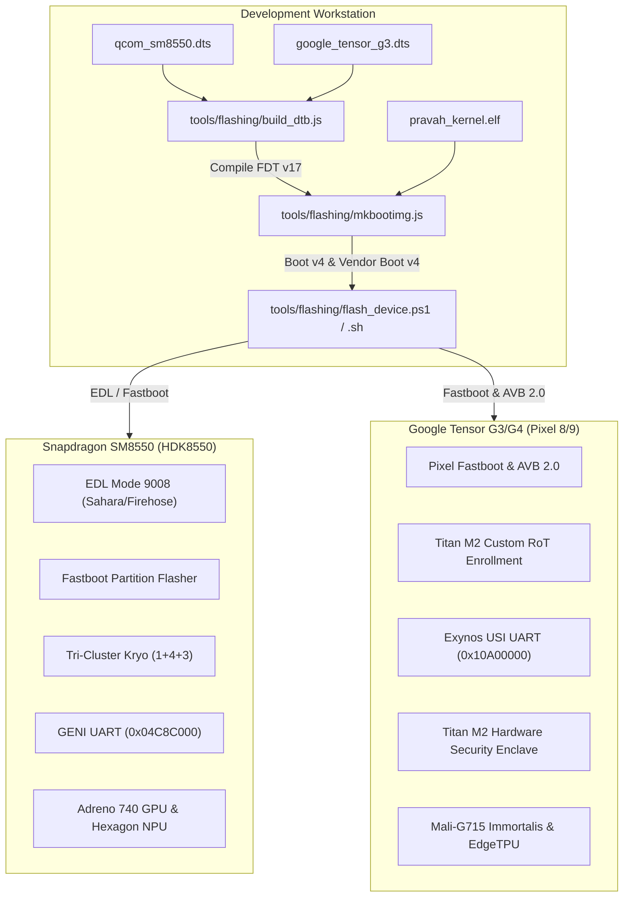
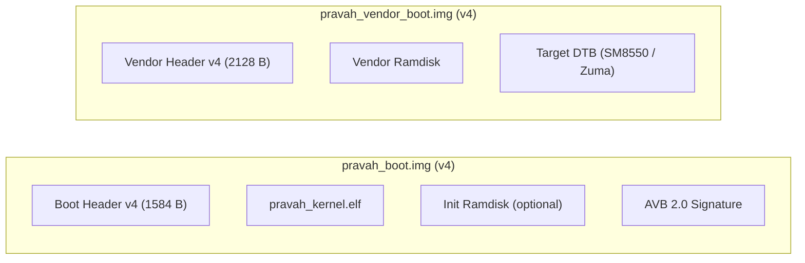

# PravahOS Physical Silicon Bringup & Bootloader Guide

**Qualcomm Snapdragon (SM8550/SM8650, HDK8550) & Google Tensor (G2/G3/G4 Zuma, Pixel 7/8/9)**

---

## 1. Executive Silicon Bringup Overview

PravahOS is architected as an ultra-low-latency microkernel mobile operating system targeting modern high-performance ARM64 application processors. This specification details the hardware configuration, Device Tree Sources (DTS), hermetic compilation pipelines, bootloader bundling, and physical flashing protocols for two primary silicon platforms:

1. **Qualcomm Snapdragon 8 Gen 2 / Gen 3 (SM8550 / SM8650 / HDK8550 Dev Board)**
2. **Google Tensor G2 / G3 / G4 (GS201 / Zuma / Zuma Pro on Google Pixel 7, 8, 8 Pro, and 9)**



---

## 2. Silicon Platform Profiles

| Feature / Subsystem | Qualcomm Snapdragon SM8550 (HDK8550) | Google Tensor G3 Zuma (Pixel 8/Pro/9) |
| :--- | :--- | :--- |
| **CPU Cluster** | 1x Kryo Prime (Cortex-X3 @ 3.19 GHz)<br>4x Kryo Gold (2x A715 + 2x A710 @ 2.80 GHz)<br>3x Kryo Silver (Cortex-A510 @ 2.02 GHz) | 1x Prime (Cortex-X3 @ 3.00 GHz)<br>4x Mid (Cortex-A715 @ 2.45 GHz)<br>4x Little (Cortex-A510 @ 2.15 GHz) |
| **Microkernel PSCI** | ARM PSCI v1.0 / SMC standard | ARM PSCI v1.0 / SMC standard |
| **Memory** | 16 GB LPDDR5X (`0x80000000` base, 4 GB window) | 12 GB / 16 GB LPDDR5X (`0x80000000` base) |
| **Interrupt Controller** | ARM GICv3 (GICD `0x17A00000`, GICR `0x17A60000`) | ARM GICv3 (GICD `0x10400000`, GICR `0x10460000`) |
| **Primary Debug UART** | Qualcomm GENI UART SE12 (`0x04C8C000`, 115200 8N1) | Exynos USI UART (`0x10A00000`, 115200 8N1) |
| **GPU Subsystem** | Qualcomm Adreno 740 (`0x03D00000`) | ARM Mali-G715 Immortalis (`0x1C500000`) |
| **NPU / Acceleration** | Qualcomm Hexagon CDSP / NPU (PAS-ID 18) | Google EdgeTPU Accelerator (`0x16800000`) |
| **Hardware Enclave** | Qualcomm QSEE / TrustZone SMC | Google Titan M2 Discrete Security Chip (SPI) |
| **High-Speed Storage** | UFS 4.0 Host Controller (`0x01D84000`) | UFS 4.0 Controller (`0x131F0000`) |
| **Flashing Protocols** | Fastboot / Emergency Download (EDL 9008) | Fastboot & AVB 2.0 Custom Root-of-Trust |

---

## 3. Device Tree Implementations

The PravahOS ARM64 kernel relies on hermetic Flattened Device Trees:

1. **Qualcomm Snapdragon DTS** (`kernel/arch/arm64/qcom/qcom_sm8550.dts`):
   - Configures tri-cluster CPU topology with DMIPS capacity ratings.
   - Allocates carveout reserved memory for TrustZone, continuous splash framebuffer, and CDSP NPU.
   - Declares the Qualcomm GENI Serial Engine UART (`qcom,geni-uart`) at `0x04c8c000`.
   - Binds Qualcomm SPMI PMIC arbiter (`qcom,spmi-pmic-arb`) and PM8550 voltage regulators.
   - Sets early kernel bootargs: `console=ttyMSM0,115200 earlycon=geni,0x04c8c000 root=/dev/pravah_root`.

2. **Google Tensor DTS** (`kernel/arch/arm64/google/google_tensor_g3.dts`):
   - Configures 9-core Big-Mid-Little cluster.
   - Maps Google EdgeTPU at `0x16800000` with model weight reservation carveout.
   - Declares discrete Titan M2 Hardware Security Enclave SPI node at `0x10930000` (`google,titan-m2-spi`).
   - Sets early kernel bootargs: `console=ttySAC0,115200 earlycon=exynos4210,0x10a00000 pravah.titan_m2=1`.

---

## 4. Titan M2 Hardware Security Enclave Bindings

On Google Pixel Tensor hardware, PravahOS leverages the discrete Titan M2 security coprocessor via the kernel driver located at [`kernel/arch/arm64/google/titan_m2.h`](file:///L:/projectz/OS/kernel/arch/arm64/google/titan_m2.h) and [`kernel/arch/arm64/google/titan_m2.c`](file:///L:/projectz/OS/kernel/arch/arm64/google/titan_m2.c):

### 4.1 Hardware-Backed Keystore
- **16 Discrete Key Slots**:
  - `Slot 0`: Hardware Root-of-Trust (RoT)
  - `Slot 1`: Per-Device Unique Identity Key
  - `Slot 2`: Kernel Image Integrity Sealing Key
  - `Slot 3`: Disk Encryption Key (DEK)
  - `Slot 4`: AVB 2.0 Custom Root-of-Trust Public Key
  - `Slot 5..15`: Dynamic User / Application Compartment Keys
- **Key Operations**: Key synthesis (`titan_m2_generate_key`), key import (`titan_m2_import_key`), key derivation (`titan_m2_derive_key`), and cryptographically signed device attestation (`titan_m2_attest_device`).

### 4.2 Cryptographic Forward-Hash Ledger
PravahOS implements an append-only forward-hash chain sealing mechanism. As boot stages, user-space driver hosts, and system compartments are loaded into memory, measurements are extended into the linear forward hash:

$$H_{n} = \text{SHA256}(H_{n-1} \parallel \text{stage\_measurement})$$

- Data sealed via `titan_m2_ledger_seal()` is mathematically tied to the specific forward ledger measurement.
- If firmware alteration, memory corruption, or unauthorized code injection alters $H_{n}$, `titan_m2_ledger_unseal()` fails immediately with `TITAN_M2_ERR_LEDGER_MISMATCH`.

### 4.3 Physical Tamper Resistance & Zeroization
The Titan M2 chip continuously monitors hardware sensors:
- Voltage glitch detector (`TITAN_M2_TAMPER_VOLTAGE_GLITCH`)
- Silicon mesh wire probe severance (`TITAN_M2_TAMPER_ACTIVE_SHIELD`)
- Laser/optical fault injection (`TITAN_M2_TAMPER_OPTICAL_FAULT`)
- Cryogenic/thermal excursion (`TITAN_M2_TAMPER_TEMP_EXTREME`)
- External clock frequency glitching (`TITAN_M2_TAMPER_CLOCK_GLITCH`)
- Unauthorized JTAG debug probe attachment (`TITAN_M2_TAMPER_DEBUG_UNLOCK`)

When a tamper alert interrupt fires (`titan_m2_handle_tamper_irq`), the driver executes instantaneous cryptographic zeroization (`titan_m2_zeroize_secrets()`), destroying all in-enclave keys and wiping volatile states before the CPU halts.

---

## 5. Hermetic Device Tree Compilation

PravahOS provides a standalone, hermetic JavaScript Device Tree Compiler (`tools/flashing/build_dtb.js`):

```bash
# Compile Snapdragon DTS to DTB
node tools/flashing/build_dtb.js --input kernel/arch/arm64/qcom/qcom_sm8550.dts --output kernel/arch/arm64/qcom/qcom_sm8550.dtb

# Compile Google Tensor DTS to DTB
node tools/flashing/build_dtb.js --input kernel/arch/arm64/google/google_tensor_g3.dts --output kernel/arch/arm64/google/google_tensor_g3.dtb

# Validate an existing DTB binary
node tools/flashing/build_dtb.js --input kernel/arch/arm64/google/google_tensor_g3.dtb --validate
```

The tool produces compliant **FDT Version 17** binary blobs with memory reservation maps, aligned structure tokens (`FDT_BEGIN_NODE`, `FDT_PROP`, `FDT_END_NODE`), and deduplicated string tables.

---

## 6. Android Boot Image v4 Packaging & AVB 2.0

The PravahOS kernel image is packaged into Android Boot Image v4 specification via `tools/flashing/mkbootimg.js`:



Command-line manual generation:
```bash
node tools/flashing/mkbootimg.js \
  --kernel kernel/pravah_kernel.elf \
  --dtb kernel/arch/arm64/qcom/qcom_sm8550.dtb \
  --out-boot tools/flashing/pravah_qcom_boot.img \
  --out-vendor tools/flashing/pravah_qcom_vendor_boot.img
```

---

## 7. Step-by-Step Flashing Procedures

### 7.1 Qualcomm Snapdragon (HDK8550 Dev Board)

#### Fastboot Mode
1. Power on the HDK8550 while holding `SW4` (Volume Down) to enter Fastboot bootloader mode.
2. Verify USB connection:
   ```bash
   fastboot devices
   ```
3. Run the PravahOS Flasher:
   - **PowerShell (Windows)**:
     ```powershell
     .\tools\flashing\flash_device.ps1 -Target qcom -Mode fastboot -Slot both
     ```
   - **Bash (Linux/macOS)**:
     ```bash
     ./tools/flashing/flash_device.sh --target qcom --mode fastboot --slot both
     ```
4. Attach serial console via USB-to-UART adapter to HDK pin header `J26` (GENI UART SE12):
   - Baud Rate: `115200`
   - Data Bits: `8`, Parity: `None`, Stop Bits: `1`

#### Emergency Download (EDL 9008) Mode
If bootloader partitions are corrupted or blank eMMC/UFS silicon is uninitialized:
1. Connect EDL shorting pin or hold `FORCE_USB_BOOT` while inserting USB-C cable.
2. Device enumerates as `Qualcomm HS-USB QDLoader 9008`.
3. Flash via Sahara/Firehose XML protocol:
   ```powershell
   .\tools\flashing\flash_device.ps1 -Target qcom -Mode edl
   ```

---

### 7.2 Google Pixel 7 / 8 / 9 (Tensor G2/G3/G4 Zuma)

#### Bootloader Unlock & AVB 2.0 Custom Root of Trust
1. Boot Pixel into Fastboot mode: Hold `Power` + `Volume Down` until the fastboot screen displays.
2. Unlock critical partitions (one-time setup):
   ```bash
   fastboot flashing unlock
   fastboot flashing unlock_critical
   ```
3. Run the automated PravahOS Tensor flasher:
   - **PowerShell (Windows)**:
     ```powershell
     .\tools\flashing\flash_device.ps1 -Target tensor -Mode fastboot -Slot both
     ```
   - **Bash (Linux/macOS)**:
     ```bash
     ./tools/flashing/flash_device.sh --target tensor --mode fastboot --slot both
     ```
4. **What this accomplishes**:
   - Erases stock OEM AVB root key: `fastboot erase avb_custom_key`
   - Enrolls PravahOS custom root-of-trust key into Titan M2 NVRAM:
     `fastboot flash avb_custom_key tools/flashing/pravah_avb_custom_key.bin`
   - Flashes dual-slot `boot_a`/`boot_b` (kernel), `vendor_boot_a`/`vendor_boot_b` (DTB), and signed `vbmeta_a`/`vbmeta_b`.
   - Sets active boot slot to `a`: `fastboot set_active a`.
   - Boots without yellow/red AVB verification warnings: Titan M2 verifies the boot partition hash against `pravah_avb_custom_key.bin`.
5. Attach serial console:
   - Use SuzyQable or USB-C debug accessory into Pixel debug port.
   - Serial port: `ttySAC0` / Exynos USI UART at `0x10A00000`, `115200 8N1`.

---

## 8. Diagnostic Runbook & Panic Recovery

| Symptom | Probable Cause | Diagnostic Command / Remediation |
| :--- | :--- | :--- |
| **Silent Black Screen on Boot** | Invalid DTB magic or memory overlap in `reserved-memory` | Run `node tools/flashing/build_dtb.js --input <file.dtb> --validate` to verify FDT header and memreserves |
| **Serial Hangs after "earlycon: geni"** | UART SE12 clock frequency mismatch | Ensure `current-speed = <115200>` and GCC clock parent index matches DTS in `qcom_sm8550.dts` |
| **Titan M2 Returns `TITAN_M2_ERR_TAMPER_DETECTED`** | Hardware intrusion flag set or glitch detected | Check `dev->active_tamper_flags`. Clear tamper pin status in bootloader before kernel handover |
| **AVB Verification Failure (Red Warning Screen)** | Pixel Titan M2 does not recognize custom RoT key | Re-enroll custom key: `fastboot flash avb_custom_key tools/flashing/pravah_avb_custom_key.bin` |
| **EDL Handshake Timeout** | Sahara programmer binary missing | Verify `prog_firehose_lite.elf` is located in flashing directory and COM port is assigned correctly |
