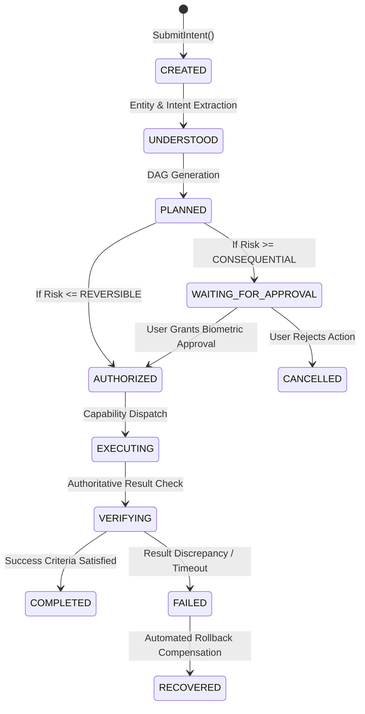

# PravahOS Autonomous Task Runtime

---

## 1. Goal-Oriented Task Representation

In PravahOS, user requests are not mapped to application-launch sequences. They are represented as structured **Directed Acyclic Graphs (DAGs)**.

### Task Data Structure:
- `taskId`: Globally unique 64-bit identifier.
- `goal`: High-level user objective (e.g., *"Flight AI-202 Status & Reminder"*).
- `nodes`: Array of discrete capability checkpoints with explicit dependencies.
- `authorityScope`: Permitted authority level (`OBSERVE`, `PREPARE`, `EXECUTE`, `MANAGE`).
- `riskLevel`: Maximum risk boundary (`READ_ONLY`, `REVERSIBLE`, `CONSEQUENTIAL`, `IRREVERSIBLE`).
- `auditRecords`: Cryptographically linked verification history.

---

## 2. Complete Task Lifecycle State Machine

---

## 3. Reliability & Idempotency Invariants

1. **Deterministic Rollback**: Reversible capabilities declare compensation actions. If a downstream node fails (e.g. hotel booking fails after flight lookup), upstream state is safely rolled back.
2. **Crash Resilience**: Task graphs and intermediate checkpoint payloads are persisted in local flash storage. If the device suffers sudden power loss, in-flight tasks resume or cleanly terminate upon reboot.
3. **Irreversible Protection**: Irreversible operations (financial wire transfers $> \text{₹}2,000$, wiping storage, dispatching taxis) can strictly never be automatically retried without a fresh biometric authorization prompt.
